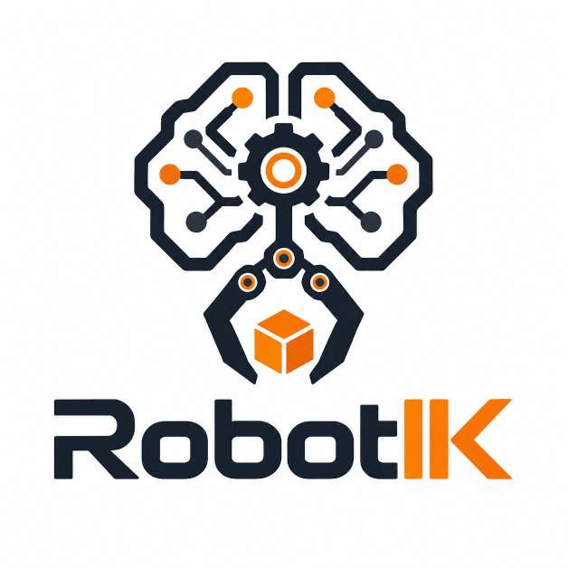
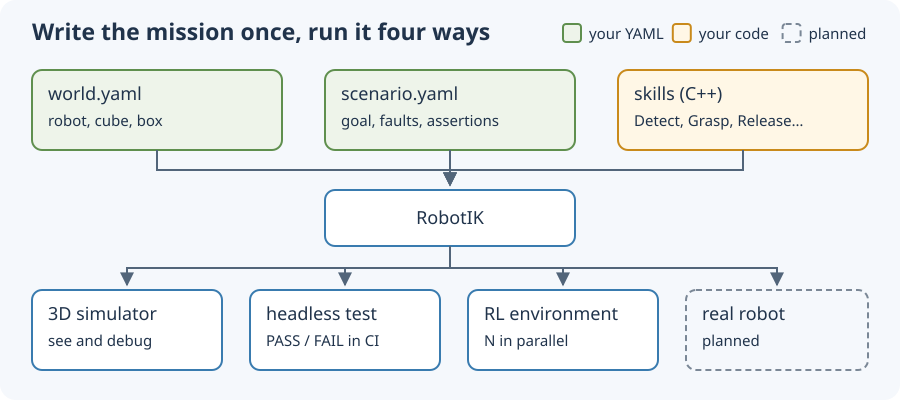
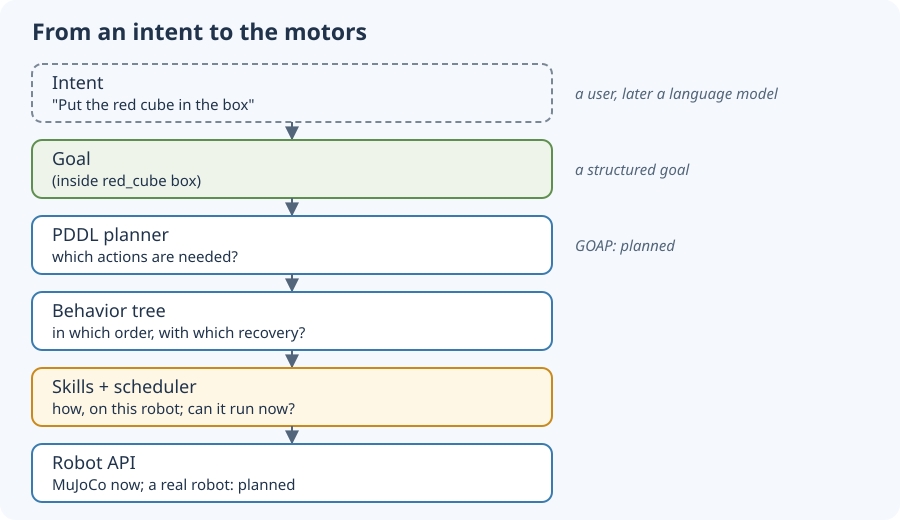
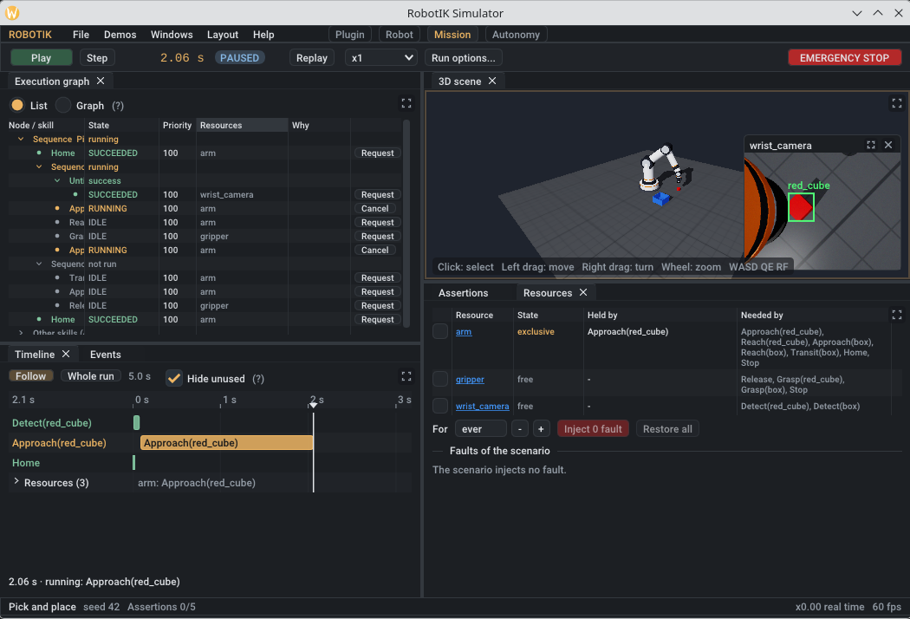

# 🤖 RobotIK

**Write a robot mission once, then run it in a 3D simulator, as a test in CI, as a reinforcement learning environment, and later on a real robot — and see, at every moment, what the robot decided and why.**

> ⚠️ **Active project: the API is still evolving.** Scenarios, demos and tests are the best examples of the current API. No physical robot has been driven yet.

> **🌐 Try the online version instantly:** 👉 [Click here to launch the RobotIK Simulator in your browser!](https://lecrapouille.github.io/Robotik/RobotIK-Simulator.html)

New to robotics? Even if you do not want to work on robotic, [the introduction](doc/concepts/01-robotics-in-ten-minutes.md) explains you all robotic terms: joints, frames, kinematics, skills and behavior trees in ten minutes, with no code.

---

## 🤔 What is RobotIK for?

Suppose you want to design a robot arm that picks up a red cube and drops it into a box. The motion itself is the easy part. The hard part is everything around it:

- 🎯 **Deciding**: find the cube, approach, grasp, carry, release… and what to do when the camera fails in the middle.
- 🧪 **Proving it works**: not "it looked fine once", but "the cube ends in the box, nothing collided, it took less than 30 seconds", checked on every commit.
- 🔍 **Understanding failures**: when the robot stops, which step failed, what it believed, who held the gripper, why the planner chose this plan?
- 🔁 **Reusing the work**: the same mission as a demo, a regression test, a benchmark, a learning environment, and one day the real robot.

RobotIK provides a framework for this work. You describe the **world** and the **mission** in YAML, you write the robot's **skills** in C++, and RobotIK runs them on simulated physics, judges the result, and shows you everything that happened.

---

## 🧱 What RobotIK is built on

RobotIK itself has three layers. Each works without the layers above it, so a project can use the lowest layer that meets its needs:

| Layer | You have… | You get |
|-------|-----------|---------|
| 🦾 **Robot** | a URDF | one robot, its joints, sensors and physics, in three lines (`robotik::openRobot`) |
| 🧩 **Task** | robots, objects, a job | a robot cell written in C++: skills, behavior tree or PDDL plan, beliefs (`robotik::RoboticCell`) |
| 📦 **Package** | YAML files, a plugin | scenarios, experiments, assertions, reports, the simulator (`robotik::Simulation`) |

A skill never asks "am I simulated?". It drives the robot through one API (`robot.joints()`, the tool, the sensors); a backend translates it to MuJoCo today, and to a real robot (an SO-101 arm is planned) tomorrow.



Here what RobotIK tries to solve:



- ✅ **Integration done:** behavior trees, PDDL planning with replanning, skills with resources, faults, assertions, experiments, RL environments;
- 🔜 **Integration still in progress:** backend for testing on real robots, Prolog to query the world, an LLM front-end that stays at the level of intent and never drives motors directly, Petri for concurrent processes, GRAFCET and production chain finding critical circuits.
- 🧭 **Help wanted:** hardware targets:
  - 🦆 [Microduck](https://github.com/pollen-robotics/microduck)
  - 🦾 [SO-ARM101](https://github.com/TheRobotStudio/SO-ARM100)
  - 🤖 [Roboparty](https://github.com/Roboparty)

---

## ✨ Why do you need RobotIK?

| | 🤖 RobotIK | ROS 2 + Gazebo / RViz | SkiROS2 | MuJoCo or PyBullet scripts |
|---|---|---|---|---|
| What you install | one C++ library, plain `make` | ROS 2 distribution, middleware | ROS 2 + SkiROS2 | a Python package |
| Mission as a test | ✅ scenario with assertions, PASS/FAIL, JSON report | by hand (launch tests) | by hand | by hand |
| Scenario file (world, faults, variants, seeds) | ✅ world / scenario / experiment YAML | world files, no scenario standard | world model, no scenario file | your script |
| Skills with resources, priorities, preemption | ✅ `SkillScheduler` | by hand | ✅ | ❌ |
| Behavior tree and PDDL planner | ✅ both, with replanning | Nav2 BT, PlanSys2 (separate) | ✅ | ❌ |
| One window to debug tree, plan, skills, resources, beliefs | ✅ the simulator workspaces | several tools | partly | ❌ |
| Belief vs ground truth | ✅ skills see beliefs, assertions see truth | by convention | world model | ❌ |
| Fault injection | ✅ in the scenario file | by hand | by hand | by hand |
| Headless and parallel (CI, RL) | ✅ same scenario, N environments | heavy | heavy | ✅ |
| Distributed robots, ROS ecosystem | ❌ not the goal | ✅ | ✅ | ❌ |

SkiROS2 is a robot control platform for distributed systems in the ROS ecosystem, with a semantic world model. RobotIK is a C++ library without middleware, centered on **simulation, tests and debugging**, with the same mission running in a simulator and, later, on hardware. If you live in ROS 2, SkiROS2 is a great fit; if you want a self-contained program you can test in CI, RobotIK is.

What this gives you:

- 🧪 **A mission is a test.** The scenario says what must be true at the end, at every step, or before a deadline. A failure keeps the measured value, the bound and the simulated time.
- 🔍 **You see why.** The **Mission** workspace of the simulator shows the live behavior tree, a timeline of skills with the resources they hold, the assertions, and the plans of the PDDL planner. The **Autonomy** workspace shows what the robot *believes* next to what is *true*.
- 💥 **You break it on purpose.** Faults are written in the scenario: the camera dies at 0 s, comes back at 1 s, dies again at 3 s. The tree must cope.
- 🎲 **You reproduce it.** One seed feeds the world, the sensors, the faults and the RL runs: the same seed gives the same run.
- 🧩 **You extend it with plugins.** Each demo is a plugin: its C++, its worlds, its scenarios, its assets. The core knows nothing about cubes or brushes.
- 🏆 **You learn with it.** Any scenario becomes a reinforcement learning environment, run N times in parallel without a window.

---

## 🧱 What RobotIK is built on?

RobotIK brings existing robotics libraries together:

- 🦾 [MuJoCo](https://github.com/google-deepmind/mujoco) simulates physics.
- 📐 [Pinocchio](https://github.com/stack-of-tasks/pinocchio) computes robot kinematics.
- 🧭 [Kairos](https://github.com/PlanSys2/kairos) finds plans from PDDL goals.
- 🧠 [SWI-Prolog](https://www.swi-prolog.org/) is planned for logic queries; integration is still in progress.

I also develop libraries that support RobotIK or explore future additions:

- 🧱 [Compages](https://github.com/Lecrapouille/Compages) has three layers. **World** holds the simulated world and works without a window in tests. **Renderer** draws the scene, including live textures such as the painter's canvas. **GPU** provides the graphics API used by Renderer.
- 🌳 [BlackThorn](https://github.com/Lecrapouille/BlackThorn) is my behavior tree library faster than the [mainstream lib](https://www.behaviortree.dev/). It drives missions, and its Oakular editor shows the trees as they run.
- 🕸️ [TimedPetriNetEditor](https://github.com/Lecrapouille/TimedPetriNetEditor) explores Petri nets for concurrent processes and GRAFCET as an alternative to behavior trees for industrial robotic cells. It also supports production flow analysis, including critical circuits. Integration with RobotIK is still in progress.

---

## 👀 What RobotIK looks like

Let us follow the **pick-and-place** demo from its files to the result. A robot with a camera on its wrist picks up a red cube and places it inside a box. All the files for a demo live in one folder: a **plugin** that RobotIK loads at run time:

```text
📦 demos/PickAndPlace/
┣ 📄 plugin.yaml     ⬅️ the name of the plugin and the list of its scenarios
┣ 📂 worlds/         ⬅️ what exists
┣ 📂 src/            ⬅️ the skills, in C++
┣ 📂 scenarios/      ⬅️ what happens and what is checked (+ the behavior tree)
┗ 📂 experiments/    ⬅️ the variants to compare
```

### 🌍 1. The world: what exists

A robot with a camera on its wrist, a red cube, a box. Only facts, no behavior:

```yaml
# worlds/pick_place_cell.world.yaml (excerpt)
world:
  id: pick_place_cell
  entities:
    - id: robot
      type: robot
      model: robotik.robots.robot_6axis
      sensors:
        wrist_camera: { type: camera, parent: link6, fov: 70, frequency: 15 }
    - id: red_cube
      type: prop
      shape: { type: box, size: [0.04, 0.04, 0.04] }
      pose: { position: [0.40, 0.20, 0.02] }
      randomize: { x: [-0.02, 0.02], y: [-0.02, 0.02] }
```

### 🔧 2. The skills: what the robot knows how to do

A **skill** is one thing the robot knows how to do: detect an object, approach it, grasp it, release it. It is a small C++ class in the plugin (`src/PickPlaceSkills.cpp`). It is called at each step and returns *running*, *success* or *failure*. Here is the heart of `Grasp`:

```cpp
Status GraspSkill::tick(RobotContext& p_context, Seconds p_dt)
{
    VacuumGripper* gripper = findGripper(p_context.robot, m_gripper);
    gripper->suction(true);                                    // turn on the vacuum
    if (heldObject(p_context.robot, m_gripper) == m_object)
        return Status::SUCCESS;                                // the cube is held
    ...                                                        // RUNNING, or FAILURE after 0.5 s
}
```

A skill only sees the robot and what the robot **believes** (`RobotContext`): never the simulator, never the true position of the cube. This is what lets the same skill run on a real robot later.

When the run starts, the plugin registers its skills with a name, the **resources** they need (the arm, the gripper, the camera) and their conditions (`src/PickPlaceLogic.cpp`):

```cpp
grasp.preconditions.push_back({ "gripper is empty", ... });
skills.add<robotik::GraspSkill>(std::move(grasp), "red_cube");   // the skill "Grasp(red_cube)"
```

The **skill scheduler** then makes sure two skills never use the same arm at the same time, and stops a skill whose camera breaks.

### 🌳 3. The behavior tree: in which order

The tree only uses the names of the skills. It says the order, and what to do when a step fails:

```yaml
# scenarios/pick_and_place.bt.yaml (excerpt)
- UntilSuccess:                 # the camera may be broken: try again
    attempts: 1000
    child:
      - Action: { name: Detect(red_cube) }
- Action: { name: Approach(red_cube) }
- Action: { name: Reach(red_cube) }
- Action: { name: Grasp(red_cube) }
```

A scenario can specify a **goal**, such as "the cube must be inside the box". The PDDL planner chooses the actions, and the executor turns the plan into a behavior tree. If a step fails, the planner plans again ([The PDDL planner](doc/concepts/05-pddl-planner.md)).

WIP: In future work a LLM layer can understand the human and drive the robot goald using the planner.

### 🎬 4. The scenario: what happens, and what is checked

The scenario puts it together: this world, this tree, these faults, and **the assertions that decide whether the mission succeeded**. Here, the camera breaks at 0 s, comes back at 1 s, and breaks for good at 3 s:

```yaml
# scenarios/pick_and_place_faults.scenario.yaml (excerpt)
scenario:
  id: pick_and_place_faults
  world: worlds/pick_place_cell.world.yaml
  seed: 7
  controller:
    behavior_tree: scenarios/pick_and_place.bt.yaml   # or a PDDL goal
  faults:
    - { at: 0.0, resource: wrist_camera, action: disable }
    - { at: 1.0, resource: wrist_camera, action: restore }
    - { at: 3.0, resource: wrist_camera, action: disable }
  assertions:
    - controller.success
    - (inside red_cube box)
    - { condition: (== (collision_count robot) 0), phase: always }
    - (< time 30)
```

### 🖥 5.1. Graphical simulation

Open the scenario in **RobotIK-Simulator** to watch the robot and inspect the mission as it runs. Use the run bar to play, pause or advance one step at a time.



- 🤖 **Robot** lets you inspect joints, sensors and the tool.
- 🌳 **Mission** shows the behavior tree or plan, active skills, shared resources and assertions.
- 👁 **Autonomy** lets you compare the robot's beliefs with the simulated world and camera images.

Select a skill or resource to see its state in the Inspector. The [Getting started tutorial](doc/tutorials/01-getting-started.md) explains the controls and workspaces.

### 💻 5.2. Headless simulation

Run it without a graphical window (headless), the way CI does:

```text
$ ./build/linux-gcc-debug/bin/RobotIK-Headless build/linux-gcc-debug/lib/robotik/plugins/PickAndPlace/scenarios/pick_and_place_faults.scenario.yaml --trace

  0.99 s  Detect(red_cube)  FAILED (unavailable: wrist_camera)  (0 s)
  1.01 s  Detect(red_cube)  SUCCEEDED  (0.01 s)
  1.03 s  Approach(red_cube)  SUCCEEDED  (2.37 s)
  3.41 s  Reach(red_cube)  SUCCEEDED  (0.5 s)
  3.92 s  Grasp(red_cube)  SUCCEEDED  (0.01 s)
  ...
  6.02 s  Release  SUCCEEDED  (0.01 s)
  6.04 s  Home  SUCCEEDED  (2.37 s)

[PASS] controller.success  (controller.success = 1)
[PASS] (inside red_cube box)  ((inside red_cube box) = 1)
[PASS] (== (holding gripper) 0)  ((holding gripper) = 0)
[PASS] (== (collision_count robot) 0)  ((collision_count robot) = 0)
[PASS] (< time 30)  (time = 8.43)
pick_and_place_faults: 1/1 runs passed
```

The tree retried `Detect` until the camera came back, then the robot went on from what it had seen when the camera died for good. The exit code is 0: **this is a test**. Open the same file in `./build/linux-gcc-debug/bin/RobotIK-Simulator` to watch the arm, the tree and the skills live.

### 🧪 6. The experiment: the same task, several ways

One success proves little. An **experiment** runs the same scenario in several **cases** (a wider area for the cube, real physics, the camera down at start), each with several **seeds**, and judges them all with the same assertions:

```yaml
# experiments/pick_and_place.experiment.yaml (excerpt)
experiment:
  id: pick_and_place_experiment
  seeds: [11, 12, 13]
  cases:
    - id: nominal
      scenario: scenarios/pick_and_place.scenario.yaml
    - id: wide_layout
      scenario: scenarios/pick_and_place.scenario.yaml
      overrides:
        world.entities.red_cube.randomize: { x: [-0.05, 0.05], y: [-0.05, 0.05] }
    - id: rigid
      scenario: scenarios/pick_and_place.scenario.yaml
      overrides:
        scenario.physics.fidelity: rigid
  evaluation:
    metrics: [ time, (collision_count robot), (distance red_cube box) ]
```

```text
$ ./build/linux-gcc-debug/bin/RobotIK-Headless build/linux-gcc-debug/lib/robotik/plugins/PickAndPlace/experiments/pick_and_place.experiment.yaml
[PASS] nominal                  seed=11     controller succeeded at 7.4 s ...  time=7.4  (collision_count robot)=0  (distance red_cube box)=0.0149
[PASS] wide_layout              seed=12     controller succeeded at 7.54 s ...  time=7.54  (collision_count robot)=0  (distance red_cube box)=0.0149
[PASS] rigid                    seed=13     controller succeeded at 7.4 s ... (physics rigid)  time=7.4  (collision_count robot)=0  (distance red_cube box)=0.0337539
...
pick_and_place_experiment: 12/12 runs passed
```

`--report results.json` writes every run and every metric, to compare strategies or follow a regression.

The other demos: a painter that draws strokes on a canvas, a mobile robot following a line, a fly brain avoiding obstacles, a humanoid walking with a learned policy ([Case studies: the demos](doc/case-studies/README.md)).

---

## 🔬 Physics: as simple as your question

A simulation does not need to be perfect; it needs to answer **your** question. Checking that a plan is right does not need the cube to bounce; checking that it lands in the box does. A scenario chooses how finely objects are simulated, and **the skills, the tree, the planner and the assertions stay the same** at every level:

| Level | When the robot grasps | When it releases | Use it to |
|-------|-----------------------|------------------|-----------|
| `abstract` (default) | the object simply follows the tool | the object is put at the bottom of the container, no fall | check the logic and the plan, fast |
| `rigid` | the object is a rigid body held to the tool | the object **falls for real** and stops where it lands | check the task with real positions |
| `contact` | *(planned)* the tool holds by friction and may slip | | study the grasp itself |

```yaml
scenario:
  physics:
    fidelity: abstract        # every object
    overrides:
      red_cube: rigid         # except this one
```

The good habit: keep the scenario at `abstract`, and add a `rigid` case to the experiment, as above. The same task is then judged at both levels, and the report says which level each run used. The robot itself can also be simulated more or less finely: the arm of the pick-and-place follows its joint commands in MuJoCo, the humanoid is a full floating body with motor gains and contacts, and the fly flies by plain kinematics. Details: [Physics fidelity](doc/reference/scenario-file.md#-physics-fidelity).

Perception works the same way. A car simulator may give the car the lane marks and the pedestrians instead of a photo-realistic image to process; a test of a plan may give the robot the true pose of the cube instead of running a detector. The scenario chooses, per object, and **the report says it**:

| Level | Where the robot's belief comes from | Use it to |
|-------|-------------------------------------|-----------|
| `sensed` (default) | the detectors, on the camera images | test the whole chain |
| `noisy_truth` | the true pose, with noise, delay and misses | test the robustness, without a detector |
| `truth` | the true pose | skip perception, test the plan |

```yaml
scenario:
  perception:
    fidelity: sensed
    overrides: { red_cube: truth }   # a mock of the detector, for this cube only
```

Skills still read only their beliefs, and the planner counts an effect as done only when the beliefs show it. Details: [Truth, description and belief](doc/concepts/02-worlds-scenarios-experiments.md#-truth-description-and-belief).

---

## 🚀 Quick start

Linux only, plain `make` (no CMake). macOS is not supported: the simulator needs a newer OpenGL version than the 4.1 available on macOS.

```bash
git clone https://github.com/Lecrapouille/RobotIK --recurse-submodules
cd RobotIK
make

./build/linux-gcc-debug/bin/RobotIK-Simulator          # Tutorials and Demos menus: every plugin and its scenarios
./build/linux-gcc-debug/bin/RobotIK-Headless build/linux-gcc-debug/lib/robotik/plugins/PickAndPlace/scenarios/pick_and_place.scenario.yaml
./build/linux-gcc-debug/bin/RobotIK-Headless build/linux-gcc-debug/lib/robotik/plugins/Painter/experiments/painter.experiment.yaml --report painting.json
./build/linux-gcc-debug/bin/RobotIK-PickAndPlaceRL --policy converged --envs 16 --threads 8 --episodes 32
```

A web version, built with Emscripten by the CI: [RobotIK-Simulator.html](https://lecrapouille.github.io/Robotik/RobotIK-Simulator.html). The page runs the light plugins with MuJoCo, Pinocchio, Kairos and the 3D view (WebGL 2): HelloWorld, Painter, PickAndPlace, DualArm and FlyBrain (13-neuron circuit only, the FlyWire connectome is too large). LineFollower, MicroDuck and HumanoidWalk need OpenCV or ONNX Runtime and stay on the desktop. The same sources also build for [ExaequOS](https://www.exaequos.com).

Unit tests: `make tests -j"$(nproc --all)"`. Then follow the **HelloWorld** tutorial in [Your first plugin](doc/tutorials/04-your-first-plugin.md).

---

## 📚 Documentation

Start with the [tutorials](doc/tutorials/README.md). If robotics is new to you, read [Robotics in ten minutes](doc/concepts/01-robotics-in-ten-minutes.md) first. The documentation map, with suggested reading paths, is in [doc/README.md](doc/README.md).

| Folder | Kind | Pages |
|--------|------|-------|
| 🎓 [Tutorials](doc/tutorials/README.md) | learn by doing, in order | getting started, three programs, a cube in a box, your first plugin, move the arm, a skill and a behavior tree, your own plugin, a planned pick and place, see and grasp |
| 🧭 [Guides](doc/guides/README.md) | the steps of one task | mount a tool, share 3D models, write a skill, write tree nodes, recover from a fault, reinforcement learning, write a good demo |
| 💡 [Concepts](doc/concepts/README.md) | why it works this way | robotics in ten minutes, worlds and scenarios, tools and frames, skills and behavior trees, the PDDL planner, architecture |
| 📖 [Reference](doc/reference/README.md) | one fact at a time | world, scenario and experiment files, plugins, the planner, the API, the glossary |
| 🎬 [Case studies](doc/case-studies/README.md) | one demo from end to end | HelloWorld, pick and place, painter, line follower, RL, fly brain, humanoid walk, dual arm, micro duck |

The libraries RobotIK is built on have their own documentation, written the same way: [Compages](https://github.com/Lecrapouille/Compages#-documentation) and [BlackThorn](https://github.com/Lecrapouille/BlackThorn/blob/master/doc/README.md).

🤖 Coding agents: [AGENTS.md](AGENTS.md) maps each task to a skill of `.claude/skills/`. Compages and BlackThorn have their own `AGENTS.md` and skills.

---

## 📖 The story of RobotIK

RobotIK started as a small project to learn **inverse kinematics** while I was preparing to apply for a job at a robotics company. That is where the **IK** in the name comes from: computing the joint angles that bring a robot arm's tool to a target position.

Over time, it became a library built around simulation. Its design grew from problems I encountered at work: stacking the correct layers that work well together for robot planning, testing robot behavior, and understanding failures.

I wanted a tool that brought these parts together:

- 🐢 With **ROS**, I could use Gazebo and RViz, but I also had to learn and manage middleware, nodes, launch files and message types.
- 🚗 With **autonomous car simulator**, standards such as [OpenSCENARIO](https://www.asam.net/standards/detail/openscenario/) structure scenarios, describing a situation, run it, and judge the result. I wanted something similar for robot missions.
- 🕸️ In my professional robotics projects, I found it difficult to debug the planner, behavior tree, skills and shared resources together. Each had its own tools, logs and clock.

---

## 📝 License

RobotIK is dual-licensed: GNU GPL v3 or later, or a commercial license for those who cannot use the GPL. See [LICENSING.md](LICENSING.md).
