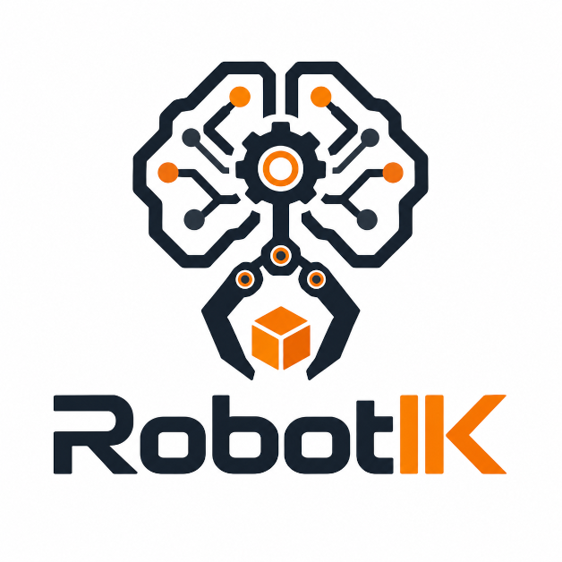

# 🤖 RobotIK

**Write a robot mission once, then run it in a 3D simulator, as a test in CI, as a reinforcement learning environment, and later on a real robot — and see, at every moment, what the robot decided and why.**

> ⚠️ **Active project: the API is still evolving.** Scenarios, demos and tests are the best examples of the current API. No physical robot has been driven yet.

---

## 🤔 What is it for?

You want a robot arm to pick a red cube and drop it in a box. The motion itself is the easy part. The hard part is everything around it:

- 🎯 **Deciding**: find the cube, approach, grasp, carry, release… and what to do when the camera fails in the middle.
- 🧪 **Proving it works**: not "it looked fine once", but "the cube ends in the box, nothing collided, it took less than 30 s", checked on every commit.
- 🔍 **Understanding failures**: when the robot stops, which step failed, what it believed, who held the gripper, why the planner chose this plan?
- 🔁 **Reusing the work**: the same mission as a demo, a regression test, a benchmark, a learning environment, and one day the real robot.

RobotIK gives you a frame for all of this. You describe the **world** and the **mission** in YAML, you write the robot's **skills** in C++, and RobotIK runs them on simulated physics, judges the result, and shows you everything that happened.

```text
   world.yaml            scenario.yaml                 skills (C++)
robot, cube, box     goal, faults, assertions     Detect, Grasp, Release…
         └──────────────────────┼─────────────────────────┘
                                ▼
                             RobotIK
                                │
          ┌─────────────────────┼─────────────────────┬──────────────────┐
          ▼                     ▼                     ▼                  ▼
     3D simulator          headless test          RL environment      real robot
    (see and debug)      (PASS / FAIL in CI)      (N in parallel)     (planned)
```

New to robotics? [The introduction](doc/01-Introduction.md) explains joints, frames, kinematics, skills and behavior trees in ten minutes, with no code.

---

## 📖 The story

RobotIK started as a small project to **learn inverse kinematics** — the **IK** of the name: how to compute the joint angles that bring the hand of an arm to a point. It mixed my own OpenGL code and my own robotics code, which is a fine way to learn and a poor way to build anything serious.

Little by little it turned into something else: a **simulation-oriented library** built on real, proven tools — [MuJoCo](https://github.com/google-deepmind/mujoco) for physics, [Pinocchio](https://github.com/stack-of-tasks/pinocchio) for kinematics, [Kairos](https://github.com/PlanSys2/kairos) for planning. On the way, my 3D library [Compages](https://github.com/Lecrapouille/Compages) was finally finished, and RobotIK uses its three layers: the **World** layer holds the simulated world, headless in tests; the **Renderer** layer draws it in the simulator, down to the live texture of the painter's canvas; the **GPU** layer is what the Renderer stands on. My behavior tree library [BlackThorn](https://github.com/Lecrapouille/BlackThorn) drives the missions, and its editor Oakular shows them running.

Why I build it? Because, professionally, I never found this kind of tool:

- 🐢 **ROS** has Gazebo and RViz, but ROS is heavy: middleware, nodes, launch files, message types — a lot to install and learn before a cube moves.
- 🚗 When I worked on an **autonomous car simulator**, the automotive world had scenario standards such as [OpenSCENARIO](https://www.asam.net/standards/detail/openscenario/): describe a situation, run it, judge it. **Robotics has almost nothing like this.**
- 🕸️ In a real professional project, **debugging the planner, the behavior tree, the skills and the shared resources together is hard**: each lives in its own tool, its own logs, its own clock.

The closest project I found, afterwards, is [SkiROS2](https://github.com/RobotLabLTH/skiros2): skills, behavior trees, planning and a world model — on ROS 2. I did not know it when RobotIK took shape, and the two answer differently (see below).

---

## ✨ Why RobotIK?

| | 🤖 RobotIK | ROS 2 + Gazebo / RViz | SkiROS2 | MuJoCo or PyBullet scripts |
|---|---|---|---|---|
| What you install | one C++ library, plain `make` | ROS 2 distribution, middleware | ROS 2 + SkiROS2 | a Python package |
| Mission as a test | ✅ scenario with assertions, PASS/FAIL, JSON report | by hand (launch tests) | by hand | by hand |
| Scenario file (world, faults, variants, seeds) | ✅ world / scenario / experiment YAML | world files, no scenario standard | world model, no scenario file | your script |
| Skills with resources, priorities, preemption | ✅ `SkillScheduler` | by hand | ✅ | ❌ |
| Behavior tree and PDDL planner | ✅ both, with replanning | Nav2 BT, PlanSys2 (separate) | ✅ | ❌ |
| One window to debug tree, plan, skills, resources, beliefs | ✅ the simulator workspaces | several tools | partly | ❌ |
| Belief vs ground truth | ✅ skills see beliefs, assertions see truth | by convention | world model | ❌ |
| Fault injection | ✅ in the scenario file | by hand | by hand | by hand |
| Headless and parallel (CI, RL) | ✅ same scenario, N environments | heavy | heavy | ✅ |
| Distributed robots, ROS ecosystem | ❌ not the goal | ✅ | ✅ | ❌ |

SkiROS2 is a robot control platform for distributed systems in the ROS ecosystem, with a semantic world model. RobotIK is a C++ library without middleware, centered on **simulation, tests and debugging**, with the same mission running in a simulator and, later, on hardware. If you live in ROS 2, SkiROS2 is a great fit; if you want a self-contained program you can test in CI, RobotIK is.

What this gives you:

- 🧪 **A mission is a test.** The scenario says what must be true at the end, at every step, or before a deadline. A failure keeps the measured value, the bound and the simulated time.
- 🔍 **You see why.** The **Mission** workspace of the simulator shows the live behavior tree, a timeline of skills with the resources they hold, the assertions, and the plans of the PDDL planner. The **Autonomy** workspace shows what the robot *believes* next to what is *true*.
- 💥 **You break it on purpose.** Faults are written in the scenario: the camera dies at 0 s, comes back at 1 s, dies again at 3 s. The tree must cope.
- 🎲 **You reproduce it.** One seed feeds the world, the sensors, the faults and the RL runs: the same seed gives the same run.
- 🧩 **You extend it with plugins.** Each demo is a plugin: its C++, its worlds, its scenarios, its assets. The core knows nothing about cubes or brushes.
- 🏆 **You learn with it.** Any scenario becomes a reinforcement learning environment, run N times in parallel without a window.

---

## 👀 What it looks like

Let us follow the **pick-and-place** demo from the files to the result: A robot with a camera on its wrist, picks a red cube and places it inside a box. Everything of a demo lives in one folder, a **plugin**, that RobotIK loads at run time:

```text
plugins/PickAndPlace/
├── plugin.yaml          📦 the name of the plugin and the list of its scenarios
├── worlds/              🌍 what exists
├── src/                 🔧 the skills, in C++
├── scenarios/           🎬 what happens and what is checked (+ the behavior tree)
└── experiments/         🧪 the variants to compare
```

### 🌍 1. The world: what exists

A robot with a camera on its wrist, a red cube, a box. Only facts, no behavior:

```yaml
# worlds/pick_place_cell.world.yaml (excerpt)
world:
  id: pick_place_cell
  entities:
    - id: robot
      type: robot
      model: robotik.robots.robot_6axis
      sensors:
        wrist_camera: { type: camera, parent: link6, fov: 70, frequency: 15 }
    - id: red_cube
      type: prop
      shape: { type: box, size: [0.04, 0.04, 0.04] }
      pose: { position: [0.40, 0.20, 0.02] }
      randomize: { x: [-0.02, 0.02], y: [-0.02, 0.02] }
```

### 🔧 2. The skills: what the robot knows how to do

A **skill** is one thing the robot knows how to do: detect an object, approach it, grasp it, release it. It is a small C++ class of the plugin (`src/PickPlaceSkills.cpp`). It is called again and again, and answers *running*, *success* or *failure*. Here is the heart of `Grasp`:

```cpp
Status GraspSkill::tick(RobotContext& p_context, Seconds p_dt)
{
    VacuumGripper* gripper = findGripper(p_context.robot, m_gripper);
    gripper->suction(true);                                    // turn on the vacuum
    if (heldObject(p_context.robot, m_gripper) == m_object)
        return Status::SUCCESS;                                // the cube is held
    ...                                                        // RUNNING, or FAILURE after 0.5 s
}
```

A skill only sees the robot and what the robot **believes** (`RobotContext`): never the simulator, never the true position of the cube. This is what lets the same skill run on a real robot later.

When the run starts, the plugin registers its skills with a name, the **resources** they need (the arm, the gripper, the camera) and their conditions (`src/PickPlaceMission.cpp`):

```cpp
grasp.preconditions.push_back({ "gripper is empty", ... });
skills.add<robotik::GraspSkill>(std::move(grasp), "red_cube");   // the skill "Grasp(red_cube)"
```

The **skill scheduler** then makes sure two skills never use the same arm at the same time, and stops a skill whose camera breaks.

### 🌳 3. The behavior tree: in which order

The tree only uses the names of the skills. It says the order, and what to do when a step fails:

```yaml
# scenarios/pick_and_place.bt.yaml (excerpt)
- UntilSuccess:                 # the camera may be broken: try again
    attempts: 1000
    child:
      - Action: { name: Detect(red_cube) }
- Action: { name: Approach(red_cube) }
- Action: { name: Reach(red_cube) }
- Action: { name: Grasp(red_cube) }
```

Instead of a predefined tree, a scenario can give a **goal** ("the cube shall be inside the box"): the PDDL planner then finds the actions itself as beaavior tree, and plans again when one fails ([doc/11](doc/11-PDDL-Planner.md)).

### 🎬 4. The scenario: what happens, and what is checked

The scenario puts it together: this world, this tree, these faults, and **the assertions that decide whether the mission succeeded**. Here, the camera breaks at 0 s, comes back at 1 s, and breaks for good at 3 s:

```yaml
# scenarios/pick_and_place_faults.scenario.yaml (excerpt)
scenario:
  id: pick_and_place_faults
  world: worlds/pick_place_cell.world.yaml
  seed: 7
  controller:
    behavior_tree: scenarios/pick_and_place.bt.yaml   # or a PDDL goal
  faults:
    - { at: 0.0, resource: wrist_camera, action: disable }
    - { at: 1.0, resource: wrist_camera, action: restore }
    - { at: 3.0, resource: wrist_camera, action: disable }
  assertions:
    - controller.success
    - inside(red_cube, box)
    - { condition: "collision_count(robot) == 0", phase: always }
    - time < 30
```

Run it without a window, the way CI does:

```text
$ ./build/Robotik-Headless build/plugins/PickAndPlace/scenarios/pick_and_place_faults.scenario.yaml --trace

  0.99 s  Detect(red_cube)  FAILED (unavailable: wrist_camera)  (0 s)
  1.01 s  Detect(red_cube)  SUCCEEDED  (0.01 s)
  1.03 s  Approach(red_cube)  SUCCEEDED  (2.37 s)
  3.41 s  Reach(red_cube)  SUCCEEDED  (0.5 s)
  3.92 s  Grasp(red_cube)  SUCCEEDED  (0.01 s)
  ...
  6.02 s  Release  SUCCEEDED  (0.01 s)
  6.04 s  Home  SUCCEEDED  (2.37 s)

[PASS] controller.success  (controller.success = 1)
[PASS] inside(red_cube, box)  (inside(red_cube, box) = 1)
[PASS] holding(gripper) == 0  (holding(gripper) = 0)
[PASS] collision_count(robot) == 0  (collision_count(robot) = 0)
[PASS] time < 30  (time = 8.43)
pick_and_place_faults: 1/1 runs passed
```

The tree retried `Detect` until the camera came back, then the robot went on from what it had seen when the camera died for good. The exit code is 0: **this is a test**. Open the same file in `./build/Robotik-Simulator` to watch the arm, the tree and the skills live.

### 🧪 5. The experiment: the same task, several ways

One success proves little. An **experiment** runs the same scenario in several **cases** (a wider area for the cube, real physics, the camera down at start), each with several **seeds**, and judges them all with the same assertions:

```yaml
# experiments/pick_and_place.experiment.yaml (excerpt)
experiment:
  id: pick_and_place_experiment
  seeds: [11, 12, 13]
  cases:
    - id: nominal
      scenario: scenarios/pick_and_place.scenario.yaml
    - id: wide_layout
      scenario: scenarios/pick_and_place.scenario.yaml
      overrides:
        world.entities.red_cube.randomize: { x: [-0.05, 0.05], y: [-0.05, 0.05] }
    - id: rigid
      scenario: scenarios/pick_and_place.scenario.yaml
      overrides:
        scenario.physics.fidelity: rigid
  evaluation:
    metrics: [ time, collision_count(robot), distance(red_cube, box) ]
```

```text
$ ./build/Robotik-Headless build/plugins/PickAndPlace/experiments/pick_and_place.experiment.yaml
[PASS] nominal                  seed=11     controller succeeded at 7.4 s ...  time=7.4  collision_count(robot)=0  distance(red_cube, box)=0.0149
[PASS] wide_layout              seed=12     controller succeeded at 7.54 s ...  time=7.54  collision_count(robot)=0  distance(red_cube, box)=0.0149
[PASS] rigid                    seed=13     controller succeeded at 7.4 s ... (physics rigid)  time=7.4  collision_count(robot)=0  distance(red_cube, box)=0.0337539
...
pick_and_place_experiment: 12/12 runs passed
```

`--report results.json` writes every run and every metric, to compare strategies or follow a regression.

The other demos: a painter that draws strokes on a canvas, a mobile robot following a line, a fly brain avoiding obstacles, a humanoid walking with a learned policy ([doc/09-Demos.md](doc/09-Demos.md)).

---

## 🔬 Physics: as simple as your question

A simulation does not need to be perfect; it needs to answer **your** question. Checking that a plan is right does not need the cube to bounce; checking that it lands in the box does. A scenario chooses how finely objects are simulated, and **the skills, the tree, the planner and the assertions stay the same** at every level:

| Level | When the robot grasps | When it releases | Use it to |
|-------|-----------------------|------------------|-----------|
| `abstract` (default) | the object simply follows the tool | the object is put at the bottom of the container, no fall | check the logic and the plan, fast |
| `rigid` | the object is a rigid body held to the tool | the object **falls for real** and stops where it lands | check the task with real positions |
| `contact` | *(planned)* the tool holds by friction and may slip | | study the grasp itself |

```yaml
scenario:
  physics:
    fidelity: abstract        # every object
    overrides:
      red_cube: rigid         # except this one
```

The good habit: keep the scenario at `abstract`, and add a `rigid` case to the experiment, as above. The same task is then judged at both levels, and the report says which level each run used. The robot itself can also be simulated more or less finely: the arm of the pick-and-place follows its joint commands in MuJoCo, the humanoid is a full floating body with motor gains and contacts, and the fly flies by plain kinematics. Details: [doc/03 §Physics fidelity](doc/03-Worlds-and-Scenarios.md#physics-fidelity).

---

## 🧱 What RobotIK is built on

RobotIK does not rewrite robotics. It makes proven libraries work together behind one API:

| Library | Role in RobotIK |
|---------|-----------------|
| 🦾 [MuJoCo](https://github.com/google-deepmind/mujoco) | physics, contacts, sensors |
| 🤖 [Pinocchio](https://github.com/stack-of-tasks/pinocchio) | kinematics: forward, inverse, Jacobians |
| 🤔 [Kairos](https://github.com/PlanSys2/kairos) | PDDL planner: a goal instead of a tree ([doc/11](doc/11-PDDL-Planner.md)) |
| 🌳 [BlackThorn](https://github.com/Lecrapouille/BlackThorn) | behavior trees in YAML, and the Oakular editor in the simulator ([docs](external/BlackThorn/doc/README.md)) |
| 🧱 [Compages](https://github.com/Lecrapouille/Compages) | the world (World layer, headless), the 3D view and live textures (Renderer layer, on top of the GPU layer) ([docs](external/Compages/doc/README.md)) |
| OpenCV, AprilTag, ONNX Runtime | only in the plugins that need them |

A skill never asks "am I simulated?". It drives the robot through one API (`robot.joints()`, the tool, the sensors); a backend translates it to MuJoCo today, and to a real robot (an SO-101 arm is planned) tomorrow.

---

## 🧭 Where it goes

```text
"Put the red cube in the box"         ← intent (user, later an LLM)
              │
     PDDL planner ✅ · GOAP 🔜        ← which actions are needed?
              │
       behavior tree ✅               ← in which order, with which recovery?
              │
          skills ✅                   ← how, on this robot
              │
   MuJoCo ✅ · real robot 🔜
```

- ✅ behavior trees, PDDL planning with replanning, skills with resources, faults, assertions, experiments, RL environments;
- 🔜 a real robot backend (SO-ARM101), GOAP, Prolog to query the world, an LLM front-end that stays at the level of intent and never drives the motors.

Expected robots:
- [Microduck](https://github.com/pollen-robotics/microduck)
- [SO-ARM101](https://github.com/TheRobotStudio/SO-ARM100)
- [Roboparty](https://github.com/Roboparty)

---

## 🚀 Quick start

Linux only, plain `make` (no CMake). macOS is not supported: the simulator needs a newer OpenGL than the 4.1 of macOS.

```bash
git clone https://github.com/Lecrapouille/RobotIK --recurse-submodules
cd RobotIK
make download-external-libs
make -j"$(nproc --all)"

./build/Robotik-Simulator          # Demos menu: every plugin and its scenarios
./build/Robotik-Headless build/plugins/PickAndPlace/scenarios/pick_and_place.scenario.yaml
./build/Robotik-Headless build/plugins/Painter/experiments/painter.experiment.yaml --report painting.json
./build/Robotik-PickAndPlaceRL --policy converged --envs 16 --threads 8 --episodes 32
```

Unit tests: `make tests -j"$(nproc --all)"`. Then follow the **HelloWorld** tutorial in [doc/04-Your-First-Plugin.md](doc/04-Your-First-Plugin.md).

---

## 📚 Documentation

Chapters 1 to 5 are for everybody; 6 to 11 are references.

| # | Chapter | Contents |
|---|---------|----------|
| | [doc/README.md](doc/README.md) | 🧭 Reading order and quick paths |
| 1 | [Introduction](doc/01-Introduction.md) | 🌱 Robotics in ten minutes, and what RobotIK does |
| 2 | [Getting started](doc/02-Getting-Started.md) | 🚀 Build, simulator, headless, reports |
| 3 | [Worlds and scenarios](doc/03-Worlds-and-Scenarios.md) | 🧩 World, scenario and experiment files, assertions, trajectories, ground truth |
| 4 | [Your first plugin](doc/04-Your-First-Plugin.md) | 🎓 The HelloWorld tutorial, writing a plugin, manifest, asset packs |
| 5 | [Skills and behavior trees](doc/05-Skills-and-Behavior-Trees.md) | 🌳 Skills, resources, `SkillScheduler`, BlackThorn trees, faults |
| 6 | [Architecture](doc/06-Architecture.md) | 🏗 Layers, data flow, `include/Robotik/` layout |
| 7 | [API reference](doc/07-API-Reference.md) | 📖 The classes a plugin uses |
| 8 | [Reinforcement learning](doc/08-Reinforcement-Learning.md) | 🏆 Environments, spaces, episode ends, pool, episode log |
| 9 | [Demos](doc/09-Demos.md) | 🎬 HelloWorld, pick and place, painter, line follower, RL, fly brain, humanoid walk |
| 10 | [Tools and frames](doc/10-Tools-and-Frames.md) | 🔧 Flange, tool, TCP |
| 11 | [The PDDL planner](doc/11-PDDL-Planner.md) | 🧠 A goal instead of a behavior tree (Kairos) |

The libraries RobotIK is built on have their own documentation, written the same way: [Compages](external/Compages/doc/README.md) and [BlackThorn](external/BlackThorn/doc/README.md).

🤖 Coding agents: [AGENTS.md](AGENTS.md) maps each task to a skill of `.claude/skills/`. Compages and BlackThorn have their own `AGENTS.md` and skills.

---

## 📝 License

RobotIK is dual-licensed: GNU GPL v3 or later, or a commercial license for those who cannot use the GPL. See [LICENSING.md](LICENSING.md).
