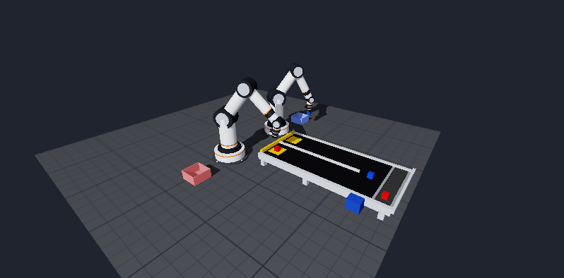
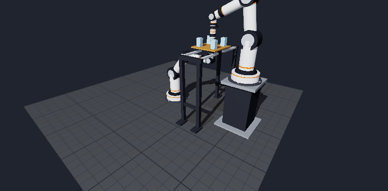

# 🦾 Dual arm

[⏫ Case studies](README.md)

**Two robots in one world, planned together.** Two 6-axis arms share one physics, one scheduler and their beliefs ([Several robots](../reference/world-file.md#-several-robots)). The PDDL planner plans for both, and the executor runs at the same time the steps that do not depend on each other ([Steps that run together](../concepts/05-pddl-planner.md#-steps-that-run-together)). No behavior tree is written. `conveyor_pabt` grows a tree from the goal (PA-BT) instead of planning: one goal condition after the other, so one arm at a time, like `conveyor_sequential`.

 

```bash
make robotik_dual_arm
./build/linux-gcc-debug/bin/RobotIK-Headless build/linux-gcc-debug/lib/robotik/plugins/DualArm/scenarios/conveyor.scenario.yaml --trace
```

| Scenario | What happens |
|----------|--------------|
| `conveyor` | A conveyor of two lanes brings four parts from its infeed table (out of reach) to the end stop of each lane; each arm takes the parts of its lane and drops them in its bin, then waits over its pick zone for the next part. The belt brings the next part while an arm carries the last one |
| `conveyor_sequential` | The same plan, step by step (`planner.parallel: false`), to compare |
| `tray` | The left arm holds a tray with four glasses **from below**, its cup pointing up, carries it to another stand and puts it down; the right arm, on a pedestal, feels the tray with a drill and its force sensor, and draws a target between the glasses **while the tray moves**. A temporal domain (durative actions) |

**Conveyor.** One plan of 12 steps; the times show the overlap:

```text
  0 s  Convey(p4, feeder, zone_right)  SUCCEEDED  (2.56 s)
  2.57 s  right.Hover(p4)  SUCCEEDED  (0.95 s)
  2.57 s  Convey(p3, feeder, zone_left)  SUCCEEDED  (2.91 s)
  3.53 s  right.Reach(p4)  SUCCEEDED  (0.4 s)
  3.94 s  right.Grasp(p4)  SUCCEEDED  (0.01 s)
  3.96 s  right.Hover(p4)  SUCCEEDED  (0.41 s)
  4.38 s  right.Over(bin_right)  SUCCEEDED  (2.09 s)
  5.49 s  left.Hover(p3)  SUCCEEDED  (0.95 s)
  5.49 s  Convey(p2, feeder, zone_right)  SUCCEEDED  (2.91 s)
  6.45 s  left.Reach(p3)  SUCCEEDED  (0.4 s)
  6.48 s  right.Release  SUCCEEDED  (0.01 s)
  6.5 s  right.Ready(zone_right)  SUCCEEDED  (2.08 s)
  ...
  8.59 s  right.Hover(p2)  SUCCEEDED  (0.28 s)
  ...
[PASS] (> dual_arm.overlap 2)  (dual_arm.overlap = 8.22)
[PASS] (< time 20)  (time = 16.85)
```

Run step by step, the same plan ends at 33.35 s instead of 16.85 s.

- **The belt.** The conveyor is a fixed body (`robotik.dual_arm.conveyor`, a model of the plugin pack in `data/`). The belt is a device of the plugin with its resource `conveyor`: `Convey(part, feeder, zone)` pushes the part off the infeed table, across to the lane of the zone, and down the lane to its end stop. It holds the resource alone, so two conveys never overlap, and a fault on `conveyor` stops the belt.
- **Waiting at the right place.** `place` ends with `Ready(zone)`: the arm comes back over its pick zone, at the height it takes the next part from. The part arrives under the cup (`right.Ready(zone_right)` runs during `Convey(p2, …)`), so the next `Hover` takes 0.28 s instead of 0.95 s. The zone is a parameter of `place` in the domain, bound by the static fact `(reaches arm zone)`.

**Tray.** The plan holds the tray during the drilling: `drill` needs the tray `in_motion` over all its duration, a token `carry` adds at its start and removes at its end. The carry motion ends at 25.52 s; the executor keeps the tray held until the drill is done (30.1 s), then lowers it.

```text
  0 s  left.Approach(tray)  SUCCEEDED  (2.5 s)
  2.51 s  left.Reach(tray)  SUCCEEDED  (0.99 s)
  3.51 s  left.Grasp(tray)  SUCCEEDED  (0.01 s)
  3.53 s  left.Raise  SUCCEEDED  (1.99 s)
  5.53 s  left.Carry(pad_b)  SUCCEEDED  (19.99 s)
  5.53 s  right.Trace(tray)  SUCCEEDED  (24.57 s)
  30.12 s  left.Lower  SUCCEEDED  (1.99 s)
  32.12 s  left.Release  SUCCEEDED  (0.01 s)
  32.14 s  left.Retreat  SUCCEEDED  (0.99 s)
  plan 0 at 0 s (start): solved (lift left tray pad_a) (carry left tray pad_a pad_b) (drill right tray) (set_down left tray pad_b)
[PASS] (on tray stand_b)  ((on tray stand_b) = 1)
[PASS] (on g1 tray)  ((on g1 tray) = 1)
...
[PASS] (== (collision_count left) 0)  ((collision_count left) = 0)
[PASS] (== (collision_count right) 0)  ((collision_count right) = 0)
[PASS] (> dual_arm.contact 15)  (dual_arm.contact = 18.52)
[PASS] (> dual_arm.overlap 4)  (dual_arm.overlap = 19.99)
```

How it works:

- **One arm under, one arm above.** The stands (`robotik.dual_arm.stand`) have two rails, open toward the middle of the cell. The cup of the left arm points up: it slides between the rails under the tray (`Approach`), rises to 5 mm under its bottom face (`Reach`) and holds it there. The drill comes from above. The arms never meet.
- **Why so high.** With the tool pointing up, the wrist of the 6-axis arm bends at most 100°: the forearm must stay about horizontal, so the tray is at 0.80 m, near the full reach of the arm. With the tool pointing down, the forearm may rise at most 10° above horizontal: the drilling arm stands on a pedestal of 0.55 m.
- **Synchronized arms.** `Trace(tray)` draws its path **in the frame of the tool of the carrying arm**, read through `RobotContext::team` (what that arm measures of itself), not through the camera. It comes 12 cm above the start of the path and goes down.
- **The contact is felt.** A force sensor measures the force on the spindle (`right_ft: { type: force_torque, link: drill_spindle }` on the drill). Read above the tray, it gives the weight of the tool (the tare). The drill goes down slowly until it feels 1 N more: the tray is there, wherever the beliefs put it. Then it follows the path at 6 cm/s and moves up or down to keep 5 N (an admittance). Over a path of about 19 s, it touches the tray 18.5 s.
- **The path is a file.** `scenarios/trajectories/drill_target.trajectory.yaml` draws a target in the frame of the tray: a line through the corridor between the glasses along x, a line through the other corridor along y, and a circle in the free middle of the 2 × 2 glasses. The body of the drill passes 3.3 cm from the nearest glass. Edit it to draw another path.
- **A still drill.** The spindle does not turn: a turning bit drags the tray, and its glasses, by friction. The arm joint group lists the six arm joints, so the spindle is not one of them.
- **Real glasses.** The cup is at the `rigid` physics level, so the tray and the glasses are free bodies of MuJoCo; `(on g1 tray)` with `phase: always` is a real contact at every step. `dual_arm.contact` counts the seconds the drill really touched the tray (`(touching right_drill tray)`).
- **Touching is the work.** `touches: [tray]` on the drill ([Tools](../reference/world-file.md#-tools)): its contacts with the tray are not collisions; a contact with a glass, a stand or the other arm is.
- **Gentle moves.** The tray moves along straight lines with a smooth profile (`PathSkill`). The arms have stiffer joint gains than the default: the gravity compensation of the drives does not know the 0.7 kg of the tray.
- **What is real, what is not.** Real (MuJoCo): the tray and the glasses (free bodies: gravity, contacts, friction), the arms (joints driven by their servos), the contact of the drill on the tray, the force it feels. Simplified: the cup holds by a weld that never slips (the `contact` fidelity does not exist yet), the drill removes no material and its spindle does not turn, and the beliefs are the true poses (`perception: { fidelity: truth }`, no camera detection).

Files: `plugins/DualArm/`
- `worlds/conveyor_cell.world.yaml`, `worlds/tray_cell.world.yaml`;
- `data/`: the pack `robotik.dual_arm` (conveyor, stand, pedestal);
- `scenarios/trajectories/drill_target.trajectory.yaml` (the path of the drill);
- `scenarios/conveyor.domain.pddl` (classical), `scenarios/tray.domain.pddl` (temporal);
- `src/ConveyorLogic.cpp`, `src/TrayLogic.cpp`: skills of each robot, observers, bindings; `src/Conveyor.cpp`: the belt; `src/ArmSkills.cpp`, `src/TraySkills.cpp`: the skills.

Limits: the parts and glasses are boxes (the only free shape); the parts are given by the simulator (`perception: { fidelity: truth }`), as the plugin has no detector yet; the arms are the generic `robot_6axis`.
