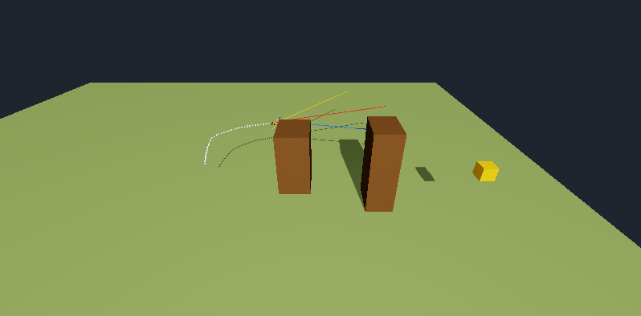
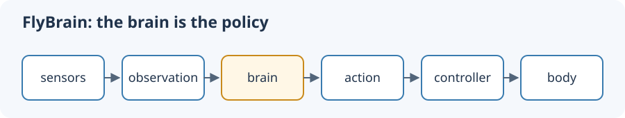

# 🪰 Fly brain

[⏫ Case studies](README.md)

A fly-like agent reaches food while avoiding obstacles. [Video](https://youtu.be/ao2lA3Rlmrc?si=DECtcn7l44Q-iMCo).





The brain knows neither MuJoCo, nor Compages, nor the URDF. Two brains share this surface: a reflex rule, and the integrate-and-fire network of Shiu et al. 2024, which can load the FlyWire connectome (`--edges`, `--binding`); without those files it runs a small circuit with the same equations.

The body is the ×100 model (`drosophila_x100.urdf`, about 28 cm). Flight is plain kinematics: wings, legs and neck are a posture, not a wind tunnel. The flight model is the robot backend (`FlyBackend`), the brain is the agent the scenario logic runs. The eye beams and the trail are decorations: ignored by grasping, range sensors and ground truth.

```bash
./build/linux-gcc-debug/bin/RobotIK-Fly --brain reflex
./build/linux-gcc-debug/bin/RobotIK-Fly --view
./build/linux-gcc-debug/bin/RobotIK-Fly --headless --envs 8 --episodes 8 --seed 123456
./build/linux-gcc-debug/bin/RobotIK-Headless build/linux-gcc-debug/lib/robotik/plugins/FlyBrain/scenarios/fly_obstacle_avoidance.scenario.yaml
```

In the simulator, the **Fly brain** panel shows the state and chooses the brain: the small circuit, or the FlyWire connectome (loaded in the background, a few seconds). The **Cameras** panel shows both eyes.
