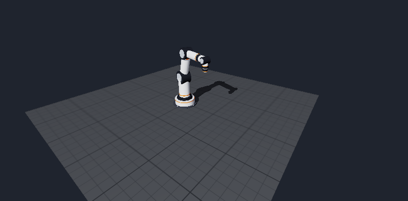

# 👋 HelloWorld

[⏫ Case studies](README.md)

The tutorial plugin. Tutorials 4 to 6 read it, one lesson each: [Your first plugin](../tutorials/04-your-first-plugin.md) (`hello`), [Move the arm](../tutorials/05-move-the-arm.md) (`wave`, `reach`) and [A skill and a behavior tree](../tutorials/06-skills-and-a-behavior-tree.md) (`skills`).

| Scenario | Shows |
|----------|-------|
| `hello` | The smallest scenario logic: a metric and an end |
| `wave` | Joint commands, forward kinematics |
| `reach` | Inverse kinematics, a `within` assertion that turns green |
| `skills` | A skill (`Wave`) called by a behavior tree |

The plugin also has a panel, a menu entry and a key binding (**H** = Home). It is used by the plugin unit tests (`tests/Plugin/TestPlugin.cpp`).
