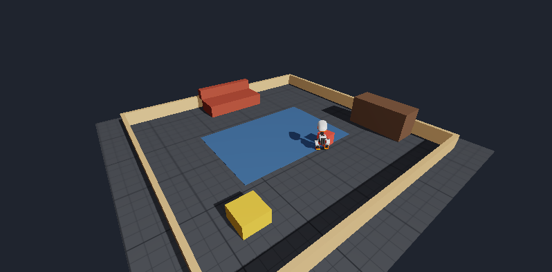

# 🦆 Micro Duck

[⏫ Case studies](README.md)

**A small legged robot in a room.** The Pollen Robotics Microduck (14 servos, about 25 cm) walks with the official `velstand` policy (ONNX), like the humanoid of [Humanoid walk](humanoid-walk.md), but in a room: the walls and the furniture are one fixed body of MuJoCo, and a light toy box is a free body the duck pushes. No training is needed.



```bash
make EXTRA_PLUGINS=MicroDuck        # fetches its repositories and ONNX Runtime, prepares its data once
./build/linux-gcc-debug/bin/RobotIK-Headless build/linux-gcc-debug/lib/robotik/plugins/MicroDuck/scenarios/tour.scenario.yaml --trace
```

| Scenario | What happens |
|----------|--------------|
| `walk_forward` | Walk straight for 8 s on an empty floor (a test) |
| `tour` | Push the toy box, turn left, walk, turn left, walk back (a behavior tree) |
| `drive` | (simulator) the **Micro Duck** panel gives the command (forward, left, turn, Stop) |

```text
  0 s  Stand  SUCCEEDED  (0.015 s)
  0.02 s  Forward  SUCCEEDED  (5 s)
  5.025 s  TurnLeft  SUCCEEDED  (2 s)
  7.03 s  Forward  SUCCEEDED  (5 s)
  12.035 s  TurnLeft  SUCCEEDED  (2 s)
  14.04 s  Forward  SUCCEEDED  (5 s)
[PASS] controller.success  (controller.success = 1)
[PASS] (> duck.height_min 0.09)  (duck.height_min = 0.112537)
[PASS] (> (pose_error toy) 0.15)  ((pose_error toy) = 0.330871)
[PASS] (> duck.distance 2.0)  (duck.distance = 3.10567)
[PASS] default                  seed=1      controller succeeded at 19.05 s (physics abstract, toy: rigid)  time=19.05
tour: 1/1 runs passed
```

How it works:

- **The physics of the core.** The scenario logic does not build its own physics. In `setup` it tunes `RoboticCell::physicsOptions()` (a floating base, no gravity compensation, the step of the policy, the exact rotor inertia of the small servos) and the core builds the physics with the room and the box of the world.
- **Real contacts.** The box is a prop made rigid by the scenario (`physics.overrides: { toy: rigid }`): `(pose_error toy)` measures how far the duck pushed it.
- **Slower than asked.** With PD actuators instead of the motor model of the training, 0.4 m/s gives about 0.14 m/s. `duck.displacement` measures the real progress; `duck.distance` also counts the sway of the trunk.

More details in [demos/MicroDuck/README.md](../../demos/MicroDuck/README.md).
