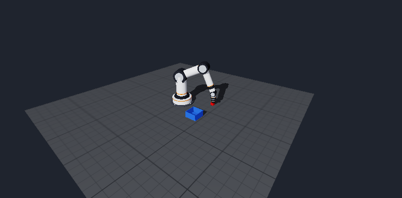
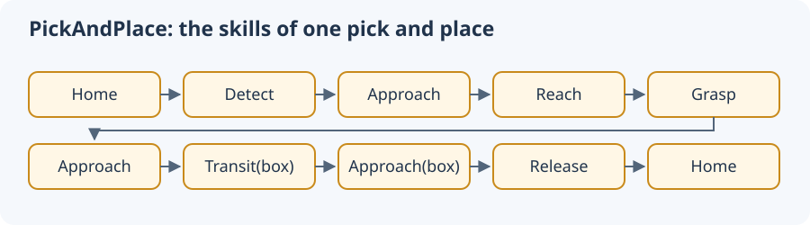

# 📦 Pick and place

[⏫ Case studies](README.md)

**The reference demo**: look at it first to understand the architecture end to end. [Video](https://youtu.be/MuWdpaLvGoU?si=qjJWl1kZFv4DRHOo).



A 6-axis arm with a wrist camera and a vacuum cup takes a red cube and drops it in a box:



Files: `demos/PickAndPlace/`
- `worlds/pick_place_cell.world.yaml`: the arm, its camera, the vacuum cup and four stored tools, the cube (randomized), the box;
- `scenarios/pick_and_place.scenario.yaml`: nominal run;
- `scenarios/pick_and_place_faults.scenario.yaml`: the camera fails during the run;
- `scenarios/pick_and_place.bt.yaml`: the tree (`UntilSuccess` around `Detect` waits for the camera to come back);
- `src/`: `ColorDetector` (perception), the skills, `PickPlaceLogic`.

The assertions judge the result, not the trajectory:

```yaml
assertions:
  - controller.success
  - (inside red_cube box)
  - (== (holding gripper) 0)
  - { condition: (== (collision_count robot) 0), phase: always }
  - (< time 30)
```

[See and grasp](../tutorials/09-see-and-grasp.md) reads this demo from the camera to the grasp.

In headless, no image is rendered: the scenario says `perception: { blind: truth }`, so the true cube position replaces the camera, and reports say `perception truth`. The simulator renders the image and uses the colour detector.

The fault scenario does not only check that things fail: it checks that the architecture **reacts** (retry, fall back, abort).

```bash
./build/linux-gcc-debug/bin/RobotIK-Headless build/linux-gcc-debug/lib/robotik/plugins/PickAndPlace/scenarios/pick_and_place.scenario.yaml --seed 11
./build/linux-gcc-debug/bin/RobotIK-Headless build/linux-gcc-debug/lib/robotik/plugins/PickAndPlace/experiments/pick_and_place.experiment.yaml \
    --report pick.json
```

The experiment runs four cases with three seeds each (12 runs): the nominal run, a wider cube layout, the `rigid` physics level, and a camera down at start.

**With the PDDL planner** (`scenarios/pick_and_place_pddl.scenario.yaml` and `pick_and_place_pddl_faults.scenario.yaml`, menu **PDDL planner**): no tree, only the goal `(in red_cube box)`. The domain is `scenarios/pick_and_place.domain.pddl`; `src/PickPlacePlanning.cpp` reads the state on the beliefs and binds each action to the same skills. With the camera down, the executor plans again until it can go on. See [A planned pick and place](../tutorials/08-a-planned-pick-and-place.md). `pick_and_place_pabt.scenario.yaml` does the same with no search: the tree grows from the goal (PA-BT, [Without search: a tree grown from the goal (PA-BT)](../concepts/05-pddl-planner.md#-without-search-a-tree-grown-from-the-goal-pa-bt)).
