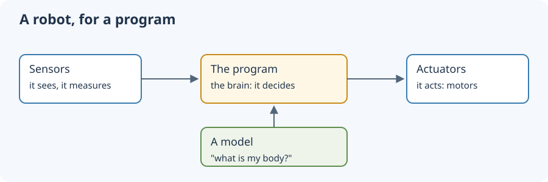
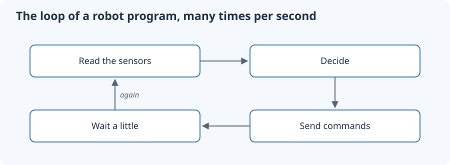
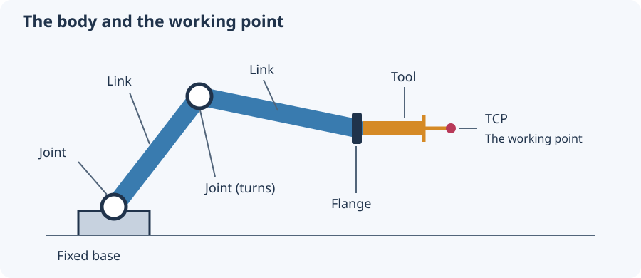
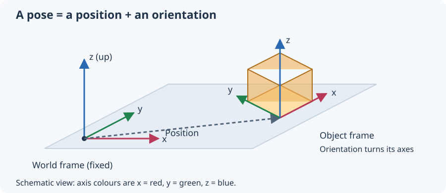
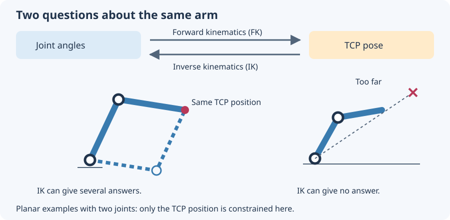
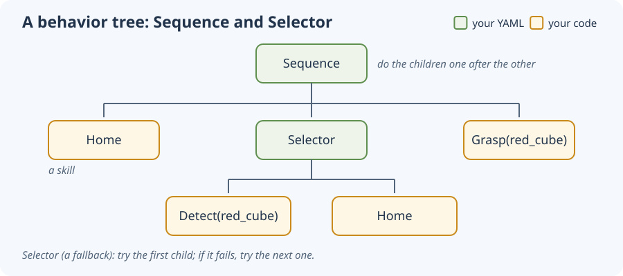
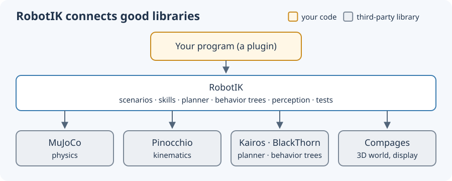

# ⏳ Robotics in ten minutes

[⏫ Concepts](README.md)

This page is for people who never wrote a robot program. It explains the words you will meet in the rest of the documentation, then what RobotIK does with them. No code here: only ideas and pictures.

If you already know robotics, read only [What is RobotIK?](#-what-is-robotik) and go to [Getting started](../tutorials/01-getting-started.md).

## 🤖 What is a robot, for a program?

For a program, a robot is three things:



- **Sensors** measure the world:
  - a camera gives images, a lidar gives distances,
  - an IMU gives accelerations.
- **Actuators** change the world:
  - motors turn the joints,
  - a vacuum gripper sucks an object.
- **A model** describes the body:
  - how long each arm segment is,
  - how they are connected,
  - how far each joint can turn.

The program runs in a **loop**, many times per second:



That is all. Everything else in robotics is a better way to do one of those three steps.

## 📖 The words you will meet

### 🦴 The body: links and joints

A robot arm is a chain of rigid pieces, the **links**, connected by **joints**.



| Word | Meaning | Example |
|------|---------|---------|
| **DOF** | Degrees of freedom: the number of joints that move | a "6-axis arm" has 6 DOF |
| **Link** | A rigid piece of the robot | the forearm |
| **Joint** | A connection that moves | the elbow |
| **Revolute joint** | Turns. Its position is an **angle** (radians) | a shoulder |
| **Prismatic joint** | Slides. Its position is a **length** (metres) | a linear axis |
| **Joint limits** | The angle (or length) a joint cannot pass | -170° … +170° |
| **Home** | A safe, known position the robot goes back to | arm folded |

The body is written in a file called **URDF** (Unified Robot Description Format). It is XML: one `<link>` per piece, one `<joint>` per connection. You do not need to write URDF to use RobotIK: some robots are already given in `data/packs/`.

### 📐 Frames and poses

To say *where* something is, you need a reference: a **frame**. A frame is an origin point and three axes (x, y, z).

- The **world frame** is fixed to the floor. In RobotIK, **z points up**, distances are in **metres** and angles in **radians** (π rad = 180°).
- Every link has its own frame, which moves with it.

A **pose** is a position (x, y, z) plus an orientation (how the object is turned). Orientations are often written **rpy**: roll, pitch, yaw, three angles around x, y and z.



Example: `40 cm forward, 20 cm left, 2 cm up, turned 90° around z`  is expressed as:

```yaml
pose: { position: [0.40, 0.20, 0.02], rpy: [0.0, 0.0, 1.57] }
```

### 🔧 The tool and the TCP

At the end of the arm there is a mounting face, the **flange**. A **tool** is fixed on it: a gripper, a vacuum cup, a drill, a brush.

The **TCP** (Tool Center Point) is the point of the tool that does the work: the tip of the drill, the centre of the vacuum cup. When we say "move the robot to this point", we mean "move the TCP to this point".

The TCP is marked at the tool tip in the [arm illustration](#-the-body-links-and-joints).

### 🔄 Forward and inverse kinematics

These two words come back often. They answer opposite questions.

| | Question | Input | Output |
|--|----------|-------|--------|
| **Forward kinematics (FK)** | "My joints are at these angles. Where is my tool?" | joint angles | TCP pose |
| **Inverse kinematics (IK)** | "I want my tool here. Which joint angles do I need?" | TCP pose | joint angles |

- FK is easy: there is always exactly one answer.
- IK is harder: there can be zero answers (the point is too far), one, or many.



RobotIK uses the [Pinocchio](https://github.com/stack-of-tasks/pinocchio) library for both.

### 🔬 Simulation and physics

A **simulator** computes how the robot and the objects move: gravity, collisions, friction, motors. RobotIK uses [MuJoCo](https://github.com/google-deepmind/mujoco) for that. A simulation advances by small **steps** of time, for example 10 ms (`dt = 0.01 s`).

The **ground truth** is the real state of the simulated world: the exact position of every object. A real robot never knows the ground truth: it only knows what its sensors say.

### 👁 Perception and beliefs

**Perception** turns raw sensor data into useful facts. "This image has a red blob at pixel (120, 80)" becomes "there is a red cube at (0.40, 0.20, 0.02), I am 87 % sure".

What the robot *thinks* about the world is its **belief**. In RobotIK, beliefs live in the **WorldModel**. A belief can be wrong: that is normal, and it is what we want to test.

### 🌳 Skills and behavior trees

A **skill** is one thing the robot knows how to do: "go home", "grasp the cube", "follow the line". A skill runs over many steps until it succeeds or fails.

A **behavior tree** (BT) decides *which skill to run, in which order, and what to do when one fails*. It is a tree of small decision nodes:



A behavior tree is easier to read and to change than a big `if / else` program, and it reacts well to failures. It is the new way to write state machines and uses a lot in video games.

### 🔒 Resources and faults

A **resource** is a part of the robot that only one skill can use at a time: the arm, the gripper. A camera can be shared by several skills.

A **fault** is a resource that stops working: the camera is blind, the gripper is broken. RobotIK can inject faults on purpose to test how the robot reacts.

### 🎲 Reinforcement learning (RL)

In **reinforcement learning**, a program learns by trial and error. At each step it receives an **observation**, chooses an **action**, and gets a **reward** (a score). An **episode** is one try, from start to end. You will need these words only in [Build reinforcement learning environments](../guides/reinforcement-learning.md).

## 🤖 What is RobotIK?

RobotIK is a C++20 library to **write a robot program once, then run it in a simulator, in automatic tests, in a learning environment, and (later) on a real robot**, without changing that program.

RobotIK does not rewrite physics, kinematics or 3D rendering. It **connects** good existing libraries behind one simple API:



### 💡 The three ideas behind RobotIK

**1. The program does not know if the robot is real.** A skill writes `joints.moveTo(elbow, 0.5)`. A *backend* translates this command for MuJoCo, or (later) for a real motor. The skill never contains `if (simulation) ... else ...`.

**2. A mission is also a test.** A scenario file says what must be true at the end, for example "the cube is in the box, and the robot never hit anything". The same file is a demo in the simulator, a regression test in CI, and a benchmark.

```yaml
assertions:
  - (inside red_cube box)
  - { condition: (== (collision_count robot) 0), phase: always }
```

**3. A window is optional.** The same scenario runs with a 3D window (`RobotIK-Simulator`) or without (`RobotIK-Headless`). Without a window, you can run thousands of episodes for tests or learning.

### 🤝 What you write, and what RobotIK gives you

| You write | RobotIK gives you |
|-----------|-------------------|
| A **world** file (YAML): the robot, the objects | Builds the 3D world and the physics |
| A **scenario** file (YAML): what happens, what is checked | Runs it, checks it, writes a report |
| A **plugin** (C++): your skills, your perception, your metrics | Loads it in the simulator and in headless mode |

## 🔗 Where to go next

| You want to… | Read |
|--------------|------|
| Build RobotIK and see a robot move | [Getting started](../tutorials/01-getting-started.md) |
| Change a scenario without writing C++ | [Worlds, scenarios and experiments](02-worlds-scenarios-experiments.md) |
| Write your own C++ program | [Your first plugin](../tutorials/04-your-first-plugin.md) |
