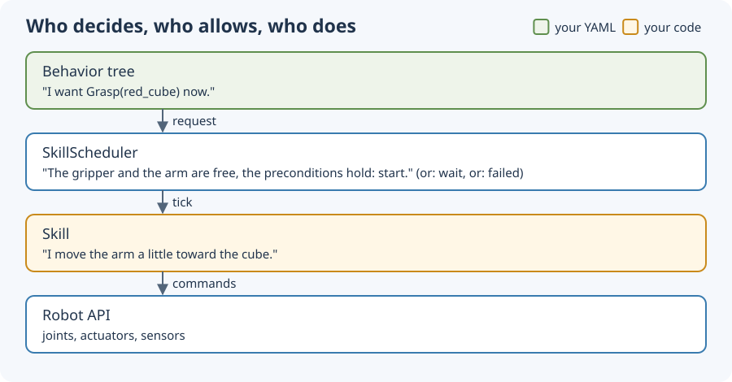
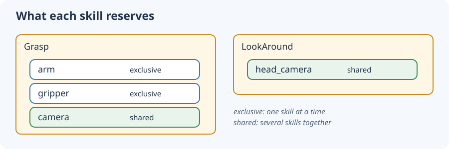
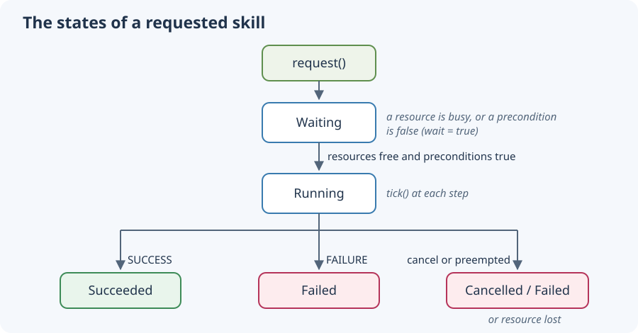
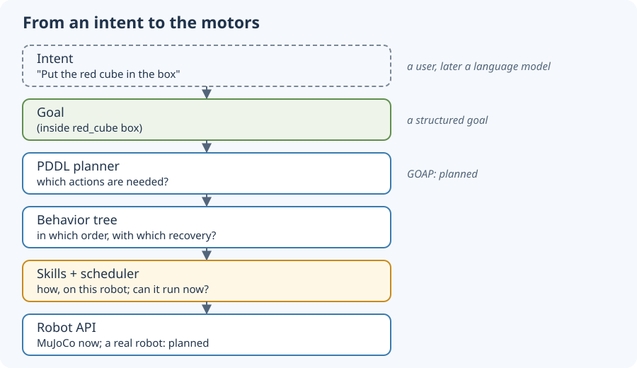

# 🌳 Skills, the scheduler and behavior trees

[⏫ Concepts](README.md)

Lesson 4 of [Your first plugin](../tutorials/04-your-first-plugin.md) showed a skill called by a behavior tree. This page explains the three pieces, how they talk, and how to write your own.

The one sentence to remember:

> **The behavior tree decides *what* to do next. The scheduler decides *if it can run now*. The skill knows *how* to do it.**



## 🔧 What is a skill?

A skill is **one capability** of the robot: `Home`, `MoveJoint`, `Detect`, `Grasp`, `FollowLine`. It can be very small (move one joint) or bigger (`Pick` = detect, approach, reach, grasp, lift).

A skill is **not a thread**. It is an object with a `tick` method, called once per simulation step until it returns `SUCCESS` or `FAILURE`. Hundreds of skills can exist without one thread each.

```cpp
class Skill
{
public:
    virtual void reset();                                          // a new run starts
    virtual Status tick(RobotContext& p_context, Seconds p_dt) = 0; // one step of work
    virtual void cancel(RobotContext& p_context);                   // stop safely
};
```

| Method | Called | Your job |
|--------|--------|----------|
| `reset()` | Each time the skill starts | Clear the state of the last run |
| `tick(context, dt)` | Each step while running | Command the robot a little; return `RUNNING`, `SUCCESS` or `FAILURE` |
| `cancel(context)` | When cancelled, preempted, or a resource is lost | Put the hardware in a safe state (stop the joints, open the gripper...) |

A skill sees only the `RobotContext`:

```cpp
struct RobotContext
{
    Robot& robot;              // joints, sensors, actuators, resources, kinematics
    WorldModel& world_model;   // what the robot believes about the objects
    Seconds time{};            // robot clock at the start of the tick
    Seconds dt{};              // duration of the tick
    std::span<Robot* const> team{}; // every robot of the world; empty for a robot alone
};
```

There is **no simulator in there**. A skill cannot tell MuJoCo from a real robot, and it cannot read the ground truth. This is on purpose: the same skill must work on a real robot.

### 🧰 Built-in skills

| Skill | Class | Notes |
|-------|-------|-------|
| `Home` | `HomeSkill` | Added by every simulation that has a `joint_group` actuator. Moves the joints to `home`. One per robot, `left.Home`, when the world has several |
| `Stop` | `StopSkill` | Added by every simulation. Reserves **all** actuators with the highest priority and holds the joints: an emergency stop. It never ends by itself (always `RUNNING`). One per robot, `left.Stop`, when the world has several |
| — | `MoveJointSkill(joint, target)` | One joint to an angle |
| — | `MoveJointsSkill(posture)` | Several joints, `{ "joint1": 0.5, ... }` |
| — | `MoveTCPSkill(frame)` + `goal(pose)` | A frame to a pose (IK once per goal). Useful **inside** your own skills |

Pick-and-place skills (`DetectSkill`, `ApproachSkill`, `GraspSkill`, `ReleaseSkill`) are in `demos/PickAndPlace/src`.

## 📝 Register a skill: `SkillDescription`

A skill is added to the scheduler with a description:

```cpp
robotik::ResourceManager const& resources = p_simulation.robot().resources();

robotik::SkillDescription grasp;
grasp.name = "Grasp(red_cube)";                       // unique; also the BT action name
grasp.resources = { resources.require("arm"),
                    resources.require("gripper"),
                    resources.require("wrist_camera", robotik::Access::Shared) };
grasp.priority = 100;                                 // higher runs first, may preempt
grasp.wait = true;                                    // wait while busy (default)
grasp.cancellable = true;                             // may be preempted (default)
grasp.preconditions = {
    { "gripper is empty",
      [](robotik::RobotContext const& c) { return !gripperHolds(c); } } };

p_simulation.skills().add<GraspSkill>(std::move(grasp), /* constructor args */ "red_cube");
```

Do this in `ScenarioLogic::setup`. The simulation then makes every skill a behavior tree action with the same name.

| Field | Meaning |
|-------|---------|
| `name` | Unique name. The behavior tree calls the skill by this name |
| `resources` | What the skill holds for its whole run. `Exclusive` (default) or `Shared` |
| `priority` | Higher first. A higher-priority request may **preempt** a running skill |
| `wait` | `true`: wait while a resource is busy or a precondition is false. `false`: fail at once |
| `cancellable` | `false` forbids preemption |
| `preconditions` | Conditions checked before the start. The text is shown when the skill is blocked |
| `robot` | Id of the robot the skill drives (`left`); empty: the first robot. The skill gets the `RobotContext` of that robot |

### 👥 Several robots

In a world of several robots ([Several robots](../reference/world-file.md#-several-robots)), each skill drives the robot of its `robot` field: `p_context.robot` is that robot. Name the skills after the robot (`left.Hover(p3)`), so that a behavior tree or a planner binding (`"{0}.Hover({1})"`) picks the right one. From `demos/DualArm/src/ConveyorLogic.cpp`:

```cpp
std::string const& id = p_robot.id();
skills.add<HoverSkill>(describe(id + ".Hover(" + part + ")", id, arm), part, Length(kHover));
```

- The resources are shared by the robots: a skill may hold an arm of each (a move of both arms at once).
- `p_context.team` lists every robot: a skill reads what the others measure of themselves (joints, tool pose), as a real cell shares it on its network. The drill of the DualArm tray follows the tool of the carrying arm this way. Command another robot only with its resources held.
- The beliefs are in the world frame: bring them into the base of your robot with `p_context.robot.base().pose.inverse() * belief`.

## 🔒 Resources

A resource is a part of the robot that skills must share: an actuator or a sensor. Each actuator and each sensor of the world file is a resource **with the same name**: `arm`, `gripper`, `wrist_camera`.



- `Grasp` and `LookAround` can run **at the same time**: no conflict.
- `MoveArm` (arm) and `Grasp` (arm) **cannot**: the second one waits, or fails, or preempts the first (if its priority is higher).
- Two skills can share a camera stream (`Shared`).

In the simulator, the **Timeline** panel (Mission workspace, under the scene, full width) draws one row per skill, grouped by robot when there are several: blue when it waits (the text says for which resource), orange when it runs, green when it succeeded, red when it failed, grey when it was cancelled. Hover a phase to read why and how long; click it to keep its details on the line under the rows. By default the window of time follows the present and keeps its width (**Follow**); **Whole run** shows it from the start. The wheel zooms, a drag or Shift+wheel moves in time, a double-click follows the present again. The row **Resources** says who holds what now; click it to get one row per resource: orange when a skill holds it, blue when skills share it, red when it is in fault. Small marks under the times of the ruler show the plans, the steps of the plan that end, the faults, the failures of the tree and the verdicts of the assertions (the lines of the **Events** tab without the skills); hover one to read it. The simulation cannot go back: the mouse on a past time only reads what ran then, on the line under the rows. The **Resources** panel is one table: who holds each resource, who needs it, its fault; tick one or more resources, give a duration (ever: until you restore them), then press *Inject*.

## 📅 The scheduler

`SkillScheduler` is the referee. It does not know how to move an arm. It knows **if and when** a skill may run.

At each update it:

1. stops the runs that lost a resource (fault), and the cancelled runs;
2. admits waiting requests by priority, if resources and preconditions allow;
3. preempts lower-priority skills when needed;
4. ticks the running skills.



| `SkillState` | Meaning |
|--------------|---------|
| `Idle` | Never requested since the last reset |
| `Waiting` | Requested, not started (busy resource, false precondition, or another run of the same skill) |
| `Running` | Holds its resources, ticked each update |
| `Stopping` | Cancelled or preempted, keeps its resources until `Skill::stopping` says it is safe |
| `Succeeded` / `Failed` / `Cancelled` | End of the run |

`SkillReason` says why: `Busy`, `Queued`, `Preempting`, `Unavailable`, `Precondition`, `ResourceLost`, `Preempted`, `Cancelled`, `Failed`. `--trace` prints them:

```text
  0.01 s  Wave  FAILED (resource lost: arm)  (0.99 s)
  1.02 s  Wave  FAILED (unavailable: arm)  (0 s)
```

Each `request` returns a ticket (`RunId`): read the state of your run and cancel it with that ticket, so you never cancel the run of another caller. A preempted skill with `wait = true` waits for its resources again and starts again from `reset()`. A skill that commands an actuator held by another skill throws `std::logic_error`. The reasons for these rules, and the stopping phase, are in [Resources and arbitration](06-architecture.md#-resources-and-arbitration).

### 📅 Use the scheduler without a tree

The tree is only one client of the scheduler. A test, a GUI button or an RL policy can use it directly:

```cpp
robotik::SkillScheduler& skills = simulation.skills();
robotik::SkillId const home = skills.find("Home");
robotik::RunId const run = skills.request(home);
while (skills.state(run) != robotik::SkillState::Succeeded)
{
    simulation.step(Seconds(0.01));          // the simulation updates the scheduler
}
```

This is what the **Home** menu of HelloWorld does.

## 🌳 Behavior trees

A behavior tree is the **mission logic**. RobotIK uses [BlackThorn](https://github.com/Lecrapouille/BlackThorn). Trees are YAML files, named in the scenario:

```yaml
scenario:
  controller:
    behavior_tree: skills.bt.yaml
```

Each tick, the tree is evaluated from the root. Each node returns `RUNNING`, `SUCCESS` or `FAILURE`.

### 🔧 An `Action` is a skill

```yaml
- Action:
    name: Wave
```

A tick of this node **requests** the skill `Wave` and returns:

| State of its run | Node returns |
|------------------|--------------|
| `Waiting`, `Running` or `Stopping` (a preempted run that waits included) | `RUNNING` |
| `Succeeded` | `SUCCESS` |
| `Failed` or `Cancelled` | `FAILURE` |

Each node has its own ticket: two nodes of the same skill make two runs, one after the other. When the tree leaves the node while it is running (for example a parent gives up), only the run of this node is cancelled.

When the run ends, the node writes `Wave.state`, `Wave.reason` and `Wave.failure` on the blackboard of the tree (`FAILED`, `resource lost` and an empty failure, for example). A condition of the tree can read them to react to a fault and not to a failure, and to tell one failure of the skill from another (the code the skill gave to `fail`). The list of reasons is in [What the tree sees](06-architecture.md#-what-the-tree-sees).

### 🌿 The main nodes

| Node | Kind | Behaviour |
|------|------|-----------|
| `Sequence` | composite | Runs the children in order. Fails as soon as one fails. Succeeds when all succeed |
| `Selector` | composite | Tries the children in order. Succeeds as soon as one succeeds. Fails when all fail (a "fallback") |
| `Parallel` | composite | Ticks all children. Keys `success_threshold`, `failure_threshold` |
| `Inverter` | decorator | `SUCCESS` ↔ `FAILURE` |
| `ForceSuccess` / `ForceFailure` | decorator | Always succeeds / fails when the child ends |
| `UntilSuccess` | decorator | Runs the child again until it succeeds (`attempts`) |
| `UntilFailure` | decorator | Runs the child again until it fails (`attempts`) |
| `Repeater` | decorator | Runs the child `times` times |
| `Action` | leaf | A skill, by name |

Composites take `children:`, decorators take `child:` (a list with one node):

```yaml
BehaviorTree:
  Sequence:
    name: PickAndPlace
    children:
      - Action:
          name: Home
      - UntilSuccess:
          attempts: 1000
          child:
            - Action:
                name: Detect(red_cube)
      - Selector:
          children:
            - Action:
                name: Grasp(red_cube)
            - Action:
                name: Home          # grasp failed: go back home (and the Sequence fails)
```

> **Time in trees.** BlackThorn's `Timeout`, `Delay`, `Wait` and `Cooldown` count **simulated time**: the simulation gives its clock to the tree. They stop when the run is paused, follow the speed slider, and give the same result in headless and in the simulator. Example: fail a grasp that takes more than 3 simulated seconds:
>
> ```yaml
> - Timeout:
>     milliseconds: 3000
>     child:
>       - Action:
>           name: Grasp(red_cube)
> ```

## 🚀 Going further: planners, logic and LLMs

The split *tree / scheduler / skill* leaves room for higher layers. None of them is implemented yet; the architecture is ready for them.



- **GOAP / PDDL** would build the sequence of skills from a goal and from the skill preconditions.
- **Prolog** could answer questions like `reachable(arm, red_cube)` to check preconditions or enrich the WorldModel.
- **An LLM** would stay at the level of intent: it never drives the motors.

Why keep the tree when a planner exists? A plan is ideal; the world is not. `MoveTo(box)` can fail because something blocks the path, the grasp slipped, or a sensor failed. The tree reacts: retry, fall back, re-plan, abort.

A skill is also a **slot**, not one implementation: `Reach(target)` can be done with IK, with a motion planner, or with a learned policy. The scenario and the tree do not change.
