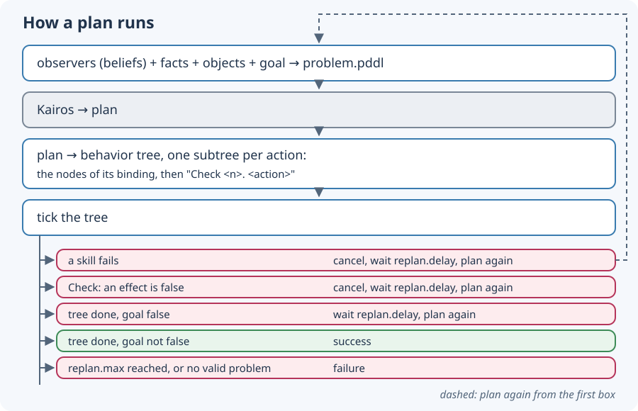

# 🧠 The PDDL planner

[⏫ Concepts](README.md)

This page explains how a scenario can give a **goal** instead of a behavior tree, how the planner finds the steps, how it reacts when reality does not follow the plan, and what a plugin writes to use it. To run one first, follow the tutorial [A planned pick and place](../tutorials/08-a-planned-pick-and-place.md); the keys and the calls are in [the planner reference](../reference/pddl-planner.md).

You should know [skills and behavior trees](04-skills-and-behavior-trees.md) and [worlds and scenarios](02-worlds-scenarios-experiments.md) first.

## 🤔 Why a planner

A behavior tree says **how**: "detect, approach, reach, grasp, carry, release". You write every step, in order. That fits when the sequence is almost always the same.

The planner works from **what**: the scenario gives a **goal** instead of a tree: "the cube must be in the box". You still write **skills** (motions, sensors) and a **domain** (symbolic actions and their rules written in PDDL syntax). The solver chooses the order of actions from what is true when it **plans**. You do not hand-write the full sequence.

That matters when the order depends on the situation. If the robot already holds the cube, there is nothing to pick. If the camera already saw the box, there is nothing to detect. If the brush is dirty, it must be rinsed first. A tree needs a branch for each case. A planner skips steps that are already satisfied and **replans** when a step fails or the world changes.

The planner reads the robot's **belief** (what perception says), not the **ground truth** (where things really are in the simulation). Skills work the same way. Assertions at the end still use ground truth to say whether the scenario logic really succeeded. [Truth, description and belief](02-worlds-scenarios-experiments.md#-truth-description-and-belief) defines belief, ground truth, description, and oracle.

The planner returns a **plan**: symbolic steps like `(pick red_cube)`, not joint trajectories. **Skills** run on the robot (`Approach`, `Grasp`, …). The plugin connects each PDDL action to skills with a **binding** ([what goes where](#-what-goes-where)). The executor turns the plan into a behavior tree for the run. If a skill fails, the rest of the plan is dropped and Kairos plans again ([how a plan runs](#-how-a-plan-runs)).

The words of this page:

| Word | Meaning |
|------|---------|
| **PDDL** | *Planning Domain Definition Language*: a file syntax for describing domains and problems. You need a planner (solver) to read these files and searches for a plan. |
| **Domain** | The types of objects, the predicates and the actions of a task. Written once per plugin, in a `.pddl` file. |
| **Problem** | The objects, what is true now, and the goal. Also written in a `.pddl` file but RobotIK writes it for you. |
| **Kairos** | The PDDL solver RobotIK uses: it takes a problem and returns a plan. |
| **Predicate** | A symbolic fact (true or false). You declare names in the domain. Kairos reads their value from **observers** (belief) and from `planner.facts` ([what goes where](#-what-goes-where)). Examples: `(holding red_cube)`, `(in red_cube box)`, `hand_empty`. |
| **Action** | A symbolic step in the domain (not a skill): preconditions and effects in PDDL. Example: `pick` means "the robot should end up holding the object", not how to move the arm. |
| **Plan** | The ordered list of actions Kairos returns, e.g. `(detect red_cube) (pick red_cube) (place red_cube box)`. It is a recipe on paper: it does not run the robot. |
| **Skill** | C++ code that moves the robot or reads sensors for one step, through `RobotContext` ([05](04-skills-and-behavior-trees.md)). Examples: `Detect`, `Approach`, `Grasp`. |
| **ScenarioLogic** | The plugin C++ class for a scenario (`PickPlaceLogic`, `PainterLogic`, …): it registers skills, publishes metrics, and ends the run. With a planner, it also registers **observers** and **bindings** on `PlanningDomain` ([04](../tutorials/04-your-first-plugin.md)). |
| **Ground truth** | The real state of the simulated world (poses, contacts, what is inside what): what `RoboticCell::requirePose` and `RoboticCell::requireQuery` report. Assertions, metrics, and RL read it; the planner and skills do not. |
| **Belief** | What the robot thinks is true: the `WorldModel`, updated by perception. Observers turn belief into PDDL predicates for the planner. |

## 🗂 What goes where

In RobotIK, planning is split across **four places**: the domain file, the world, the scenario YAML, and the scenario logic (C++). Each row below is one job; keep them separate so PDDL stays symbolic and skills stay in C++.

| Job | Where you write it | Example |
|-----|-------------------|---------|
| Vocabulary: types, predicate names, symbolic actions | `scenarios/<name>.domain.pddl` | `(:predicates (holding ?o - graspable))`, `(:action pick ...)` |
| Problem objects (which things planner can name) | World YAML: `kind` on an entity | `kind: cube` on `red_cube` |
| Facts that never change: true for the whole run | Scenario: `planner.facts` | `(before red black)` for the painter robot. |
| Goal (what must become true) | Scenario: `planner.goal` | `(in red_cube box)` for the pick-and-place robot |
| Current value of each predicate (from belief) | ScenarioLogic: one **observer** per predicate | `holding` reads the vacuum sensor and the label the grasp skill wrote |
| Real execution of each PDDL action | ScenarioLogic: one **binding** per action | `pick` → `Approach`, `Reach`, `Grasp`, `Approach` |

RobotIK builds `problem.pddl` from the world, scenario, and observers before each search. Bindings are used only at execution time ([how a plan runs](#-how-a-plan-runs)).

### 📜 The domain

`demos/PickAndPlace/scenarios/pick_and_place.domain.pddl`:

```lisp
(define (domain pick_and_place)
  (:requirements :strips :typing :negative-preconditions)

  (:types
    graspable bin - object             ; things you can pick up, and bins you drop into
    cube - graspable)                  ; a cube in the world counts as something pickable

  (:predicates
    (seen ?o - object)                 ; the robot has already looked at this object
    (holding ?o - graspable)           ; the vacuum is holding this cube
    (hand_empty)                       ; the vacuum holds nothing
    (in ?o - graspable ?b - bin))      ; this cube is inside this bin

  ; The robot has not spotted this object yet. Use the camera until it knows
  ; where the object is. Once that is done, the planner skips detect for it.
  (:action detect
    :parameters (?o - object)
    :precondition (not (seen ?o))
    :effect (seen ?o))

  ; The robot knows where the cube is and its hand is empty. Move in, grasp,
  ; and lift. After that it holds the cube and the hand is no longer empty.
  (:action pick
    :parameters (?o - graspable)
    :precondition (and (seen ?o) (hand_empty))
    :effect (and (holding ?o) (not (hand_empty))))

  ; The robot is holding the cube. Carry it above the bin and release. The bin
  ; stays where the world file put it; you do not need a "go to bin" action.
  (:action place
    :parameters (?o - graspable ?b - bin)
    :precondition (holding ?o)
    :effect (and (in ?o ?b) (hand_empty) (not (holding ?o)))))
```

`?o` is a parameter. `cube - graspable` means "a cube is a kind of graspable". The whole PDDL language is available (`forall`, `imply`, derived predicates…): the Painter domain uses `forall` to paint the layers in order.

### 🧊 The objects: `kind` in the world

```yaml
- id: red_cube
  type: prop
  kind: cube                # type of the PDDL planner (scenarios/*.domain.pddl)
...
- id: box
  type: prop
  kind: bin
```

Only entities with a `kind` are objects of the problem. Their PDDL name is their id in lower case.

### 🎯 The goal: the scenario

`demos/PickAndPlace/scenarios/pick_and_place_pddl.scenario.yaml`:

```yaml
  controller:
    planner:
      domain: scenarios/pick_and_place.domain.pddl
      goal:
        - (in red_cube box)
```

Write one literal per line, or a flow list: `[ (in red_cube box), hand_empty ]`.

### 🔭 The scenario logic: observers and bindings

`demos/PickAndPlace/src/PickPlacePlanning.cpp` (shortened):

```cpp
// --- State, from the beliefs only --------------------------------------
p_domain.observe("seen", [](RobotContext const& p_context, Args p_args) {
    robotik::WorldObject const* object = p_context.world_model.find(p_args[0]);
    return robotik::truth(object != nullptr && observed(*object));
});

p_domain.observe("holding", [](RobotContext const& p_context, Args p_args) {
    return robotik::truth(robotik::heldObject(p_context.robot) == p_args[0]);
});

...

// --- Actions, as skills of PickPlaceLogic -----------------------------
p_domain.bind("detect", { "Detect({0})" });
p_domain.bind("pick", { "Approach({0})", "Reach({0})", "Grasp({0})", "Approach({0})" });
p_domain.bind("place", { "Transit({1})", "Approach({1})", "Release" });
```

The scenario logic calls this in `ScenarioLogic::setup`, on `p_simulation.planning()`. An observer gets the entity ids (`p_args`) and returns `Truth::True`, `Truth::False` or `Truth::Unknown`. A binding lists the behavior tree nodes of the action; `{0}` is its first argument.

A behavior tree node may read a value on its blackboard instead of its name. The Painter gestures read the color:

```cpp
domain.bind("dip", { "Dip", "Home" }, { { "color", "{0}" } });
```

**Everything is checked at load time.** A predicate without observer, fact or `:derived` rule, an action without binding, an unknown `kind`, a goal with a wrong predicate, arity or type: the scenario is refused with the full list, one problem per line, such as:

```text
- predicate 'holding' has no observer (PlanningDomain::observe in the scenario logic) and no fact (planner.facts)
- action 'place' has no binding (PlanningDomain::bind in the scenario logic)
```

## 🏃 How a plan runs



Before its skills, each subtree asks "Done already?": when every effect of the action already holds in the beliefs (all `True`, none `Unknown`), the step is **skipped**. The beliefs may change between the plan and the step: an object seen on the way does not need a `detect` any more.

The generated tree is the tree of the run: the **Execution graph** panel shows it with **Tree of the plan**, as for a written tree.

**Why a step failed.** The reason comes from the scheduler (a resource `unavailable: wrist_camera`, `preempted`…) or from the skill itself: a skill explains its failure with `fail(code, words)` (`not_seen`, `red_cube not seen by the camera within 2 s`). The Planner panel, the Execution graph and the headless trace show it.

**Unknown is not false.** For the planner, an atom that is not true is false (PDDL works like that). But when the executor checks an effect or the goal, `Unknown` is accepted: "not seen" does not mean "false". In the fault scenario the camera is down at the end, so the robot cannot see that the cube is in the box: `in` says `Unknown`, the plan ends, and the **assertions** (ground truth) say whether it really worked.

### 👯 Steps that run together

The planner gives a list of actions. Many of them do not depend on each other: the conveyor can bring the next part while an arm carries the last one. The executor finds these steps alone; the domain says nothing about parallelism.

Each step has two **events**: its **start** (its skills begin; its precondition must hold) and its **end** (its skills are done; its effects hold). Two events of different steps keep the order of the plan when:

- one changes an atom the other reads, or both change it;
- their skills need the same resource and one of them alone (an arm, a cup, the conveyor): the first step ends before the second one starts.

Every other pair may happen in any order. The executor then builds one `Parallel` node with every step; each step waits for the end of the steps it needs (`After 2, 4: 7. (convey p2 feeder zone_right)`), runs once, and the first failure fails the plan (cancel, plan again, as before). A plan where each step waits for the previous one keeps its `Sequence`: the PickAndPlace and Painter plans do not change.

The DualArm conveyor ([Dual arm](../case-studies/dual-arm.md)) plans 12 steps for two arms and one conveyor. The same plan, run both ways:

```text
conveyor (parallel: true)
  0 s  Convey(p4, feeder, zone_right)  SUCCEEDED  (2.56 s)
  2.57 s  right.Hover(p4)  SUCCEEDED  (1.22 s)
  2.57 s  Convey(p3, feeder, zone_left)  SUCCEEDED  (2.91 s)
  ...
  5.49 s  left.Hover(p3)  SUCCEEDED  (1.22 s)
  5.49 s  Convey(p2, feeder, zone_right)  SUCCEEDED  (2.91 s)
  ...
[PASS] default                  seed=42     controller succeeded at 19.82 s (perception truth)  time=19.82
```

With `planner.parallel: false` (one step at a time) the same plan ends at 39.61 s. The test `PluginSession.TwoArmsSortFasterWithAParallelPlan` runs both.

**Durative actions.** In a temporal domain (`:durative-action`), the planner gives a start time and a duration to each action. The start event reads the `at start` and `over all` conditions and changes the `at start` effects; the end event reads the `at end` and `over all` conditions and changes the `at end` effects. This gives **required concurrency**: in the DualArm tray scenario, `drill` needs `(over all (in_motion ?t))`, which `carry` adds at its start and removes at its end. So the drilling starts once the carry has started (`After start of 2: 3. (drill right tray)`), and the carry ends only once the drilling has ended (`Until 3: 2. (carry left tray pad_a pad_b)`, a node before its Check). The carry motion is done at 25.53 s, but the tray stays held until 30.11 s:

```text
  5.54 s  left.Carry(pad_b)  SUCCEEDED  (19.99 s)
  5.54 s  right.Trace(tray)  SUCCEEDED  (24.57 s)
  30.13 s  left.Lower  SUCCEEDED  (1.99 s)
```

The durations of the domain only order the plan: the executor waits for the skills, not for the clock. A skill that ends early does not wait for its planned duration.

**Reproducible.** The planner runs inside a simulation step: simulated time does not move during the search. It uses one thread, a fixed search (`search: lama`) and no "anytime" improvement. The same seed gives the same plans. `timeout` is only a safety net on the wall clock.

### 🌱 Without search: a tree grown from the goal (PA-BT)

A planner with a search builds the whole plan before the robot moves. GOAP (*Goal-Oriented Action Planning*, Jeff Orkin, for the game F.E.A.R. in 2005) is the best known example. It starts from the goal and looks for the actions whose effects give it, then for the actions that give their preconditions. These links make a graph of states, and an A* search finds in it the cheapest path from the current state to the goal. The default `method: search` of RobotIK does the same job with a PDDL planner: Kairos goes forward from the current state, guided by an estimate of the distance to the goal. In both cases the result is one complete plan, the best that the search found. The robot runs it, and the executor plans again when a step fails.

PA-BT (*Planning and Acting with Behavior Trees*, Colledanchise, Marzinotto and Ögren, 2018) also starts from the goal and goes backwards, but it does not search. It never builds a graph of states and never compares two plans. It takes one false condition, chooses an action that makes it true, puts this action in the behavior tree, and lets the robot act. The tree grows during the run, only where the world does not match the goal. `method: pabt` does this with the same domain, observers and bindings as the search.

| | Search (`method: search`, and GOAP) | PA-BT (`method: pabt`) |
|---|---|---|
| When it decides | Before the robot moves: a whole plan | During the run: one false condition at a time |
| How it chooses | Compares many plans and keeps the best one | Takes the action with the fewest false preconditions; no cost |
| What runs | A tree made from the plan | The tree itself, which grows |
| A condition reached before becomes false (the cube falls) | The step fails, the executor plans again | The tree reads the condition at the next tick and goes back to the action that makes it true |
| Two arms | Steps that do not depend on each other run together | One goal condition after the other |
| Domain | Full PDDL of Kairos (`forall`, numbers, durative actions) | Plain preconditions only (see the limits below) |

Choose the search for a long job where the order matters, or for several robots. Choose PA-BT for a short job in a world that changes during the run, when going back to an earlier step must not cost a new plan.

```yaml
controller:
  planner:
    domain: scenarios/pick_and_place.domain.pddl
    method: pabt
    goal:
      - (in red_cube box)
```

The tree starts with the conditions of the goal. When it fails on a condition, the executor puts under it the actions of the domain whose effects make it true, each with its preconditions as new conditions, then ticks again. A condition becomes:

```text
ReactiveSelector            condition true?   yes: SUCCESS, nothing to do
  condition?                else: an action that makes it true
  ReactiveSequence
    precondition?           (grown the same way when it fails)
    Sequence: the nodes of the binding, then "Done"
```

The run of `pick_and_place_pabt.scenario.yaml` grows the tree twice, from the goal down to what already holds (`(seen red_cube)` and `hand_empty`):

```text
  plan 0 at 0 s (start): solved
  plan 1 at 0 s ((in red_cube box) is false: put 1 action(s) under it): solved (place red_cube box)
  plan 2 at 0.01 s ((holding red_cube) is false: put 1 action(s) under it): solved (place red_cube box) (pick red_cube)
```

and runs this tree (shortened):

```text
ReactiveSequence "Goal"
  ReactiveSelector "(in red_cube box)"
    (in red_cube box)? #1
    ReactiveSequence "1. (place red_cube box)"
      ReactiveSelector "(holding red_cube)"
        (holding red_cube)? #2
        ReactiveSequence "2. (pick red_cube)"
          (seen red_cube)? #3
          hand_empty? #4
          Sequence "Do 2. (pick red_cube)": Approach, Reach, Grasp, Approach, Done
      Sequence "Do 1. (place red_cube box)": Transit(box), Approach(box), Release, Done
```

What changes from the search:

- **It reacts without planning again.** Each tick reads the conditions on the beliefs again. When a condition reached before becomes false (an object moved), the tree goes back to the actions that make it true, at the end of the running action, with no new plan.
- **An action is atomic, as in PDDL.** Its preconditions are read before it starts; the condition it makes true does not stop it (`holding` is true after `Grasp`, the arm still lifts the cube).
- **Which action first.** A condition gets at most 16 actions, those with the fewest false preconditions first. An action that needs a false static atom (a `fact`, or a predicate no action changes) is left out, and so is one that needs a condition the tree is already making true above it (it would go round in a circle).
- **A failed action** (a skill fails) does not grow the tree: the executor waits `replan.delay` and ticks the same tree again, `replan.max` times.
- **One goal condition after the other.** The goal is a `ReactiveSequence`: `parallel` does not apply, two arms do not work together. On the DualArm conveyor, PA-BT ends at 39.73 s, like the plan run step by step (39.61 s); the parallel plan ends at 19.82 s.
- The **History** has one record per growth of the tree; **Execution graph** lists the actions of the tree, in the order they were added.

On PickAndPlace (`pick_and_place_pddl` and `pick_and_place_pabt`) both ways end at 6.89 s: on one arm with one cube, the search and the tree grown from the goal choose the same actions.

## 🚧 Limits

- The order between steps is read from the atoms each end of an action names. A quantified variable (`forall (?y - zone) ...`) matches any object, so a step with a `forall` waits for more steps than needed.
- Two steps that overlap in a temporal plan and need the same exclusive resource are not ordered by the executor: the scheduler makes the second one wait for the resource.
- Two steps running together share the blackboard of the tree: two `parameters` of the same name in parallel bindings would clash.
- PA-BT reads only the plain preconditions (atoms and `not` atoms, `at start` and `over all`). A `forall`, an `or` or a number is not read: an order written with `forall` (as in the Painter domain) is lost, the goal conditions are made true in the order of the list. PA-BT does not move a subtree when an action undoes a condition reached before it (the "conflicts" of the paper): the tree reaches the condition again.
- The PickAndPlace, Painter and DualArm demos have PDDL scenarios. LineFollower and HumanoidWalk do not.

## 🔗 Next

- [Case studies](../case-studies/README.md): the PDDL scenarios of PickAndPlace, Painter and DualArm.
- [API reference](../reference/api.md): the other classes a scenario logic uses.
