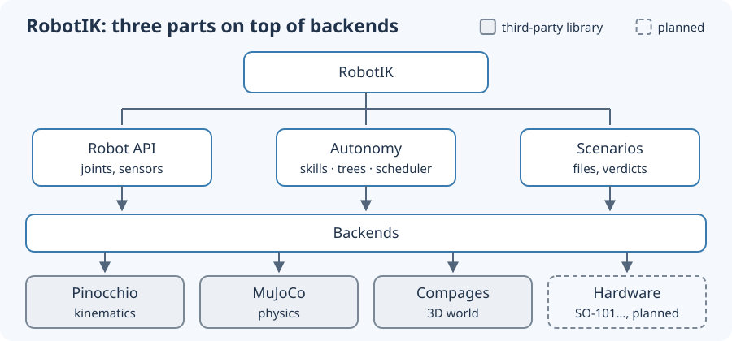
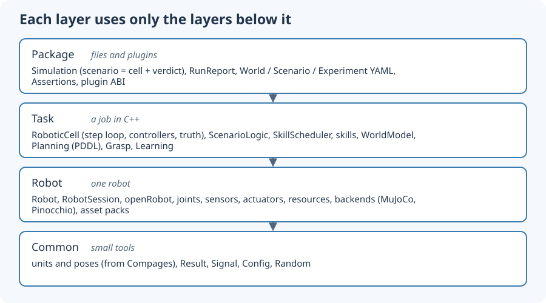
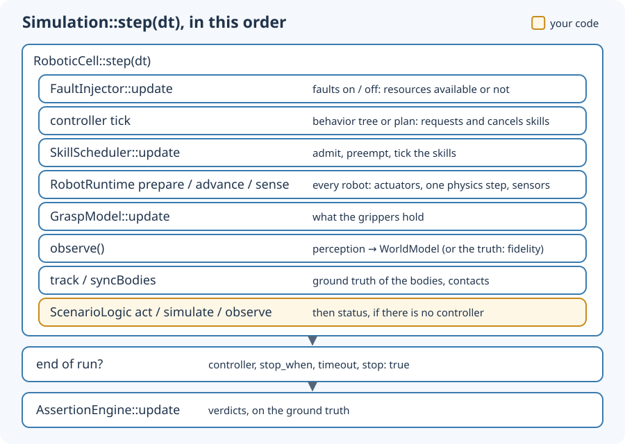
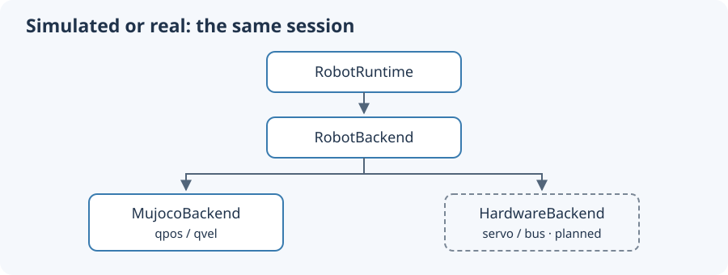
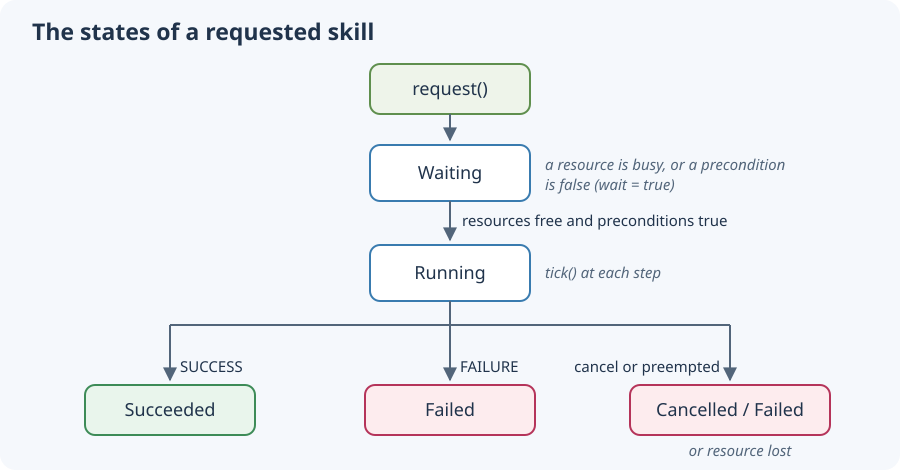
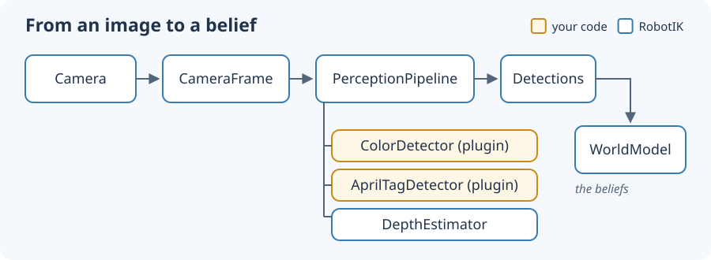
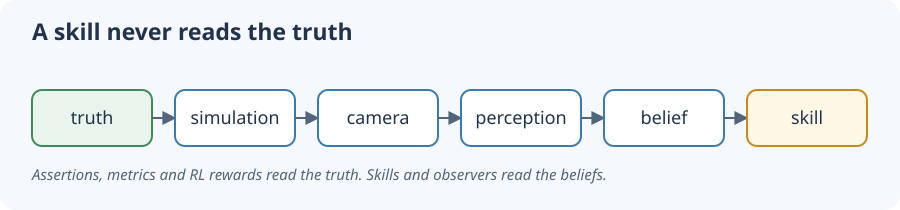
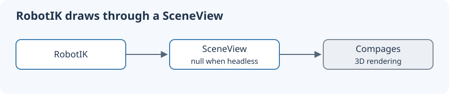
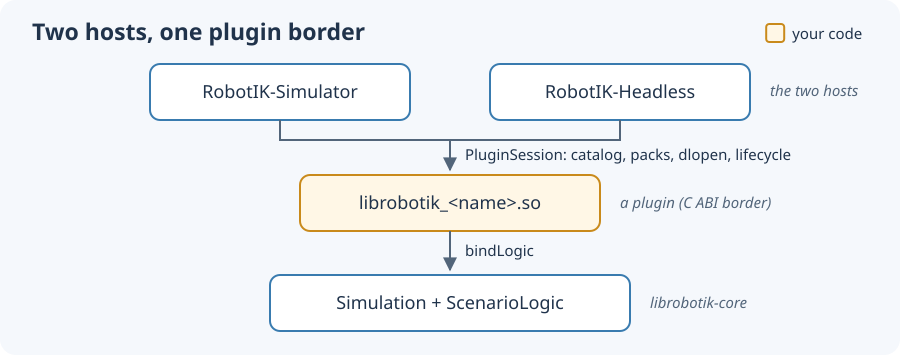

# 🏗 Architecture

[⏫ Concepts](README.md)

This page explains **how RobotIK is built and why**. It is for people who want to change RobotIK itself, or to understand what happens behind the API. You do not need it to write a plugin.

## 🎼 The principle: RobotIK orchestrates

RobotIK is not a monolithic simulator. It assembles specialised libraries and keeps each one in its own domain:



| Library | Responsible for | Used through |
|---------|-----------------|--------------|
| [Pinocchio](https://github.com/stack-of-tasks/pinocchio) | Forward kinematics, Jacobians, inverse kinematics | `PinocchioBackend` |
| [MuJoCo](https://github.com/google-deepmind/mujoco) | Dynamics, contacts, integration | `MujocoBackend` |
| [Compages](https://github.com/Lecrapouille/Compages) | ECS world (entities, transforms), 3D rendering | `compages::world::World`, `SceneView` |
| [BlackThorn](https://github.com/Lecrapouille/BlackThorn) | Behavior trees | `RoboticCell::factory()`, `SkillNodes.hpp` |
| OpenCV, AprilTag | Image processing (only in some plugins) | detectors of the plugins |

RobotIK provides the layer that combines them. It does not want to become a second Pinocchio or a second MuJoCo.

### 🧅 Three layers

Like Compages (GPU, world, renderer), RobotIK is cut in layers. Each layer works without the ones above it, so a project takes the smallest one it needs (examples in [Three programs, one per layer](../tutorials/02-three-programs.md)):



`make check-layers` (`tests/scripts/check_layers.py`) lets the compiler check the layers. It compiles every header and source alone, with an include path where only the allowed layers exist: an include towards a higher layer is "file not found", however the line is written. A header that forgets one of its own includes fails the same way. `Task/Skills` and `Task/Planning` are compiled without `Task/RoboticCell.hpp` and `Robot/RobotSession.hpp`: they cannot call the truth API (`RoboticCell::requirePose`, `RoboticCell::requireQuery`...) nor reach the simulator (`RobotSession::world`, `RobotSession::backend`), because the classes are not defined there. A future split stays possible: `Package` could become `Scenario` (files) and `App` (plugins, hosts) without touching the layers below.

Contracts between modules are written at the top of each header (`@par Contract`: what it promises, what it expects, how it reports an error). Errors from files and users are a `Result`; a mistake in the code throws. Events are `Signal`s: `SkillScheduler::changed`, `Camera::frames`, `Simulation::assertionChanged` and `Simulation::ended`; the plugin session listens to them instead of polling.

## 🛤 The full path of a decision

```text
Scenario (YAML)
   ↓
Behavior tree            what to do next
   ↓
SkillScheduler           may it run now? (resources, priorities, faults)
   ↓
Skills                   how to do it
   ↓
Robot / actuators        joint targets, gripper on/off
   ↓
Backend                  MuJoCo or (later) hardware
   ↓
Sensors                  camera, IMU, lidar, force/torque
   ↓
Perception               detectors
   ↓
WorldModel               the beliefs, read by the skills at the next tick
```

> **Decisions produce commands; the robot moves; sensors observe; perception updates beliefs; assertions judge on the ground truth.**

## ⏱ One simulation step

`Simulation::step(dt)` (Package, `src/RobotIK/Package/Simulation.cpp`) steps the cell (`RoboticCell::step`, Task, `src/RobotIK/Task/RoboticCell.cpp`), then judges. In this order:



The plugin is called after: `Plugin::update(dt)`, from the host.

## ⏰ Time

The clock of a run has to mean the same thing in a simulation and on a robot. It does not come from the same place.

In a simulation, RobotIK commands the time. It asks for a step of `dt`, and the world waits for the next step. This is what makes a run reproducible: the same seed gives the same run, in CI and in RL.

On hardware, the robot gives the time. RobotIK cannot ask a motor to wait. A program that adds the asked `dt` to its clock drifts from the real time: a loop at 100 Hz that falls behind still counts 10 ms per step.

The code reads the time in one place in both cases: `RobotBackend::time()`, after each step.

- MuJoCo gives its simulated time: the sum of its physics steps.
- A hardware backend gives the stamp of its last reading. When the robot has no clock in its API (MicroDuck, for example), the backend stamps each reading with the monotonic clock of the host (`std::chrono::steady_clock`) when the reading arrives.
- A backend without a clock (Pinocchio, the tests) gives nothing; the robot then adds the asked `dt`.

`RoboticCell::step` gives the decision side (tree, plan, scheduler, skills) the time measured since its last tick, in `RobotContext::dt`. In a simulation it is the asked `dt`; on hardware, a late step shows. When the clock did not move, the decision side is not ticked, and `RoboticCell::stalledSteps` counts it.

A measurement keeps the time of its capture, not the time of the step that reads it. `Measurement::stamp` is the capture time, a `LatencyBuffer` delivers a reading later with the same stamp, and a detection gives its stamp to the belief it updates. So `perception.max_age` measures the true age of a belief.

The trees read the simulated time too. `Timeout`, `Delay`, `Wait` and `Cooldown` use the clock that `RoboticCell` gives them. A `PlanExecutor` without a clock reads the time of the last context it ticked, never the wall clock.

The search of the planner is the only wall clock left in a run. Its timeout is a safety net: a plan found before it does not depend on it. A search that the timeout stops ends `TimedOut`, and the failure says that the result depends on the machine, so a CI does not trust it.

## 🤖 The robot: model, state, backend

Three separate notions:

| Notion | What | Where |
|--------|------|-------|
| **Model** | The structure: links, joints, limits. From a URDF | `Robot`, `PinocchioBackend` |
| **State** | What happens now: positions, velocities, efforts | `JointSet` |
| **Backend** | How to read and change the state | `RobotBackend` → `MujocoBackend` (→ `HardwareBackend` later) |

`RobotSession` (`Robot/RobotSession.hpp`) joins them: the robot, its backend and the world. Only the session reaches the ECS world and the backend; a skill gets its `Robot` base, which reads joints and sensors and sends commands.

```cpp
compages::world::World world;
robotik::AssetResolver const assets = robotik::AssetResolver::standard();
std::filesystem::path const urdf = assets.model("robotik.robots.robot_6axis");

robotik::RobotSession robot(world, urdf);
auto physics = std::make_unique<robotik::MujocoBackend>();
(void)physics->load(urdf);
robot.connect(std::move(physics));

robot.step(Seconds(0.01));   // backend, joint states, kinematics, transforms, sensors
```

In practice, `Simulation` builds all this from the world file.

### 🔁 Simulated or real: the same code

A skill writes:

```cpp
p_context.robot.joints().moveTo(elbow, Radians(0.5));
```

and never:

```cpp
if (simulation) mujoco_command(...); else serial_command(...);
```

The backend does the translation:



> No physical robot has been controlled with RobotIK yet. The architecture is ready for it; the hardware backend is not written.

### 🧮 `JointSet`: structure of arrays

Joint states are stored as parallel arrays (positions[], velocities[], efforts[], targets[]), not as one small object per joint. This keeps memory compact and loops fast.

Units are part of the API contract:

| Joint | position | velocity | effort |
|-------|----------|----------|--------|
| revolute | angle (rad) | rad/s | torque (N·m) |
| prismatic | length (m) | m/s | force (N) |

Typed handles (`Revolute`, `Prismatic`) carry these units at compile time. Conversions to the simulator or the hardware stay in the backends.

### ⚡ Fast data: what is ECS, what stays a class

ECS (entity, component, system) is a way to store data: an *entity* is only an id, a *component* is plain data put on it (a pose, a reading), a *system* is a loop over all the entities that have some components. The data of one kind sits side by side in memory, so the loop is fast. Compages stores the world this way; RobotIK uses it for what runs at every step.

Rules:

1. **Find by name once, then use a handle.** A name is for people and YAML files. Searching it walks a tree and compares strings. Code that runs at every step keeps a handle found once: `JointId` for a joint, `LinkRef` (`Robot::requireLink`) for a link, `ResourceId` for a resource. A handle found during an episode is dropped at the reset and found again. A `LinkRef` is opaque (a frame index and its robot, no ECS entity) and stays good across resets; used on another robot, it throws `std::logic_error`.
2. **Many small values of one kind: arrays.** `JointSet` keeps one array per field, not one object per joint (see above).
3. **Results of the step: components.** A sensor puts its last reading on the entity of its link (`ImuReading`, `RangeScan`...). The 3D view and the inspectors read the components; they do not ask the sensor.
4. **Rare events and choices of the user: classes.** `ScenarioLogic`, `Plugin`, `PlanningEngine`, `Skill`, `SceneView`, `RobotBackend` keep virtual methods. They run a few times per step at most, and a plugin must be able to add its own kind.

**Measure before you change the storage.** The sensor pilot shows why. With 64 IMUs and 8 lidars on one arm (`tests/Sensors/BenchSensors.cpp`, physics off, debug build), a step took 130 µs. The profiler gave: 66 % to find the link of each sensor by its name at each sample, 8 % to find its kinematic frame by its name, and almost nothing to the virtual `Sensor::sample` calls. After rule 1 (`LinkRef`), a step takes 27 µs: 4.7 times faster. Same readings, same seeds, same scenario reports. A contiguous storage per sensor type would remove the virtual calls, but they cost under 1 % of the step: it is not worth the change of API today.

What costs now, in order: `compages::world::World::update` (31 %, the scene graph of Compages, outside the sensors), the IMU computation (16 %), and the copy of each reading into its component (15 %). The next candidates are, in this order: the scene graph update, then the actuators and the skills, then the grasp systems. Each one starts with a benchmark and a profile.

## 🔒 Resources and arbitration

Several parts of a program want to move the same robot: a behavior tree, a plan, a button of the simulator, the scenario logic, later an LLM. Two of them must never drive the same arm at once, and a fault must never leave a skill running blind. This section explains how RobotIK keeps that promise, for people who change the core. How to declare resources and request skills is in [Skills, the scheduler and behavior trees](04-skills-and-behavior-trees.md).

### 🔩 A resource and its lease

A resource is a part that two skills must not use at once in conflicting ways. Each actuator and each sensor of the world is a resource with the same name (`arm`, `gripper`, `wrist_camera`); a scenario logic can add more, for example a zone of the table. The `ResourceManager` keeps them in arrays indexed by a `ResourceId`: a name, a health (failed or not), one exclusive owner, and a count of shared users. With several robots, one manager holds the resources of the whole world, so names are unique in the world.

A `ResourceLease` is the right to use a set of resources. `acquire` gives all of them or none, so a skill never holds half of what it needs. Before acquiring, the manager sorts the requirements and merges the duplicates: a resource asked twice is held once, and exclusive access wins over shared access. An unknown id is a conflict, never a write outside the arrays. The lease gives the resources back when it is released or destroyed.

### ⚖ Who may act, who may write

Two separate mechanisms do the work.

The `SkillScheduler` decides **who has the right to act**. At each update it stops the runs that lost a resource, admits the waiting requests by priority, and ticks the running skills. It only answers and records: it never chooses what to do next.

The actuators refuse **a command without that right**. While the scheduler calls a skill, it opens a `WriterScope` with the id of the skill. A `JointGroup` or a `Motor` guards its joints with its resource, and a `VacuumGripper` guards its pump. Before each command (`moveTo`, `spin`, `push`, `release`, `suction`), `ResourceManager::checkWrite` compares the owner of the resource with the current writer. When another owner holds the resource, the command throws `std::logic_error`.

An exception is the right answer here, not a `Result`. A command that bypasses the scheduler is a mistake in the code, the same kind as an unknown joint name written in C++. Before this check, the leases were only advice: the scenario logic writes after the scheduler in a step, so its command replaced the command of the skill without any message.

Some writes are not checked, on purpose:

- A free resource stays writable. `WaveLogic` commands its joint from `act` and needs no lease, because no skill holds the arm.
- A scenario logic that wants to keep the joints for a while takes a lease itself (`resources.acquire`, owner `ANONYMOUS`). The skills that need them then wait with the reason `Busy`.
- The safe state of a failed actuator is written by the robot under the writer `SAFETY`, whoever holds the actuator.
- The measurements (`measureJoint`, `measureHolding`) and the reset are written by the `RobotSession`: they are not commands.

The check costs one integer compare when the resource is free, and no name is read. A joint keeps the first resource that guards it: one actuator per joint, until composite resources exist.

### 🎫 The life of one request

`request(skill)` returns a ticket, a `RunId`: the skill and the number of the request. Each caller follows and cancels its own run only. Before tickets, two callers of the same skill watched the same run, and one could cancel the run of the other.

A skill has one run at a time. A second request waits in a queue, in the order of the requests, with the reason `Queued`. When the current run ends, the next ticket becomes the run of the skill. `cancel(run)` removes a queued ticket at once and cancels the current run at the next update. `cancelAll(skill)` cancels every run of one skill: the emergency button of the simulator uses it.



A cancelled or preempted skill does not give its resources back at once: its arm may still move. The scheduler calls `Skill::cancel`, then `Skill::stopping` at each update. The run stays `Stopping`, with its resources, until `stopping` answers something other than `RUNNING`, or until `SkillDescription::stop_timeout`. A forced stop is marked in the trace. The default `stopping` ends at once, so a skill that does not need this phase does not change.

Three cases end a run at once, without the stopping phase:

| Case | Why |
|------|-----|
| A lost resource (`ResourceLost`) | The resource is gone; a stopping phase could not use it. |
| `reset()` and `cancelAll()` | A new episode, a new plan or an emergency must not wait. |
| A preemption by an urgent skill (`SkillDescription::urgent`) | The built-in `Stop` must never wait for a slow stop. |

### 🥇 Preemption: all or nothing

A request of higher priority may take the resources of a lower one, if that one is `cancellable`. The scheduler first finds every holder of every resource in conflict: exclusive owners and shared users. Only when all of them may be preempted does it stop them. If one may not, nobody is stopped and the request waits. A lease taken outside the scheduler is never preempted.

The order matters. Suppose `Wave` holds the arm and can be preempted, `Hold` keeps the gripper and cannot, and `Grasp` asks for both. A scheduler that stops the holder of the first conflict, then looks at the next one, cancels `Wave` and still cannot start `Grasp`. With two phases, `Wave` goes on and `Grasp` waits for the gripper.

The preempting request waits with the reason `Preempting` while its victims stop. A preempted run that may wait (`SkillDescription::wait`) is not over: it goes back to `Waiting`, at its place in the order, and starts again from `Skill::reset` when its resources come back. So `reset` must clear what a run keeps, and `tick` must read where the robot and the objects are now. A run that may not wait ends `Cancelled` with the reason `Preempted`.

### 🐞 Faults

A fault (`FaultInjector`) makes a resource unavailable. Running skills that hold it fail with `ResourceLost`; new requests fail with `Unavailable`. Sensor readings carry a `valid` flag that is false during the fault. No skill has special fault code: the fault is a fact, the reaction is a decision of the behavior tree.

### 🌳 What the tree sees

A behavior tree node answers `SUCCESS` or `FAILURE`, and many endings give `FAILURE`. So when a run ends, its node writes `<skill>.state`, `<skill>.reason` and `<skill>.failure` on the blackboard of the tree. A condition of the tree can then tell the cases apart:

| `<skill>.reason` | Meaning |
|------------------|---------|
| `failed` | The skill returned `FAILURE`; `<skill>.failure` gives its code (`not_seen`, `grasp_not_confirmed`), chosen by the plugin. |
| `cancelled` | A caller cancelled the run. |
| `preempted` | A higher priority took a resource, and the run may not wait. |
| `resource lost` | A resource failed during the run. |
| `unavailable` | A resource was failed before the start. |
| `precondition` | A precondition was false, and the run may not wait. |
| `busy` | A resource was held, and the run may not wait. |

A preempted run that may wait gives nothing to the tree: the node stays `RUNNING` while the run waits.

### 🔍 Who answers what

Resources, beliefs and preconditions answer different questions. A decision that comes from an AI can be wrong, so each question must have one place:

| Question about a camera and a cube | Answered by |
|------------------------------------|-------------|
| Does the camera work? Who uses it? | `ResourceManager` |
| Does the robot believe it saw the cube? | `WorldModel` |
| Is the cube really there? | the ground truth (assertions only) |
| May the robot grasp the cube now? | a precondition of the skill |
| Must the cube be in the box? | the goal of the planner |

### 🚧 Limits

- One run per skill at a time; the other requests wait.
- No composite resources yet: a group such as `upper_body` made of two arms and a torso is planned (see `ROADMAP.md`).
- No blending of commands: two skills cannot share a joint, even with compatible commands.
- The write check runs when the program runs, not when it compiles. A lease that gives a writable view of its joints would let the compiler refuse the mistake; it is planned if the runtime check is not enough.

## 👁 Sensors, perception, WorldModel

A sensor is not its processing:



The core of RobotIK does **not** depend on OpenCV. A camera gives a generic `robotik::Image`; a plugin may use OpenCV, AprilTag or a neural network in its own detectors.

Every measurement has a common header (`Measurement`): time stamp, frame, sequence number, validity. `NoiseModel` applies bias, white noise, resolution and saturation. `LatencyBuffer` delays the delivery but keeps the capture time.

## 🔍 Truth, description, belief

| | Access | Used by |
|--|--------|---------|
| **Ground truth** | `RoboticCell::requirePose`, `RoboticCell::requireQuery` | assertions, reports, RL reward |
| **Description** | `RoboticCell::requireDescribedPose`, `RoboticCell::requireWaypoints` | the scenario logic, to plan |
| **Belief** | `WorldModel`, through `RobotContext` | skills |

The simulator knows `red_cube = (0.40, 0.20, 0.02)`. The robot may believe `red_cube = (0.39, 0.21, 0.03), confidence 0.87`. A good scenario tests the whole chain:



This prevents cheating by giving the skills the perfect positions. The truth enters the belief only when the scenario chooses a **perception fidelity** that asks for it, per object (`perception: { fidelity: truth }`, or `blind: truth` when no camera has an image), and the reports say so. It is a mock, as a simpler physics is: a test of the plan does not need a detector (see [Truth, description and belief](02-worlds-scenarios-experiments.md#-truth-description-and-belief)).

Three contracts keep it honest:

1. **One entry.** Skills, PDDL observers and the scenario logic read the `WorldModel` only; `make check-layers` compiles `Task/Skills` and `Task/Planning` without `Task/RoboticCell.hpp` and `Robot/RobotSession.hpp`, so a truth call cannot build.
2. **Source and age.** Each belief says where it comes from (`BeliefSource`: prior, sensed, noisy truth, truth) and when it was seen. With `perception.max_age`, an older belief is unknown to the planner.
3. **An effect is seen, not assumed.** The plan executor checks the effects of each step on the beliefs; with `planner.verify: observed`, only a belief seen after the start of the step counts, so a failed grasp is not taken for a held object.

### 🔑 Who owns which state

A robot program goes wrong when two parts keep their own copy of the world and each one changes it. In RobotIK each kind of state has one writer. The others read it, or read a copy that the writer refreshes.

| State | Lives in | Written by | Read by |
|-------|----------|------------|---------|
| Physics: free bodies, contacts, the joints of a simulated robot | the MuJoCo backend (`RobotBackend`) | the physics step, from the actuator commands | `RoboticCell::syncBodies`, which copies the body poses; the robot, which reads its joints |
| Joint positions | the `JointSet` of each robot | the backend after each step (by hand when the robot has no physics) | skills through `RobotContext`; Pinocchio, for the frame poses (`worldPose`) |
| Ground truth of props and bodies | the Compages entities of the `RoboticCell` | `syncBodies` (a copy of MuJoCo), the grasp models (an object carried by a gripper), the reset (a prop without a body) | `RoboticCell::requirePose`, `RoboticCell::requireQuery`, the conditions, the rendering |
| Description | `RoboticCellDescription` | the YAML files or the C++ program, before the run; read-only after | the scenario logic (`requireDescribedPose`, `requireWaypoints`), the planner (the entities with a `kind` are its objects) |
| Beliefs | `WorldModel` | the perception (detectors); the cell itself at the `truth` and `noisy_truth` fidelity; the priors of the description at each reset | skills, PDDL observers, the scenario logic when it decides |
| Holders of the resources | the `ResourceManager` | the scheduler (the leases of the skills), a scenario logic that takes a lease | the actuators, before each command; the interface |
| Symbolic facts (`(in red_cube box)`) | nowhere: the observers compute them from the beliefs when the planner asks | — | the planner and the plan executor |

The last row is a choice. A list of symbolic facts kept next to the beliefs would drift from them: a plan would then go on with a fact that the camera no longer sees. Computed again at each question, a fact is never older than the belief it comes from. The cost is one call of the observer per question.

The Compages world is a copy for two readers: the rendering, and the truth of the conditions. It never decides anything.

## 🖼 Rendering is separate

Compages draws the 3D world. RobotIK does not render anything itself:



The core runs without a window. This is required for CI, tests, RL, benchmarks, servers, and thousands of episodes. The graphical simulator is a **client** of RobotIK, not its centre.

## 🔌 Hosts and plugins



The border between host and plugin is a **C ABI** (`include/RobotIK/Package/Plugin/PluginABI.h`): no C++ class, container or exception crosses it. `PluginAPI.hpp` wraps it in C++ for plugin authors. The manifest `plugin.yaml` is read without loading the library; the library is loaded only for the chosen scenario. Details in [Your first plugin](../tutorials/04-your-first-plugin.md).

## 📁 Source layout

```text
include/RobotIK/          public headers (one umbrella: RobotIK.hpp)
src/RobotIK/              implementation, same folders (one library, robotik-core)
src/Simulator/            RobotIK-Simulator (ImGui window, panels)
src/Headless/             RobotIK-Headless (CLI, reports)
demos/<Name>/           one plugin each; demos/plugin.mk is the shared build recipe
data/packs/<id>/          shared asset packs (robots, tools)
tests/                    unit tests (GoogleTest)
external/                 third-party sources (downloaded)
```

| `include/RobotIK/` | Contents |
|--------------------|----------|
| `Common/` | `Math.hpp` (units, `Pose`, `Quaternion`, `Vector3`, from Compages), `Result.hpp`, `Signal.hpp`, `Config.hpp` (editable YAML tree), `Random.hpp` (`Seed`), `File.hpp`, `Version.hpp` |
| `Robot/` | `Robot`, `RobotSession`, `openRobot`, `JointSet`, `LinkRef`, `Devices`, `Resources`, actuators (`Motor`, `JointGroup`, `VacuumGripper`), `TeachPendant` |
| `Robot/Sensors/` | `Sensor`, `Camera`, `Imu`, `RangeScanner`, `ForceTorqueSensor`, `Measurement`, noise models, `Image` |
| `Robot/Backends/` | `RobotBackend` (with `contactList`, `bodyPose` for the truth), `MujocoBackend`, `PinocchioBackend`, `SceneView` |
| `Robot/Assets/` | `AssetPack` (a `pack.yaml`), `AssetResolver` (`robotik.tools.vacuum` → file) |
| `Robot/Components/` | Compages components for robots and objects, queries |
| `Task/` | `RoboticCellDescription`, `RoboticCell`, `ScenarioLogic`, `SkillScheduler`, `RobotContext`, `FaultInjector`, `Metrics`, `Status` |
| `Task/Skills/` | `Skill`, `MotionSkills` (`Home`, `MoveJoint(s)`, `MoveTCP`, `Stop`), `SkillNodes` (BT bridge) |
| `Task/Perception/` | `Detector`, `PerceptionPipeline`, `Detection`, `WorldModel`, `Localization` |
| `Task/Planning/` | `Pddl` (symbols, domain schema), `PlanningDomain` (observers, bindings), `PlanningEngine` (Kairos behind it), `PlanExecutor` (plan → behavior tree, checks, replans), `PlanGraph` |
| `Task/Grasp/` | `GraspModel`: how a gripper holds an object, per physics fidelity (`AbstractGrasp`, `RigidGrasp`); container geometry |
| `Task/Learning/` | RL: `Environment`, `Space`, `SimulationEnvironment`, `EnvironmentPool`, `EpisodeLog` |
| `Task/Agents/` | `Agent`, `Observation`, `Action`: a brain that maps observations to actions |
| `Package/` | `Simulation` (scenario = cell + verdict), `RunReport` |
| `Package/Scenario/` | `World`, `Scenario`, `Experiment`, `Assertions`, `Trajectory`, `PackagePath`, `FileRole` |
| `Package/Plugin/` | `PluginABI.h` (C border), `PluginAPI.hpp` (C++ helper), `PluginCatalog`, `PluginSession`, `PluginManager`, `PluginHost` |

## 🤔 Why this separation matters

You can replace **MuJoCo** by a **hardware backend** without rewriting the scenario, the tree, the skills, the scheduler, the WorldModel or the assertions. You can replace an **OpenCV detector** by a **neural detector** without touching the scenario. This interchangeability is most of the value of RobotIK.
