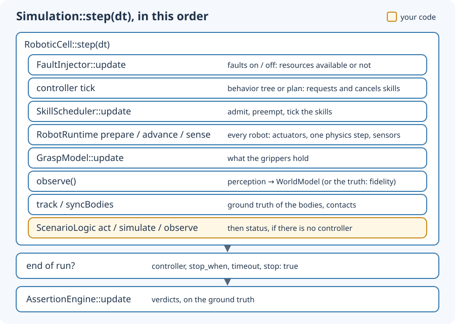

# 🛤 The path of a decision

[⏫ Architecture](README.md)

```text
Scenario (YAML)
   ↓
Behavior tree            what to do next
   ↓
SkillScheduler           may it run now? (resources, priorities, faults)
   ↓
Skills                   how to do it
   ↓
Robot / actuators        joint targets, gripper on/off
   ↓
Backend                  MuJoCo or (later) hardware
   ↓
Sensors                  camera, IMU, lidar, force/torque
   ↓
Perception               detectors
   ↓
WorldModel               the beliefs, read by the skills at the next tick
```

> **Decisions produce commands; the robot moves; sensors observe; perception updates beliefs; assertions judge on the ground truth.**

## ⏱ One simulation step

`Simulation::step(dt)` (Package, `src/RobotIK/Package/Simulation.cpp`) steps the cell (`RoboticCell::step`, Task, `src/RobotIK/Task/RoboticCell.cpp`), then judges. In this order:



The plugin is called after: `Plugin::update(dt)`, from the host.

## ⏰ Time

The clock of a run has to mean the same thing in a simulation and on a robot. It does not come from the same place.

In a simulation, RobotIK commands the time. It asks for a step of `dt`, and the world waits for the next step. This is what makes a run reproducible: the same seed gives the same run, in CI and in RL.

On hardware, the robot gives the time. RobotIK cannot ask a motor to wait. A program that adds the asked `dt` to its clock drifts from the real time: a loop at 100 Hz that falls behind still counts 10 ms per step.

The code reads the time in one place in both cases: `RobotBackend::time()`, after each step.

- MuJoCo gives its simulated time: the sum of its physics steps.
- A hardware backend gives the stamp of its last reading. When the robot has no clock in its API (MicroDuck, for example), the backend stamps each reading with the monotonic clock of the host (`std::chrono::steady_clock`) when the reading arrives.
- A backend without a clock (Pinocchio, the tests) gives nothing; the robot then adds the asked `dt`.

`RoboticCell::step` gives the decision side (tree, plan, scheduler, skills) the time measured since its last tick, in `RobotContext::dt`. In a simulation it is the asked `dt`; on hardware, a late step shows. When the clock did not move, the decision side is not ticked, and `RoboticCell::stalledSteps` counts it.

A measurement keeps the time of its capture, not the time of the step that reads it. `Measurement::stamp` is the capture time, a `LatencyBuffer` delivers a reading later with the same stamp, and a detection gives its stamp to the belief it updates. So `perception.max_age` measures the true age of a belief.

The trees read the simulated time too. `Timeout`, `Delay`, `Wait` and `Cooldown` use the clock that `RoboticCell` gives them. A `PlanExecutor` without a clock reads the time of the last context it ticked, never the wall clock.

The search of the planner is the only wall clock left in a run. Its timeout is a safety net: a plan found before it does not depend on it. A search that the timeout stops ends `TimedOut`, and the failure says that the result depends on the machine, so a CI does not trust it.
