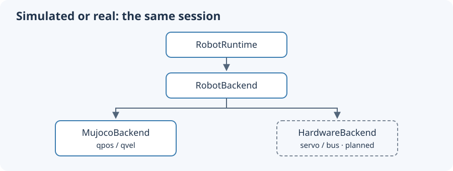

# 🤖 The robot: model, state, backend

[⏫ Architecture](README.md)

Three separate notions:

| Notion | What | Where |
|--------|------|-------|
| **Model** | The structure: links, joints, limits. From a URDF | `RobotModel`, `Kinematics` |
| **State** | What happens now: positions, velocities, efforts | `JointSet` |
| **Backend** | How to read and change the state | `RobotBackend` → `MujocoBackend` (→ a hardware driver later) |

`RobotRuntime` (`Robot/RobotRuntime.hpp`) joins them: it owns the `Robot`, its backend and its entities in the world. A skill gets only the `Robot`: why, and what each class holds, is in [What a skill sees, what runs the robot](03-robot-runtime.md).

```cpp
compages::world::World world;
robotik::AssetResolver const assets = robotik::AssetResolver::standard();
std::filesystem::path const urdf = assets.model("robotik.robots.robot_6axis");

robotik::RobotRuntime runtime(world, urdf);
auto physics = std::make_unique<robotik::MujocoBackend>();
(void)physics->load(urdf);
runtime.connect(std::move(physics));

runtime.step(Seconds(0.01));   // backend, joint states, kinematics, transforms, sensors
```

In practice, `Simulation` builds all this from the world file.

## 🔁 Simulated or real: the same code

A skill writes:

```cpp
p_context.robot.getJoints().moveTo(elbow, Radians(0.5));
```

and never:

```cpp
if (simulation) mujoco_command(...); else serial_command(...);
```

The backend does the translation:



> No physical robot has been controlled with RobotIK yet. The architecture is ready for it; the hardware backend is not written.

## 🧮 `JointSet`: structure of arrays

Joint states are stored as parallel arrays (positions[], velocities[], efforts[], targets[]), not as one small object per joint. This keeps memory compact and loops fast.

Units are part of the API contract:

| Joint | position | velocity | effort |
|-------|----------|----------|--------|
| revolute | angle (rad) | rad/s | torque (N·m) |
| prismatic | length (m) | m/s | force (N) |

Typed handles (`Revolute`, `Prismatic`) carry these units at compile time. Conversions to the simulator or the hardware stay in the backends.

## ⚡ Fast data: what is ECS, what stays a class

ECS (entity, component, system) is a way to store data: an *entity* is only an id, a *component* is plain data put on it (a pose, a reading), a *system* is a loop over all the entities that have some components. The data of one kind sits side by side in memory, so the loop is fast. Compages stores the world this way; RobotIK uses it for what runs at every step.

Rules:

1. **Find by name once, then use a handle.** A name is for people and YAML files. Searching it walks a tree and compares strings. Code that runs at every step keeps a handle found once: `JointId` for a joint, `LinkRef` (`Robot::requireLink`) for a link, `ResourceId` for a resource. A handle found during an episode is dropped at the reset and found again. A `LinkRef` is opaque (a frame index and its robot, no ECS entity) and stays good across resets; used on another robot, it throws `std::logic_error`.
2. **Many small values of one kind: arrays.** `JointSet` keeps one array per field, not one object per joint (see above).
3. **Results of the step: components.** A sensor puts its last reading on the entity of its link (`ImuReading`, `RangeScan`...). The 3D view and the inspectors read the components; they do not ask the sensor.
4. **Rare events and choices of the user: classes.** `ScenarioLogic`, `Plugin`, `PlanningEngine`, `Skill`, `SceneView`, `RobotBackend` keep virtual methods. They run a few times per step at most, and a plugin must be able to add its own kind.

**Measure before you change the storage.** The sensor pilot shows why. With 64 IMUs and 8 lidars on one arm (`tests/Sensors/BenchSensors.cpp`, physics off, debug build), a step took 130 µs. The profiler gave: 66 % to find the link of each sensor by its name at each sample, 8 % to find its kinematic frame by its name, and almost nothing to the virtual `Sensor::sample` calls. After rule 1 (`LinkRef`), a step takes 27 µs: 4.7 times faster. Same readings, same seeds, same scenario reports. A contiguous storage per sensor type would remove the virtual calls, but they cost under 1 % of the step: it is not worth the change of API today.

What costs now, in order: `compages::world::World::update` (31 %, the scene graph of Compages, outside the sensors), the IMU computation (16 %), and the copy of each reading into its component (15 %). The next candidates are, in this order: the scene graph update, then the actuators and the skills, then the grasp systems. Each one starts with a benchmark and a profile.
