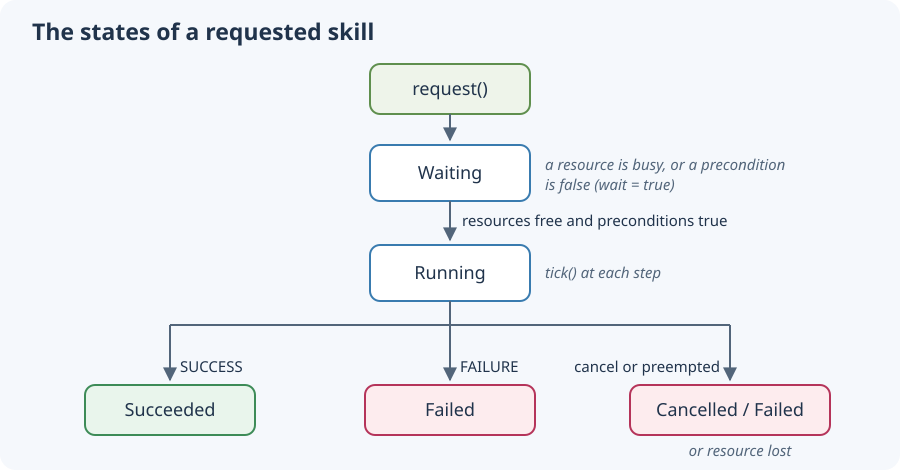

# 🔒 Resources and arbitration

[⏫ Architecture](README.md)

Several parts of a program want to move the same robot: a behavior tree, a plan, a button of the simulator, the scenario logic, later an LLM. Two of them must never drive the same arm at once, and a fault must never leave a skill running blind. This section explains how RobotIK keeps that promise, for people who change the core. How to declare resources and request skills is in [Skills, the scheduler and behavior trees](../04-skills-and-behavior-trees.md).

## 🔩 A resource and its lease

A resource is a part that two skills must not use at once in conflicting ways. Each actuator and each sensor of the world is a resource with the same name (`arm`, `gripper`, `wrist_camera`); a scenario logic can add more, for example a zone of the table. The `ResourceManager` keeps them in arrays indexed by a `ResourceId`: a name, a health (failed or not), one exclusive owner, and a count of shared users. With several robots, one manager holds the resources of the whole world, so names are unique in the world.

A `ResourceLease` is the right to use a set of resources. `acquire` gives all of them or none, so a skill never holds half of what it needs. Before acquiring, the manager sorts the requirements and merges the duplicates: a resource asked twice is held once, and exclusive access wins over shared access. An unknown id is a conflict, never a write outside the arrays. The lease gives the resources back when it is released or destroyed.

## ⚖ Who may act, who may write

Two separate mechanisms do the work.

The `SkillScheduler` decides **who has the right to act**. At each update it stops the runs that lost a resource, admits the waiting requests by priority, and ticks the running skills. It only answers and records: it never chooses what to do next.

The actuators refuse **a command without that right**. While the scheduler calls a skill, it opens a `WriterScope` with the id of the skill. A `JointGroup` or a `Motor` guards its joints with its resource, and a `VacuumGripper` guards its pump. Before each command (`moveTo`, `spin`, `push`, `release`, `suction`), `ResourceManager::checkWrite` compares the owner of the resource with the current writer. When another owner holds the resource, the command throws `std::logic_error`.

An exception is the right answer here, not a `Result`. A command that bypasses the scheduler is a mistake in the code, the same kind as an unknown joint name written in C++. Before this check, the leases were only advice: the scenario logic writes after the scheduler in a step, so its command replaced the command of the skill without any message.

Some writes are not checked, on purpose:

- A free resource stays writable. `WaveLogic` commands its joint from `act` and needs no lease, because no skill holds the arm.
- A scenario logic that wants to keep the joints for a while takes a lease itself (`resources.acquire`, owner `ANONYMOUS`). The skills that need them then wait with the reason `Busy`.
- The safe state of a failed actuator is written by the robot under the writer `SAFETY`, whoever holds the actuator.
- The measurements (`measureJoint`, `measureHolding`) and the reset are written by the `RobotRuntime`: they are not commands.

The check costs one integer compare when the resource is free, and no name is read. A joint keeps the first resource that guards it: one actuator per joint, until composite resources exist.

## 🎫 The life of one request

`request(skill)` returns a ticket, a `RunId`: the skill and the number of the request. Each caller follows and cancels its own run only. Before tickets, two callers of the same skill watched the same run, and one could cancel the run of the other.

A skill has one run at a time. A second request waits in a queue, in the order of the requests, with the reason `Queued`. When the current run ends, the next ticket becomes the run of the skill. `cancel(run)` removes a queued ticket at once and cancels the current run at the next update. `cancelAll(skill)` cancels every run of one skill: the emergency button of the simulator uses it.

A cancelled or preempted skill does not give its resources back at once: its arm may still move. The scheduler calls `Skill::cancel`, then `Skill::stopping` at each update. The run stays `Stopping`, with its resources, until `stopping` answers something other than `RUNNING`, or until `SkillDescription::stop_timeout`. A forced stop is marked in the trace. The default `stopping` ends at once, so a skill that does not need this phase does not change.

Three cases end a run at once, without the stopping phase:

| Case | Why |
|------|-----|
| A lost resource (`ResourceLost`) | The resource is gone; a stopping phase could not use it. |
| `reset()` and `cancelAll()` | A new episode, a new plan or an emergency must not wait. |
| A preemption by an urgent skill (`SkillDescription::urgent`) | The built-in `Stop` must never wait for a slow stop. |

## 🥇 Preemption: all or nothing

A request of higher priority may take the resources of a lower one, if that one is `cancellable`. The scheduler first finds every holder of every resource in conflict: exclusive owners and shared users. Only when all of them may be preempted does it stop them. If one may not, nobody is stopped and the request waits. A lease taken outside the scheduler is never preempted.

The order matters. Suppose `Wave` holds the arm and can be preempted, `Hold` keeps the gripper and cannot, and `Grasp` asks for both. A scheduler that stops the holder of the first conflict, then looks at the next one, cancels `Wave` and still cannot start `Grasp`. With two phases, `Wave` goes on and `Grasp` waits for the gripper.

The preempting request waits with the reason `Preempting` while its victims stop. A preempted run that may wait (`SkillDescription::wait`) is not over: it goes back to `Waiting`, at its place in the order, and starts again from `Skill::reset` when its resources come back. So `reset` must clear what a run keeps, and `tick` must read where the robot and the objects are now. A run that may not wait ends `Cancelled` with the reason `Preempted`.

## 🐞 Faults

A fault (`FaultInjector`) makes a resource unavailable. Running skills that hold it fail with `ResourceLost`; new requests fail with `Unavailable`. Sensor readings carry a `valid` flag that is false during the fault. No skill has special fault code: the fault is a fact, the reaction is a decision of the behavior tree.

## 🌳 What the tree sees

A behavior tree node answers `SUCCESS` or `FAILURE`, and many endings give `FAILURE`. So when a run ends, its node writes `<skill>.state`, `<skill>.reason` and `<skill>.failure` on the blackboard of the tree. A condition of the tree can then tell the cases apart:

| `<skill>.reason` | Meaning |
|------------------|---------|
| `failed` | The skill returned `FAILURE`; `<skill>.failure` gives its code (`not_seen`, `grasp_not_confirmed`), chosen by the plugin. |
| `cancelled` | A caller cancelled the run. |
| `preempted` | A higher priority took a resource, and the run may not wait. |
| `resource lost` | A resource failed during the run. |
| `unavailable` | A resource was failed before the start. |
| `precondition` | A precondition was false, and the run may not wait. |
| `busy` | A resource was held, and the run may not wait. |

A preempted run that may wait gives nothing to the tree: the node stays `RUNNING` while the run waits.

## 🔍 Who answers what

Resources, beliefs and preconditions answer different questions. A decision that comes from an AI can be wrong, so each question must have one place:

| Question about a camera and a cube | Answered by |
|------------------------------------|-------------|
| Does the camera work? Who uses it? | `ResourceManager` |
| Does the robot believe it saw the cube? | `WorldModel` |
| Is the cube really there? | the ground truth (assertions only) |
| May the robot grasp the cube now? | a precondition of the skill |
| Must the cube be in the box? | the goal of the planner |

## 🚧 Limits

- One run per skill at a time; the other requests wait.
- No composite resources yet: a group such as `upper_body` made of two arms and a torso is planned (see `ROADMAP.md`).
- No blending of commands: two skills cannot share a joint, even with compatible commands.
- The write check runs when the program runs, not when it compiles. A lease that gives a writable view of its joints would let the compiler refuse the mistake; it is planned if the runtime check is not enough.
