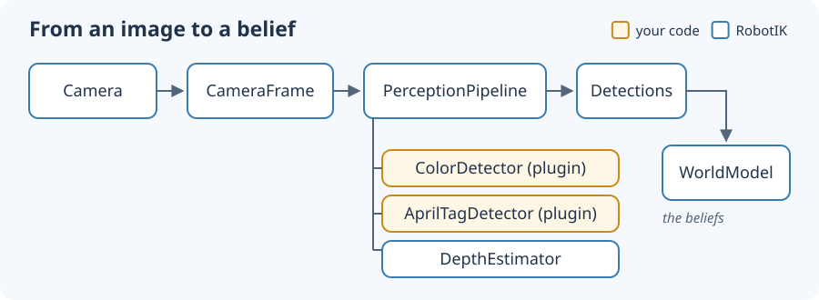
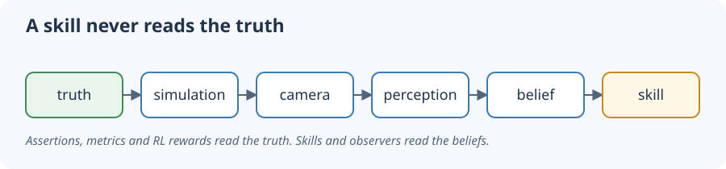

# 🔍 Truth, description, belief

[⏫ Architecture](README.md)

## 👁 Sensors, perception, WorldModel

A sensor is not its processing:

The core of RobotIK does **not** depend on OpenCV. A camera gives a generic `robotik::Image`; a plugin may use OpenCV, AprilTag or a neural network in its own detectors.

Every measurement has a common header (`Measurement`): time stamp, frame, sequence number, validity. `NoiseModel` applies bias, white noise, resolution and saturation. `LatencyBuffer` delays the delivery but keeps the capture time.

## 🧭 Three kinds of knowledge

| | Access | Used by |
|--|--------|---------|
| **Ground truth** | `RoboticCell::requirePose`, `RoboticCell::requireQuery` | assertions, reports, RL reward |
| **Description** | `RoboticCell::requireDescribedPose`, `RoboticCell::requireWaypoints` | the scenario logic, to plan |
| **Belief** | `WorldModel`, through `RobotContext` | skills |

The simulator knows `red_cube = (0.40, 0.20, 0.02)`. The robot may believe `red_cube = (0.39, 0.21, 0.03), confidence 0.87`. A good scenario tests the whole chain:

This prevents cheating by giving the skills the perfect positions. The truth enters the belief only when the scenario chooses a **perception fidelity** that asks for it, per object (`perception: { fidelity: truth }`, or `blind: truth` when no camera has an image), and the reports say so. It is a mock, as a simpler physics is: a test of the plan does not need a detector (see [Truth, description and belief](../02-worlds-scenarios-experiments.md#-truth-description-and-belief)).

Three contracts keep it honest:

1. **One entry.** Skills, PDDL observers and the scenario logic read the `WorldModel` only; `make check-layers` compiles `Task/Skills` and `Task/Planning` without `Task/RoboticCell.hpp` and `Robot/RobotRuntime.hpp`, so a truth call cannot build.
2. **Source and age.** Each belief says where it comes from (`BeliefSource`: prior, sensed, noisy truth, truth) and when it was seen. With `perception.max_age`, an older belief is unknown to the planner.
3. **An effect is seen, not assumed.** The plan executor checks the effects of each step on the beliefs; with `planner.verify: observed`, only a belief seen after the start of the step counts, so a failed grasp is not taken for a held object.

## 🔑 Who owns which state

A robot program goes wrong when two parts keep their own copy of the world and each one changes it. In RobotIK each kind of state has one writer. The others read it, or read a copy that the writer refreshes.

| State | Lives in | Written by | Read by |
|-------|----------|------------|---------|
| Physics: free bodies, contacts, the joints of a simulated robot | the MuJoCo backend (`RobotBackend` for the joints, `PhysicsWorld` for the bodies and contacts) | the physics step, from the actuator commands | `RoboticCell::syncBodies`, which copies the body poses; the robot, which reads its joints |
| Joint positions | the `JointSet` of each robot | the backend after each step (by hand when the robot has no physics) | skills through `RobotContext`; Pinocchio, for the frame poses (`getWorldPose`) |
| Ground truth of props and bodies | the Compages entities of the `RoboticCell` | `syncBodies` (a copy of MuJoCo), the grasp models (an object carried by a gripper), the reset (a prop without a body) | `RoboticCell::requirePose`, `RoboticCell::requireQuery`, the conditions, the rendering |
| Description | `RoboticCellDescription` | the YAML files or the C++ program, before the run; read-only after | the scenario logic (`requireDescribedPose`, `requireWaypoints`), the planner (the entities with a `kind` are its objects) |
| Beliefs | `WorldModel` | the perception (detectors); the cell itself at the `truth` and `noisy_truth` fidelity; the priors of the description at each reset | skills, PDDL observers, the scenario logic when it decides |
| Holders of the resources | the `ResourceManager` | the scheduler (the leases of the skills), a scenario logic that takes a lease | the actuators, before each command; the interface |
| Symbolic facts (`(in red_cube box)`) | nowhere: the observers compute them from the beliefs when the planner asks | — | the planner and the plan executor |

The last row is a choice. A list of symbolic facts kept next to the beliefs would drift from them: a plan would then go on with a fact that the camera no longer sees. Computed again at each question, a fact is never older than the belief it comes from. The cost is one call of the observer per question.

The Compages world is a copy for two readers: the rendering, and the truth of the conditions. It never decides anything.
