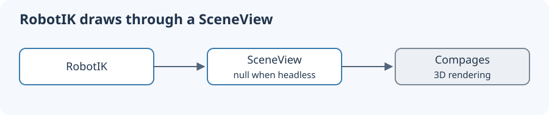
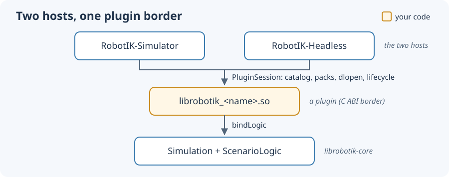

# 🔌 Hosts, plugins and the source layout

[⏫ Architecture](README.md)

## 🖼 Rendering is separate

Compages draws the 3D world. RobotIK does not render anything itself:



The core runs without a window. This is required for CI, tests, RL, benchmarks, servers, and thousands of episodes. The graphical simulator is a **client** of RobotIK, not its centre.

## 🔌 Hosts and plugins



The border between host and plugin is a **C ABI** (`include/RobotIK/Package/Plugin/PluginABI.h`): no C++ class, container or exception crosses it. `PluginAPI.hpp` wraps it in C++ for plugin authors. The manifest `plugin.yaml` is read without loading the library; the library is loaded only for the chosen scenario. Details in [Your first plugin](../../tutorials/04-your-first-plugin.md).

## 📁 Source layout

```text
include/RobotIK/          public headers (one umbrella: RobotIK.hpp)
src/RobotIK/              implementation, same folders (one library, robotik-core)
src/Simulator/            RobotIK-Simulator (ImGui window, panels)
src/Headless/             RobotIK-Headless (CLI, reports)
demos/<Name>/           one plugin each; demos/plugin.mk is the shared build recipe
data/packs/<id>/          shared asset packs (robots, tools)
tests/                    unit tests (GoogleTest)
external/                 third-party sources (downloaded)
```

| `include/RobotIK/` | Contents |
|--------------------|----------|
| `Common/` | `Math.hpp` (units, `Pose`, `Quaternion`, `Vector3`, from Compages), `Result.hpp`, `Signal.hpp`, `Config.hpp` (editable YAML tree), `Random.hpp` (`Seed`), `File.hpp`, `Version.hpp` |
| `Robot/` | `Robot`, `RobotRuntime`, `RobotModel`, `openRobot`, `JointSet`, `LinkRef`, `Kinematics` (Pinocchio), `SceneView` (rendering hooks), `Devices`, `Resources`, actuators (`Motor`, `JointGroup`, `VacuumGripper`), `TeachPendant` |
| `Robot/Sensors/` | `Sensor`, `Camera`, `Imu`, `RangeScanner`, `ForceTorqueSensor`, `Measurement`, noise models, `Image` |
| `Robot/Backends/` | `RobotBackend` (the hardware abstraction layer of one robot), `PhysicsWorld` (rays, contacts, body poses: simulation only), `MujocoBackend` (both) |
| `Robot/Assets/` | `AssetPack` (a `pack.yaml`), `AssetResolver` (`robotik.tools.vacuum` → file) |
| `Robot/Components/` | Compages components for robots and objects, queries |
| `Task/` | `RoboticCellDescription`, `RoboticCell`, `ScenarioLogic`, `SkillScheduler`, `RobotContext`, `FaultInjector`, `Metrics`, `Status` |
| `Task/Skills/` | `Skill`, `MotionSkills` (`Home`, `MoveJoint(s)`, `MoveTCP`, `Stop`), `SkillNodes` (BT bridge) |
| `Task/Perception/` | `Detector`, `PerceptionPipeline`, `Detection`, `WorldModel`, `Localization` |
| `Task/Planning/` | `Pddl` (symbols, domain schema), `PlanningDomain` (observers, bindings), `PlanningEngine` (Kairos behind it), `PlanExecutor` (plan → behavior tree, checks, replans), `PlanGraph` |
| `Task/Grasp/` | `GraspModel`: how a gripper holds an object, per physics fidelity (`AbstractGrasp`, `RigidGrasp`); container geometry |
| `Task/Learning/` | RL: `Environment`, `Space`, `SimulationEnvironment`, `EnvironmentPool`, `EpisodeLog` |
| `Task/Agents/` | `Agent`, `Observation`, `Action`: a brain that maps observations to actions |
| `Package/` | `Simulation` (scenario = cell + verdict), `RunReport` |
| `Package/Scenario/` | `World`, `Scenario`, `Experiment`, `Assertions`, `Trajectory`, `PackagePath`, `FileRole` |
| `Package/Plugin/` | `PluginABI.h` (C border), `PluginAPI.hpp` (C++ helper), `PluginCatalog`, `PluginSession`, `PluginManager`, `PluginHost` |
