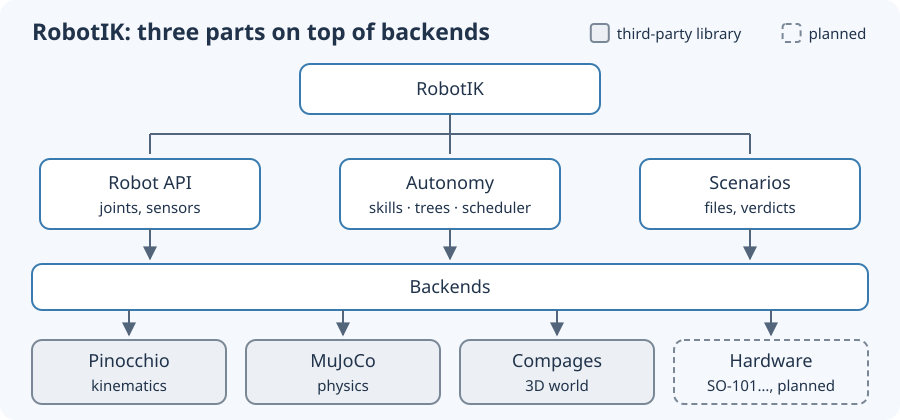
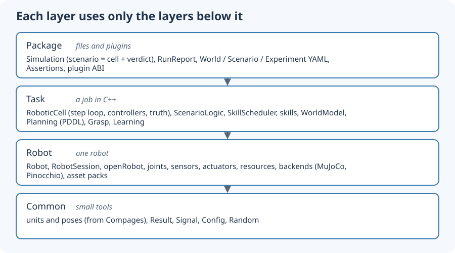

# 🏗 Architecture

[⏫ Concepts](../README.md)

These pages explain **how RobotIK is built and why**. They are for people who want to change RobotIK itself, or to understand what happens behind the API. You do not need them to write a plugin.

## 🎼 The principle: RobotIK orchestrates

RobotIK is not a monolithic simulator. It assembles specialised libraries and keeps each one in its own domain:

| Library | Responsible for | Used through |
|---------|-----------------|--------------|
| [Pinocchio](https://github.com/stack-of-tasks/pinocchio) | Forward kinematics, Jacobians, inverse kinematics | `Kinematics` |
| [MuJoCo](https://github.com/google-deepmind/mujoco) | Dynamics, contacts, integration | `MujocoBackend` |
| [Compages](https://github.com/Lecrapouille/Compages) | ECS world (entities, transforms), 3D rendering | `compages::world::World`, `SceneView` |
| [BlackThorn](https://github.com/Lecrapouille/BlackThorn) | Behavior trees | `RoboticCell::factory()`, `SkillNodes.hpp` |
| OpenCV, AprilTag | Image processing (only in some plugins) | detectors of the plugins |

RobotIK provides the layer that combines them. It does not want to become a second Pinocchio or a second MuJoCo.

### 🧅 Three layers

Like Compages (GPU, world, renderer), RobotIK is cut in layers. Each layer works without the ones above it, so a project takes the smallest one it needs (examples in [Three programs, one per layer](../../tutorials/02-three-programs.md)):

`make check-layers` (`tests/scripts/check_layers.py`) lets the compiler check the layers. It compiles every header and source alone, with an include path where only the allowed layers exist: an include towards a higher layer is "file not found", however the line is written. A header that forgets one of its own includes fails the same way. `Task/Skills` and `Task/Planning` are compiled without `Task/RoboticCell.hpp` and `Robot/RobotRuntime.hpp`: they cannot call the truth API (`RoboticCell::requirePose`, `RoboticCell::requireQuery`...) nor reach the simulator (`RobotRuntime::getWorld`, `RobotRuntime::getBackend`), because the classes are not defined there. A future split stays possible: `Package` could become `Scenario` (files) and `App` (plugins, hosts) without touching the layers below.

Contracts between modules are written at the top of each header (`@par Contract`: what it promises, what it expects, how it reports an error). Errors from files and users are a `Result`; a mistake in the code throws. Events are `Signal`s: `SkillScheduler::changed`, `Camera::frames`, `Simulation::assertionChanged` and `Simulation::ended`; the plugin session listens to them instead of polling.

## 📚 The pages

Read them in this order. Each one answers one question.

| Page | Question |
|------|----------|
| [The path of a decision](01-decision-path.md) | What happens in one step, from the tree to the sensors, and where the time comes from? |
| [The robot](02-robot.md) | How is a robot stored: model, state, backend, fast data? |
| [What a skill sees, what runs the robot](03-robot-runtime.md) | Why `Robot` and `RobotRuntime` are two classes, and what each one holds |
| [Resources and arbitration](04-resources.md) | How two skills never drive the same arm at once |
| [Truth, description, belief](05-truth-and-belief.md) | How the sensors feed the beliefs, and who owns which state |
| [Hosts, plugins and the source layout](06-hosts-and-layout.md) | Where the window, the plugins and the files are |

## 🤔 Why this separation matters

You can replace **MuJoCo** by a **hardware backend** without rewriting the scenario, the tree, the skills, the scheduler, the WorldModel or the assertions. You can replace an **OpenCV detector** by a **neural detector** without touching the scenario. This interchangeability is most of the value of RobotIK.
