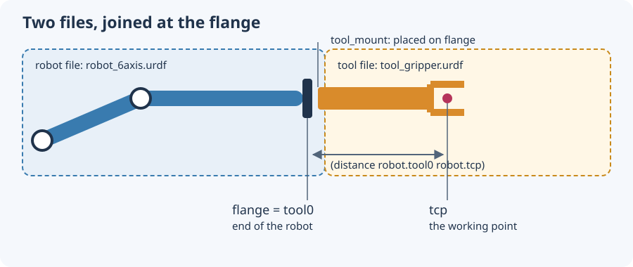

# 🔧 Mount a tool on a robot

[⏫ Guides](README.md)

A robot arm alone cannot do any work. At its end it has a flat plate, the flange, where you screw a tool: a vacuum cup to lift a box, a gripper with fingers, a drill, a welding torch. The same arm can do different jobs with different tools. In this guide you mount a tool on the arm of a world, then you check with an assertion that the tool is there and has the length that you expect.

You need to know how to write a world and a scenario ([A cube in a box](../tutorials/03-a-cube-in-a-box.md)).

## 📖 The words

Four names of frames are used in this guide. A frame is a point with three axes, attached to a part of the robot ([Frames and poses](../concepts/01-robotics-in-ten-minutes.md#-frames-and-poses)).



| Frame | Where it is | It is in |
|-------|-------------|----------|
| `flange` | The plate at the end of the arm, where a tool is screwed | the robot file |
| `tool0` | The same frame as `flange`, with its usual name in industry | the robot file |
| `tool_mount` | The face of the tool that touches the flange | the tool file |
| `tcp` | The working point of the tool (tool centre point): the tip of the drill, the face of the vacuum cup | the tool file |

The robot and the tool are two separate files, and RobotIK never merges them into one. When you mount the tool, RobotIK puts the frame `tool_mount` of the tool on the frame `flange` of the robot. If you remove the tool, the tool file does not change. [Tools and frames](../concepts/03-tools-and-frames.md) explains this choice.

The tools are in the asset pack `robotik.tools` (folder `data/packs/robotik.tools/`):

| Model | Tool |
|-------|------|
| `robotik.tools.default` | a flat plate, without function |
| `robotik.tools.vacuum` | a vacuum cup |
| `robotik.tools.gripper` | a gripper with two fingers |
| `robotik.tools.drill` | a drill |
| `robotik.tools.welding` | a welding torch |

## 🧰 1. Declare the pack

The plugin must declare each pack that it uses. In the `plugin.yaml` of your plugin, add the pack of the tools:

```yaml
resources:
  packs:
    - { id: robotik.robots, version: "1.0" }
    - { id: robotik.tools, version: "1.0" }
```

## 🔩 2. Add the tool to the world

In the world file, add the tool as an entity, after the robot. This example mounts a gripper on the arm `robot`:

```yaml
    - id: my_tool
      type: tool
      model: robotik.tools.gripper
      attach: { parent: robot.flange, frame: tool_mount }
```

`attach` mounts the tool: `parent` is the entity and the link where the tool goes (`robot.flange`), and `frame` is the frame of the tool that goes there. For a tool, the frame is always `tool_mount`.

A tool can bring its own actuators. A vacuum cup must declare its actuator, so that a skill can use it:

```yaml
    - id: vacuum
      type: tool
      model: robotik.tools.vacuum
      attach: { parent: robot.flange, frame: tool_mount }
      actuators:
        gripper: { type: vacuum }
```

The actuator `gripper` is also a resource: a grasp skill reserves it, and the assertion `(holding gripper)` reads it. If you remove the tool, its actuator goes too.

## ✅ 3. Check the tool with assertions

Add two assertions to your scenario:

```yaml
  assertions:
    - (tool_is_attached my_tool robot.flange)
    - (> (distance robot.tool0 robot.tcp) 0)
```

The first assertion is true if `my_tool` is mounted on the flange. The second one is always true when a tool is mounted. Its purpose is to print the distance from the end of the arm to the working point, which is the length of the tool. Run the scenario:

```text
[PASS] (tool_is_attached my_tool robot.flange)  ((tool_is_attached my_tool robot.flange) = 1)
[PASS] (> (distance robot.tool0 robot.tcp) 0)  ((distance robot.tool0 robot.tcp) = 0.088)
```

The gripper is 8.8 cm long. With the other tools, the same assertion gives:

| Model | `(distance robot.tool0 robot.tcp)` |
|-------|------------------------------------|
| `robotik.tools.default` | 0.016 m |
| `robotik.tools.vacuum` | 0.016 m |
| `robotik.tools.gripper` | 0.088 m |
| `robotik.tools.drill` | 0.168 m |
| `robotik.tools.welding` | 0.228 m |

If the value is not the one that you expect, the tool is not the one that you think, or its `tcp` is at the wrong place in its file. Replace the bound `0` by the length that you expect, for example `(< (distance robot.tool0 robot.tcp) 0.1)`: the scenario then fails if the tool changes.

With a tool, `robot.getTool()` in C++ gives `tcp`, and inverse kinematics puts the `tcp` on the target ([Move the arm](../tutorials/05-move-the-arm.md)). Without a tool, it gives `tool0`.

## 🔁 4. Keep other tools in storage

A world can declare several tools. Only one is mounted at a time: the one with `attach`. The others are in storage: RobotIK does not build them.

```yaml
    - { id: drill, type: tool, model: robotik.tools.drill }        # in storage
    - { id: fingers, type: tool, model: robotik.tools.gripper }    # in storage
```

In the simulator, the **Teach Pendant** panel lists the tools of the world. Choose one, and the simulator loads the scenario again with this tool mounted. Choose **None** to work without a tool, at `tool0`.

## 🚧 Limits

- The masses and inertias of the tools are estimates. They are good enough for the physics of a demo. Measure them on the real tool before you trust the dynamics.
- To use your own tool, make an asset pack ([Share 3D models in an asset pack](share-3d-models.md)). Its file must have the links `tool_mount` and `tcp`, and a prefix on its other links and joints (`gripper_finger_left_joint`), so that two tools never use the same name.
