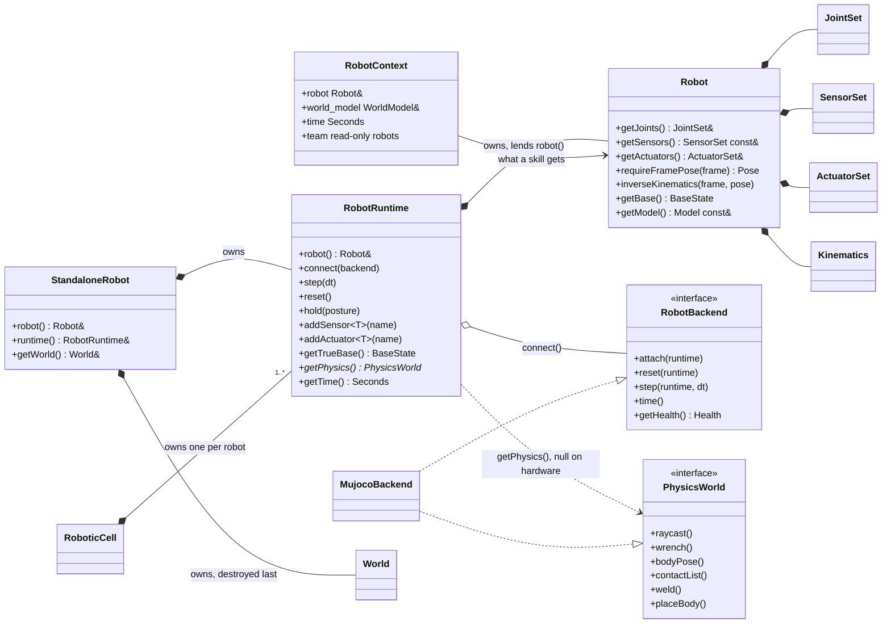
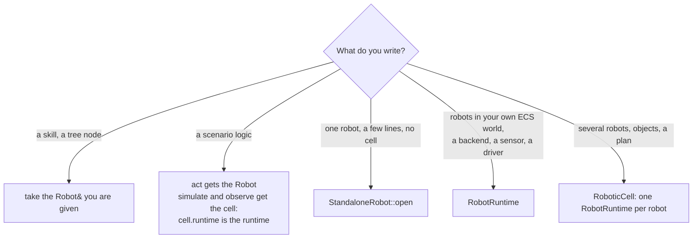
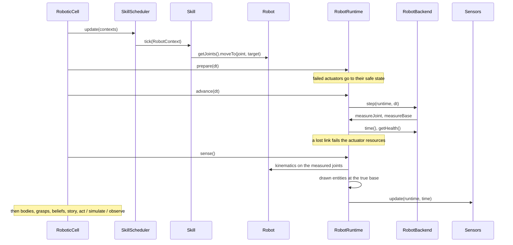

# 🤖 The robot: `Robot`, `RobotRuntime`, `StandaloneRobot`

[⏫ API reference](README.md)

One robot is seen through three classes. They do not give three robots: they give three rights on the same robot. This page explains how they fit and lists the methods you use most. Every method, with its contract, is in the Doxygen pages (`make doc`, then `doc/doxygen/html/index.html`) and in the comments of the headers.

## 🧭 Three classes, one robot

A skill must behave the same in a test, in the simulator and on the real robot. If it could read the true position of the robot, write the measure of a joint or step the physics, it would work in simulation and fail on the hardware. So the code that decides (a skill, a plan, a tree) gets a `Robot`, and the code that runs the robot (the cell, a test, a driver) gets a `RobotRuntime`. `StandaloneRobot` is a helper: a runtime and its world, built in one call.



| | `Robot` | `RobotRuntime` | `StandaloneRobot` |
|--|---------|----------------|-------------------|
| Is | the robot as a skill sees it | what runs the robot | a robot alone, with its world |
| Owns | joints, sensors, actuators, kinematics, estimated base | the `Robot`, the clock, the ECS world entities, the backend, the true base | the ECS world and the `RobotRuntime` |
| Can | read the measures and the sensors, command the joints and actuators, compute FK and IK | step, reset, write the measures, add devices, change a sensor, read the truth | everything the runtime can, through `runtime()` |
| Cannot | step, read the truth, change or add a device, reach an entity, command another robot | — | — |
| Who has it | a skill (`RobotContext::robot`), a tree node, a plan step | `RoboticCell`, a sensor, a backend, a grasp model, a test | a program with its own loop, a test, a benchmark |
| Built by | the runtime only (private constructor) | you, with an ECS world | `StandaloneRobot::open(model, setup)` |
| Header | `Robot/Robot.hpp` | `Robot/RobotRuntime.hpp` | `Robot/StandaloneRobot.hpp` |

The runtime does not derive from `Robot`: it owns it. So a skill cannot cast its `Robot&` to the runtime, and the `Robot` does not even store the world, the backend or the true base. Three checks keep it so: the storage, the compiler (`tests/Robot/TestSkillAccess.cpp`), and the layers (`make check-layers` compiles the skills without `RobotRuntime.hpp`). The long story: [What a skill sees, what runs the robot](../../concepts/architecture/03-robot-runtime.md).

## 🤔 Which one do I use?



A localization (odometry, landmarks) reads the `Robot` and writes its result with `RobotRuntime::estimateBase`: it lives on the runtime side, in the scenario logic or the plugin (no demo does it yet; see `ROADMAP.md`).

Two things a skill does not find on its `Robot`: the time, given at each tick in `RobotContext::time` and `dt` (the clock is `RobotRuntime::getTime`), and the truth (a skill reads the beliefs and `Robot::getBase`; the true base is `RobotRuntime::getTrueBase`).

## ⏱ One step of a robot in a cell

What `RoboticCell::step` does with the robot. The skills command during the tick; the runtime moves the robot after; the sensors read the result for the next tick.



With several robots, the cell calls `prepare` for all of them, then `advance` (the first one steps the shared physics), then `sense`. A `StandaloneRobot` without a cell calls the three parts in a row: `runtime().step(dt)`.

## 🧳 Get a robot in one call

```cpp
auto arm = robotik::StandaloneRobot::open("robotik.robots.robot_6axis");  // Result<StandaloneRobot>
if (!arm)
    return fail(arm.error());                                 // a missing model is a message
robotik::RobotRuntime& runtime = arm.value().runtime();      // what runs it (arm.value().step(dt) is runtime.step(dt))
robotik::Robot& robot = runtime.robot();                      // what a skill gets
robotik::JointSet& joints = robot.getJoints();
joints.moveTo(joints.requireRevolute("joint2"), 0.3_rad);
runtime.step(0.01_s);                                         // only the runtime makes time pass
```

`StandaloneRobot::open(model, setup)` takes a URDF file or an asset id ([Assets](assets.md)). Its `StandaloneRobot::Setup` has three fields, all with a default: `tool` (a `ToolMount { urdf, flange = "flange", mount = "tool_mount" }`; no URDF for a robot without tool), `home` (a [`JointPosture`](joints.md#-jointposture)), and `physics` (`std::optional<MujocoOptions>`; `std::nullopt` for no physics):

```cpp
auto legs = robotik::StandaloneRobot::open(
    "legs.urdf",
    { .physics = robotik::MujocoOptions{ .floating_base = true, .floor = true } });
```

## 🤖 `Robot`: the methods you use most

| Method | Does |
|--------|------|
| `getJoints()` | The joints: measured state and commands ([Joints](joints.md)) |
| `getSensors()` | The sensors, read only (`first<Camera>()`, `find<Imu>("imu")`) |
| `getActuators()` | The actuators, to command ([Actuators](actuators.md)) |
| `requireFramePose("frame")`, `requireWorldPose("frame")` | Forward kinematics, in the base frame or the world frame |
| `inverseKinematics("frame", pose, goal)` | Joint values that put a frame at a pose, or nothing |
| `requireLink("frame")` then `getWorldPose(link)` | A link found once, then its pose with no search by name (hot loops) |
| `getBase()` | The estimated base |
| `getModel()` | `Robot::Model`: name, URDF, work frame, joint names in `JointId` order |

## ⚙ `RobotRuntime`: the methods you use most

| Method | Does |
|--------|------|
| `RobotRuntime(world, urdf, view, tool, resources)` | Loads the robot into an ECS world; `view` null is headless; `tool` is a `ToolMount` |
| `robot()` | The `Robot` to give to the skills |
| `connect(backend)`, `step(dt)`, `reset()` | Plug what moves the joints, make time pass, start an episode |
| `hold(posture)`, `setStartPose(pose)` | The home position, the start pose of the base |
| `addSensor<T>(…)`, `addActuator<T>(…)` | The only way to add a device |
| `measureJoint`, `measureBase`, `measureHolding` | What a backend or a driver writes after each step |
| `getTrueBase()`, `getTrueWorldPose(link)` | The truth, for sensors and checks |
| `getPhysics()`, `getHealth()` | The simulated world (null on hardware), and whether the backend drives the robot |

## 🔌 `RobotBackend` and `PhysicsWorld`

One `ToolMount` (`Robot/ToolMount.hpp`) says how a tool is mounted: its URDF, the link of the robot that carries it (`flange`) and the link of the tool that lands on it (`tool_mount`). The kinematics, the drawn world and MuJoCo (`MujocoBackend::loadRobot`) read the same one, and a cell fills it from the `attach:` block of the world file.

`RobotBackend` is the hardware abstraction layer of one robot: `attach`, `reset`, `step` (commands to the motors, encoders to `measureJoint`), `time`, `getHealth`. A driver for real hardware implements it alone. `PhysicsWorld` is what only a simulator knows: rays, wrenches, body poses, contacts, welds. `MujocoBackend` implements both. The contract for a driver (time, errors, safety) is at the top of `RobotBackend.hpp` and in [the concept page](../../concepts/architecture/03-robot-runtime.md#-the-backend-hardware-abstraction-and-simulated-world).
