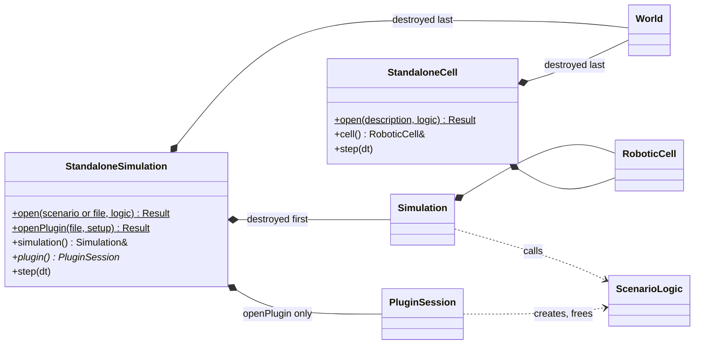

# 🏭 `RoboticCell`, `Simulation`, `StandaloneCell` and `StandaloneSimulation`

[⏫ API reference](README.md)

Header: `RobotIK/Task/RoboticCell.hpp`. The robot cell: robots, objects, one physics, the controller and the beliefs. The scenario logic receives it. A C++ program can build one from a `RoboticCellDescription`, without any file ([Three programs, one per layer](../../tutorials/02-three-programs.md)). `RobotIK/Task/StandaloneCell.hpp` builds the cell and its world in one call (see [`StandaloneCell`](#-standalonecell) below). `RobotIK/Package/Simulation.hpp` builds the cell from a scenario file and judges the run (marked *Simulation* below); `StandaloneSimulation` does it headless, in one call (see [`StandaloneSimulation`](#-standalonesimulation) below).

**The parts**

| Method | Returns |
|--------|---------|
| `robot()` | `Robot&` of the first robot, as its skills see it: joints, sensors (read only), actuators, kinematics |
| `robot(id)`, `robots()` | One robot by its entity id (or null), every robot in file order (`Robot const*`) |
| `runtime()`, `runtime(id)`, `runtimes()` | The same robots, as `RobotRuntime`: true base, backend, entities, writable sensors (for `simulate` and `observe`) |
| `skills()` | `SkillScheduler&` |
| `worldModel()` | `WorldModel&`: the beliefs |
| `perception()` | `PerceptionPipeline&`: add detectors here |
| `faults()` | `FaultInjector&` |
| `context()`, `requireContext(id)` | `RobotContext&`: what skills receive (first robot, or robot `id`; an unknown id throws) |
| `beliefFrame()` | Frame of the beliefs: the robot base when alone, the world with several robots |
| `physicsOptions()` | Options of the physics the core builds after `ScenarioLogic::setup`: tune them there (floating base, gravity compensation, step, `armature`, `damping`, `exact_inertia`); the world still adds its bodies and floor (MicroDuck) |
| `worldFrame()` | Entity of the Z-up frame of the world: hang on it what stays in the world, not on a robot root that a floating base moves |
| `factory()` | `bt::NodeFactory&`: register custom tree nodes (include `RobotIK/Task/Skills/SkillNodes.hpp`) |
| `camera()` | `Camera*`: the first camera, or null |
| `description()` | `RoboticCellDescription const&`: what the cell was built from (world, trajectories, parameters, …) |
| `logic()` | `ScenarioLogic*` |
| `planning()` | `PlanningDomain&`: observers and bindings of the PDDL planner ([The PDDL planner: reference](../pddl-planner.md)) |
| `planner()` | `PlanExecutor*`: the planner controller, or null |

**Time and run**

| Method | Does |
|--------|------|
| `run(skill, limit)` | Requests the skill and steps until it ends; returns its `SkillState` |
| `run(limit)` | Steps until the controller ends (tree, plan or scenario logic status); returns `Status` |
| `achieve(PlannerSpec)` | Plans toward the goal and runs the plan (a `planner:` block does the same); throws when domain, goal and bindings disagree |
| `status()` | `robotik::Status` of the controller (`IDLE` before the first tick) |
| `time()` | Simulated time (`Seconds`) |
| `seed()` | Seed of the current episode |
| `reset(Seed)`, `reset()` | New episode (scenario seed by default) |
| `step(Seconds dt)` | One step (see [One simulation step](../../concepts/architecture/01-decision-path.md#-one-simulation-step)) |
| `status()`, `stopController()` | State of the controller (tree, plan or scenario logic); stop ticking it |
| `perceptionOf("id")`, `perceptionSummary()` | Perception fidelity of an object (`truth`, `noisy_truth`, `sensed`) and of the run |
| *Simulation* `finished()`, `outcome()` | Has the run ended, and why (`ControllerSucceeded`, `Timeout`, `StopCondition`, …) |
| *Simulation* `checks()`, `passed()` | The assertion verdicts |
| *Simulation* `ended`, `assertionChanged` | Signals: the run ended, an assertion changed color |

**Ground truth** (for metrics and assertions, never for skills)

| Method | Returns |
|--------|---------|
| `requirePose("id")`, `requirePose("id.link")` | Current true pose of an entity or a frame; an unknown name throws |
| `initialPose("id")` | Pose at the start of the episode |
| `requireQuery("(distance a b)")` | Any value of a condition; throws on an unknown name or entity |
| `requireQuery("inside", { "a", "b" })` | A world query from C++, without text |
| `addQuery({ name, min_args, max_args, answer })` | A query of the plugin, usable in conditions |
| `compile("(inside a b)")` | A condition read once (`Result<Condition>`), then `robotik::evaluate(c, cell.metrics())` |
| `evaluate("(inside a b)")` | A full condition now, with value and verdict |
| `entity("id")` | The Compages ECS entity, or an empty handle |
| `decorate(Shape)` | Adds a visual-only object (no collision, unknown to assertions) |

**Description** (what the world file says; for planning)

| Method | Returns |
|--------|---------|
| `requireDescribedPose("id")` | Pose of the entity as written in the world file |
| `requireWaypoints("name")` | A cartesian trajectory of the scenario, in the robot base frame |

## 🧳 `StandaloneCell`, `StandaloneSimulation` (and `StandaloneRobot`)

Three classes, one per layer, with the same shape: `open` returns a `Result`, the ECS world is private and destroyed last, `step(dt)` makes time pass, and the class moves but is never assigned or copied. Use them in a program without a window: a test, the headless host, the application of a demo, an RL environment. The simulator does not use them: its world is shared with the rendering.

| Class | Layer | Owns | Scenario logic |
|-------|-------|------|----------------|
| [`StandaloneRobot`](robot.md#-get-a-robot-in-one-call) | Robot | the world and one `RobotRuntime` | none |
| `StandaloneCell` | Task | the world and a `RoboticCell` | given in C++, not owned |
| `StandaloneSimulation` | Package | the world, a `Simulation`, and the plugin library when there is one | given in C++ (`open`), or the one of a plugin, owned (`openPlugin`) |



### 🧳 `StandaloneCell`

Header: `RobotIK/Task/StandaloneCell.hpp`. A cell built from a `RoboticCellDescription` in C++, without YAML files.

```cpp
auto opened = robotik::StandaloneCell::open(std::move(description), &logic);
robotik::RoboticCell& cell = opened.value().cell();
opened.value().step(robotik::Seconds(0.01));
```

The scenario logic is not owned: it must outlive the cell. A cell cannot load a plugin library: plugins are packages, one layer above. Use `StandaloneSimulation::openPlugin` for that.

### 🎬 `StandaloneSimulation`

Header: `RobotIK/Package/StandaloneSimulation.hpp`. A scenario, its verdict and its world, headless; with `openPlugin`, also the plugin library of the scenario.

```cpp
// The scenario logic of a plugin package: found from the file, loaded, owned.
auto opened = robotik::StandaloneSimulation::openPlugin("lib/robotik/plugins/HelloWorld/scenarios/reach.scenario.yaml");
if (!opened)
    return fail(opened.error());          // not a package, a missing dependency, a bad world
robotik::Simulation& simulation = opened.value().simulation();
while (!simulation.finished())
    opened.value().step(robotik::Seconds(0.01));   // the simulation, then Plugin::update
```

| Member | Does |
|--------|------|
| `open(scenario, logic)`, `open(file, logic)` | A scenario (or its file) with a scenario logic written in C++, not owned |
| `openPlugin(file, setup)` | Finds the package of the file, loads its library, creates its scenario logic, builds the simulation, starts the plugin |
| `step(dt)` | Steps the simulation (unless the plugin owns the clock), then calls the plugin |
| `simulation()`, `plugin()`, `getWorld()` | The simulation; the `PluginSession` (null after `open`); the world |

`PluginSetup` has two fields: `plugins`, one more folder to search for packages (tests), and `scenario`, a function that reads the scenario with the asset packs of the package (an experiment case applies its overrides there; empty reads the file).

The order of destruction is the one a plugin needs: the simulation first, then the plugin frees its scenario logic and closes its library, then the world. Each `openPlugin` loads the library again, so a run never inherits the state of the previous one.
