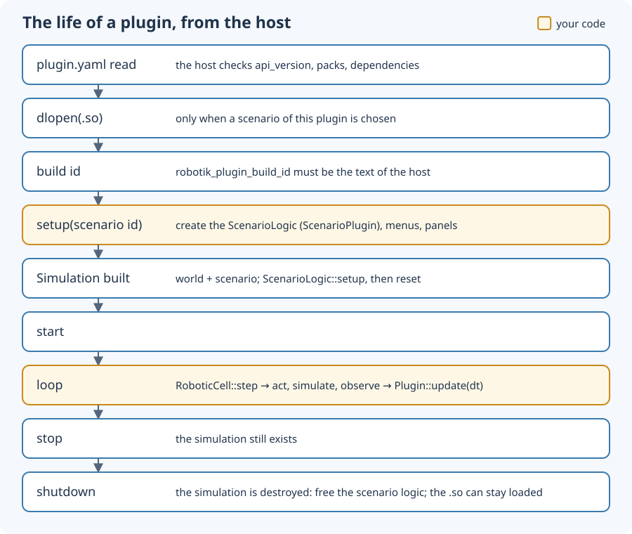

# 🔌 Plugins

[⏫ Reference](README.md)

## 🔌 The plugin class

`src/Plugin.cpp` is the entry point. Most plugins only say which scenario logic runs each scenario. This is all the Painter needs:

```cpp
class PainterPlugin final: public robotik::ScenarioPlugin
{
public:

    // The id must match plugin.id in plugin.yaml.
    static robotik::PluginInfo describe()
    {
        return { .id = "robotik.painter" };
    }

    // Scenario id (as in plugin.yaml) -> the scenario logic it runs.
    PainterPlugin()
        : ScenarioPlugin({ { "painter", robotik::logic<PainterLogic>(false) },
                          { "painter_pddl", robotik::logic<PainterLogic>(true) },
                          { "painter_pabt", robotik::logic<PainterLogic>(true) } })
    {
    }
};

ROBOTIK_EXPORT_PLUGIN(PainterPlugin)     // exports the C functions the host looks for
```

`robotik::logic<T>(args...)` builds a `T` with these arguments when the scenario starts. `ScenarioPlugin` creates the scenario logic, gives it to the simulation, and frees it at the end. An id that is not in the table stops the setup with `unknown scenario 'x' (this plugin runs: painter, painter_pddl, painter_pabt)`. One plugin, one library, many scenarios.

HelloWorld adds a key binding, a menu item and a panel. It calls `ScenarioPlugin::setup` first, then uses the host:

```cpp
    void setup(robotik::Host& p_host, std::string_view p_scenario) override
    {
        ScenarioPlugin::setup(p_host, p_scenario);
        m_host = p_host;
        p_host.subscribe(ROBOTIK_EVENT_KEY_PRESSED);
        p_host.addMenuItem("Hello world", "Home", [this] { home(); });
        p_host.addPanel("hello_world", "Hello world",
                        [this](robotik::Canvas const& p_canvas) { draw(p_canvas); });
    }
```

### 🔄 Lifecycle

A plugin binary works only with the RobotIK build that made it. The C table of `PluginABI.h` carries two C++ objects (the `Simulation` and the `ScenarioLogic`), so both sides must agree on their layout: same RobotIK version, compiler and standard library. The host compares the build id of the plugin with its own (`PluginBuildId.hpp`) and refuses another one, with both texts in the message. Build the plugins with the SDK of the host.



| `Plugin` method | When |
|-----------------|------|
| `setup(host, scenario)` | Prepare the scenario logic, subscriptions, menu and panel |
| `start(host)` | The run starts |
| `update(host, dt)` | After each step (or *instead of* the step with `host.clock: plugin`); `dt` is a `robotik::Seconds` |
| `onEvent(host, event)` | A subscribed event arrives |
| `pause(host, paused)` | The user pressed Pause / Play |
| `stop(host)` | End of the run; the simulation still exists |
| `shutdown(host)` | Free the scenario logic; the simulation is already destroyed (`ScenarioPlugin` does it) |

Override only what you need; each method does nothing by default. When a method cannot go on, it throws. The exception stops at the plugin border: the user sees its message, and the host gets an error status (`ROBOTIK_PLUGIN_ERR_SETUP` from `setup`). It does not crash the host.

### 🏠 Host services

| `robotik::Host` method | Does |
|------------------------|------|
| `bindLogic(logic)` | Gives the scenario logic to the simulation that will be built |
| `simulation()` | The running `Simulation*`, or null before it exists |
| `log(level, text)` / `error(text)` | Messages (`ROBOTIK_LOG_INFO`, `_WARNING`, `_ERROR`) |
| `subscribe(kind)` | Receive one kind of event in `onEvent` |
| `addMenuItem(menu, item, action)` | A menu entry in the simulator; `action` is a lambda |
| `addPanel(id, title, draw)` | A panel in the simulator; `draw` receives a `robotik::Canvas` |
| `removeUi(handle)` | Remove a menu entry or a panel |
| `scenarioPath()` | The path of the scenario file |

Events (`RobotIKEvent::kind`): `ROBOTIK_EVENT_KEY_PRESSED` (`code` = key), `_SCENARIO_STARTED`, `_SCENARIO_STOPPED`, `_SKILL_COMPLETED`, `_SKILL_FAILED` (`name` = skill), `_ASSERTION_CHANGED` (`name` = assertion, `flag` = passes).

### 🪟 Menus and panels

The border between the host and the plugin is C, so that compilers and versions can differ. `Host` keeps your lambdas alive on the plugin side and gives the host C functions: you write `[this] { home(); }`. An exception in a lambda is reported to the user, like an exception in a plugin method.

```cpp
    void draw(robotik::Canvas const& p_canvas) const
    {
        p_canvas.text("scenario " + scenario());
        p_canvas.text("updates=" + std::to_string(m_updates) +
                      " keys=" + std::to_string(m_keys) +
                      " homes=" + std::to_string(m_homes));
        if (ReachLogic const* reach = logic<ReachLogic>())
        {
            p_canvas.text("reach error " + std::to_string(reach->error()) + " m");
        }
    }
```

`scenario()` and `logic<T>()` come from `ScenarioPlugin`: the id of the scenario, and the scenario logic as a `T` (null when the scenario runs another scenario logic).

`Canvas` offers `text`, `textColored`, `button`, `checkbox`, `radio`, `sliderInt` and `separator`. It is valid **only during the draw call**: never keep it.

The menu entry **Hello world → Home** (and the key **H**) asks the simulation to run the built-in skill `Home`:

```cpp
    void home()
    {
        ++m_homes;
        if (robotik::Simulation* simulation = m_host.simulation())
        {
            robotik::SkillScheduler& skills = simulation->cell().skills();
            if (robotik::SkillId const id = skills.find("Home"); id != robotik::NO_SKILL)
            {
                skills.request(id);
            }
        }
    }
```

## 📄 `plugin.yaml` reference

```yaml
plugin:
  id: robotik.painter              # stable id; describe() returns the same
  name: Robotic painter            # shown in the Demos menu
  version: 1.0.0                   # major.minor.patch
  api_version: 1                   # C ABI version the library was built for
  category: Manipulation
  description: A robot arm paints colored strokes on an easel.   # optional

library:
  entrypoint: librobotik_painter.so

resources:
  directory: data                  # the asset pack of this plugin (optional)
  packs:                           # packs needed at run time
    - { id: robotik.robots, version: "1.0" }
    - { id: robotik.tools, version: "1.0" }

dependencies:
  plugins: []                      # other plugins that must be in the catalog
  system: []                       # system libraries, with license (see below)
  thirdparties: []                 # cloned libraries, with license (see below)

host:
  graphics: false                  # true: simulator only, Headless refuses it
  clock: simulation                # plugin: update() advances time itself
  view: { eye: [1.6, 1.2, 1.6], target: [0.35, 0.15, 0.0] }   # simulator camera

scenarios:
  directory: scenarios
  entries:
    - { id: painter, name: Robotic painter, file: painter.scenario.yaml }
    # optional: a submenu of the Demos menu, and a clock for this scenario only
    # - { id: painter_rl, name: Painter RL, file: painter_rl.rl.yaml, menu: Learning, clock: plugin }

experiments:
  directory: experiments
  entries:
    - { id: painter_experiment, name: Painting benchmark, file: painter.experiment.yaml }
```

| Key | Notes |
|-----|-------|
| `library.entrypoint` | A file name ending in `.so`, with no folder and no `..` |
| `resources.packs` | A missing pack, or one with an incompatible version: the scenario is refused with the reason. Version `"1.2"` accepts 1.2.0 and any newer 1.x, not 2.0 |
| `host.clock: plugin` | The host does not call `Simulation::step`: `update(dt)` advances the simulation. Default for every scenario; an entry can change it with its own `clock:` (the RL scenario of PickAndPlace) |
| `entries[].menu` | Groups the scenario in a submenu of the **Demos** menu (PickAndPlace: Behavior tree, Reinforcement learning) |
| `scenarios.entries` | Without `entries`, every runnable file of the folder is taken: `*.scenario.yaml`, `*.rl.yaml`, `*.experiment.yaml`, and an older YAML file without a role. Trees, domains and trajectories are skipped. The id is the name without the double extension |

### 📚 Third-party libraries of a plugin

A library that only one plugin uses is declared in the `<Name>.mk` of the plugin, as a target of [MyMakefile](https://github.com/Lecrapouille/MyMakefile): fetched on the first build, at the commit locked in `external/versions.lock`, and built once in the cache of MyMakefile. `dependencies:` of `plugin.yaml` lists them with their license, for the credits of the Plugin panel of the simulator:

```yaml
dependencies:
  system:                          # installed on the system: pkg-config names
    - { name: opencv4, license: Apache-2.0 }
  thirdparties:                    # declared in <Name>.mk
    - { repo: AprilRobotics/apriltag, license: BSD-2-Clause, description: AprilTag fiducial detection }
    - { name: onnxruntime, url: "https://onnxruntime.ai", license: MIT }
```

| Field | Notes |
|-------|-------|
| `repo` | GitHub `user/repo[@ref]` |
| `name`, `url` | A library without a repository (a release of binaries) |
| `license` | SPDX name. Required: without it the library shows "not checked" |
| `description` | Optional. Put a value with a comma between quotes |

`plugins/LineFollower/LineFollower.mk` builds AprilTag with its CMake, and is not built when OpenCV is not installed:

```make
ifeq ($(call robotik-missing,opencv4),)
    TARGETS += apriltag robotik_line_follower
    apriltag.GIT := https://github.com/AprilRobotics/apriltag.git
    apriltag.TYPE := cmake
    apriltag.PUBLIC_INCLUDES := include/apriltag
    apriltag.LIBRARIES := apriltag

    robotik_line_follower.SOURCES := src/*.cpp
    robotik_line_follower.DEPENDS := apriltag
    robotik_line_follower.PKG_CONFIG := opencv4
    $(eval $(call ROBOTIK_PLUGIN,robotik_line_follower,LineFollower))
else
    $(call print-warning,LineFollower skipped: ...)
endif
```

A release of binaries is a target with a `URL` (ONNX Runtime: `$(eval $(ROBOTIK_ONNXRUNTIME))` of `plugins/plugin.mk`); data made by a script is a Make rule the plugin target depends on (`MicroDuck.mk`).

## 🔎 Where the hosts look for plugins

Nothing depends on the current folder. Both hosts search, in this order:

1. the path given to `scan`, if any;
2. each folder of `$ROBOTIK_PLUGINS` (separated by `:`);
3. `plugins/` next to the executable;
4. `../lib/robotik/plugins` from the executable: `build/linux-gcc-debug/lib/robotik/plugins` in the build tree, `lib/robotik/plugins` of the install prefix.

A scenario given by its path brings its package with it: `RobotIK-Headless plugins/Painter/scenarios/painter.scenario.yaml` works from the sources; the library is searched next to the manifest, then next to the executable.

## ✅ Good rules for a plugin

- **The plugin does not own the world.** The `Simulation` builds the entities from the world file and destroys them. Find them by id (`cell.entity("canvas")`, `cell.requirePose("canvas")`); never keep a pointer to a world object after `shutdown`.
- **A reset rebuilds the state** without unloading the plugin: put all episode state back in `ScenarioLogic::reset`.
- **Skills see beliefs, not truth.** In a skill, use `RobotContext` (`robot`, `world_model`). Ground truth (`RoboticCell::requirePose`) is for metrics and assertions.
- **Publish metrics, do not judge.** The scenario file holds the verdict.
- **Units are SI**: metres, radians, seconds. Use the typed handles (`Revolute`, `Prismatic`, `Seconds`, `Radians`) when you can.
- **Headless first.** `view` is null and there is no camera image in headless: your scenario logic must still work (see `perception.blind`).

Next: [Skills, the scheduler and behavior trees](../concepts/04-skills-and-behavior-trees.md).
