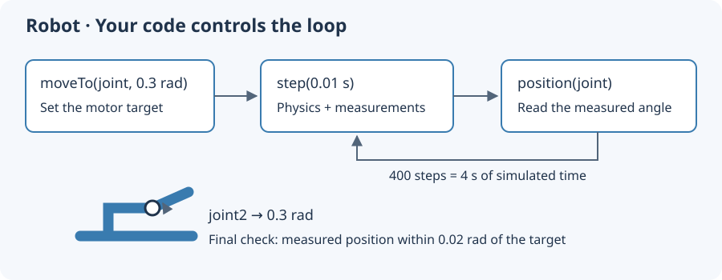
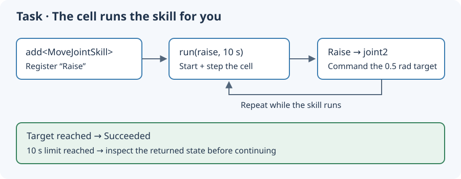
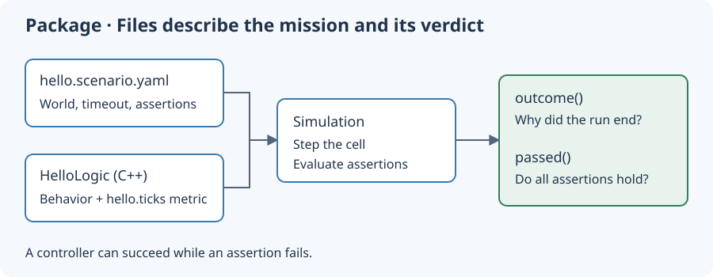

# 🧅 Three programs, one per layer

[⏫ Tutorials](README.md)

Before you write a plugin, you want to know how much code RobotIK asks for, and what it does for you. RobotIK has three layers, and each layer works without the layers above it. In this tutorial you read and run three small programs, one per layer:

1. With the Robot layer, you move one joint of an arm.
2. With the Task layer, you run a skill on a robot and a cube.
3. With the Package layer, you load a scenario file, and RobotIK judges the run.

Each program uses the layer below it. At the end, you know which layer fits your project.

| Layer | Use it when you want to… | It manages |
| ----- | ------------------------ | ---------- |
| Robot | command one robot from your own loop | the robot model, its joints, its devices, the physics |
| Task | make robots do a job | the robotic cell, the skills, the behavior trees, the plans |
| Package | describe and judge a mission in files | the scenario files, the assertions, the run report |

A robotic cell (cell) is the robots and the objects that share a world. A skill is one behaviour of the robot, for example "move a joint to an angle". The [glossary](../reference/glossary.md) defines the other words. If robots are new to you, read [Robotics in ten minutes](../concepts/01-robotics-in-ten-minutes.md) first.

## ▶ Run the three programs

The three programs are tests of RobotIK: the project compiles and runs them at each `make check`, so they stay correct. Build RobotIK and its tests as [Getting started](01-getting-started.md#-build) shows. Then run this command from the root of the repository:

```bash
./build/linux-gcc-debug/bin/RobotIK-tests --gtest_filter='OpenRobot.MovesAJointInAFewLines:LayerExamples.TaskRunsOneSkill:LayerExamples.PackageScenarioFile'
```

The last lines of the output are:

```text
[==========] 3 tests from 2 test suites ran. (126 ms total)
[  PASSED  ] 3 tests.
```

No window opens: the three programs run without a display. Each test reads the joint positions or the state of the world to know what happened.

The code below comes from [TestOpenRobot.cpp](../../tests/Robot/TestOpenRobot.cpp) and [TestLayerExamples.cpp](../../tests/Examples/TestLayerExamples.cpp). Open these files to see the includes. Three names come from the tests and not from RobotIK:

- `repoFile` makes a path from the root of the repository.
- `ASSERT_TRUE` stops the test if a file does not load.
- `EXPECT_EQ` and `EXPECT_NEAR` compare a result with the expected value.

A function that loads a file returns a `Result`. If the load fails, `.error()` tells what went wrong. In your program, test the `Result` before you call `.value()`.

## 🦾 1. Move a joint: the Robot layer



The first program has one robot, no object and no controller. A [URDF](../reference/glossary.md#-robot) file describes the links and the joints of the robot. `openRobot` reads this file and opens a session that steps the physics.

```cpp
// Load the robot model and create its simulation session.
auto arm = robotik::openRobot(repoFile("data/packs/robotik.robots/robot_6axis.urdf").string());
ASSERT_TRUE(arm) << arm.error();

// Find joint2 and set its target to 0.3 radians.
robotik::JointSet& joints = arm.value()->joints();
robotik::Revolute const joint = joints.requireRevolute("joint2");
joints.moveTo(joint, robotik::Radians(0.3));

// Simulate four seconds, then check the measured angle.
for (int i = 0; i < 400; ++i)
{
    arm.value()->step(robotik::Seconds(0.01));
}
EXPECT_NEAR(joints.position(joint).value(), 0.3, 0.02);
```

`requireRevolute` finds the joint `joint2` in the model and returns a handle. Keep the handle: the next calls use it without a search by name. If the name is wrong, `requireRevolute` throws, because a name written in the code is a mistake of the programmer.

`moveTo` gives the joint a target of 0.3 radians and returns at once. The motor needs time to move the joint. Each `step` advances the physics by 0.01 s and measures the joints again. The 400 steps make four seconds of simulated time, which takes less than a second on a computer. At the end, the measured position is at 0.3 rad, within 0.02 rad.

Use this layer if your program already has its own control loop. You decide when to send a command, when to step, and what to read.

## 🔧 2. Run a skill: the Task layer



The second program describes a robot and a cube in C++. An `EntitySpec` is the data of one item of the world. `RoboticCellDescription` collects the items. At this point, nothing is built.

```cpp
// Define a 6-axis robot arm
robotik::EntitySpec arm;
arm.id = "arm";
arm.type = robotik::EntitySpec::Type::Robot;
arm.model = repoFile("data/packs/robotik.robots/robot_6axis.urdf");

// Define a 4 cm cube
robotik::EntitySpec cube;
cube.id = "cube";
cube.shape = robotik::ShapeSpec{};
cube.pose.position = robotik::Vector3(0.4, 0.2, 0.02);

// Put the arm and the cube in the same world.
robotik::RoboticCellDescription description;
description.world.entities = { arm, cube };
```

The `id` is the name of the item in the world. The default `ShapeSpec` is a cube with sides of 4 cm. Positions are in metres, with z up: the centre of the cube is 2 cm above the floor, so the cube sits on the floor.

Then the program opens the cell, adds a skill and runs it:

```cpp
// Build the cell from its description.
auto opened = robotik::openRoboticCell(std::move(description));
ASSERT_TRUE(opened) << opened.error();
robotik::RoboticCell& cell = *opened.value();

// Register Raise and run it with a ten-second limit.
auto const raise = cell.skills().add<robotik::MoveJointSkill>({ .name = "Raise" }, "joint2", 0.5);
EXPECT_EQ(cell.run(raise, robotik::Seconds(10.0)), robotik::SkillState::Succeeded);
```

`openRoboticCell` builds the world and its physics, without a window. The cell belongs to `opened`: keep `opened` alive while you use `cell`.

`add<MoveJointSkill>` registers a skill named `Raise` that moves `joint2` to 0.5 radians. The skill does not start yet. `run` asks the scheduler to start it, then steps the cell until the skill ends. The skill succeeds when the measured position of the joint reaches its target.

The ten seconds are a limit of simulated time. If the skill has not ended at the limit, `run` returns `Waiting` or `Running`. Test the returned state before the next step of your program.

Use this layer without a controller if your C++ code chooses the next skill. A behavior tree or a plan uses the same scheduler to run its skills.

A cell can also receive a goal instead of a skill, with `cell.achieve(goal)`: a planner then chooses the skills. [A planned pick and place](08-a-planned-pick-and-place.md) shows it.

## 📦 3. Load a scenario: the Package layer

In the first two programs, C++ code builds the world and tells what a success is. A scenario file tells the same in YAML: the world, the time limit, and the assertions that must hold. Here is [hello.scenario.yaml](../../plugins/HelloWorld/scenarios/hello.scenario.yaml):




```yaml
scenario:
  id: hello
  description: Count the simulation steps, then stop after two seconds.
  world: worlds/arm.world.yaml
  seed: 1
  timeout: 30
  assertions:
    - controller.success
    - (> hello.ticks 100)
    - (< time 3)
```

The test also has a small scenario logic, `HelloLogic`. It counts the steps, publishes the count as the metric `hello.ticks`, and tells success after two seconds of simulated time. The program loads the file and steps the simulation until the run ends:

```cpp
auto scenario = robotik::loadScenario(
    repoFile("plugins/HelloWorld/scenarios/hello.scenario.yaml"), testAssets());
ASSERT_TRUE(scenario) << scenario.error();

HelloLogic logic;
compages::world::World world;
robotik::Simulation simulation(world, scenario.take(), nullptr, &logic);
while (!simulation.finished())
{
    simulation.step(robotik::Seconds(0.01));
}

EXPECT_TRUE(simulation.passed());
EXPECT_EQ(simulation.outcome(), robotik::Simulation::Outcome::ControllerSucceeded);
```

`testAssets()` tells where the robot models are. `scenario.take()` moves the description of the cell into the simulation. `nullptr` is the scene view: there is none, so nothing is drawn. Keep `world` and `logic` alive as long as `simulation`.

Each `step` steps the cell and evaluates the assertions. `outcome()` tells why the run ended. `passed()` tells if all the assertions hold. The two are different: a controller can succeed and an assertion can still fail.

The C++ code publishes a number, and the YAML file says what a good number is. To change `(> hello.ticks 100)`, you edit the file and you do not compile again. The Package layer reads the files and judges the run. The Task layer below it still runs the cell and its skills.

The simulator and RobotIK-Headless step the simulation for you. They load your scenario logic and your files from a plugin: [Your first plugin](04-your-first-plugin.md) shows how.

## 🧅 Which layer for your project?

| Your project | Layer | You write |
|--------------|-------|-----------|
| A program that already has its own control loop, for one robot | Robot | the loop: commands, steps, measures |
| A C++ program that chooses the skills of a robot cell | Task | the cell description, the skills, the order |
| A mission to test in CI, to show in the simulator, or to use for learning | Package | a plugin: YAML files and a scenario logic |

Most projects use the Package layer, because the hosts (the simulator and RobotIK-Headless) then do the loop, the window and the report for you. The next tutorials use it. The two other layers stay available inside a plugin: a scenario logic commands the joints of the Robot layer, and registers skills on the scheduler of the Task layer.

## 🔗 Next

- Change the world and the scenario without C++: [A cube in a box](03-a-cube-in-a-box.md).
- Write your own scenario logic: [Your first plugin](04-your-first-plugin.md).

Next: [A cube in a box](03-a-cube-in-a-box.md).
