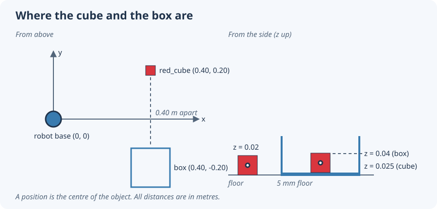

# 🧊 A cube in a box

[⏫ Tutorials](README.md)

To test a robot, you change the scene and the definition of a good run many times. In RobotIK both are YAML files, so you do not compile C++ again after a change. In this tutorial, you add a red cube and a box to a world, you write two assertions about them, and you make the cube move a little at each run.



You work on HelloWorld, the tutorial plugin. Its scenario `hello` is the one that you ran in [Getting started](01-getting-started.md). It uses two files:

| File | It says |
|------|---------|
| `doc/tutorials/HelloWorld/worlds/arm.world.yaml` | what exists at the start: one robot arm |
| `doc/tutorials/HelloWorld/scenarios/hello.scenario.yaml` | which world to load, and what must be true for the run to pass |

> [!NOTE] The programs read a copy of these files in `build/linux-gcc-debug/lib/robotik/plugins/HelloWorld/`. Change the files in `doc/tutorials/HelloWorld/`, then run `make robotik_hello_world` to update the copy. Step 6 restores the two files at the end.

## 🧱 1. Add a cube and a box to the world

Open `doc/tutorials/HelloWorld/worlds/arm.world.yaml`. The world has one entity: the robot. Add a red cube and a box at the end of the `entities` list:

```yaml
    - id: red_cube
      type: prop
      shape: { type: box, size: [0.04, 0.04, 0.04] }    # 4 cm cube
      color: [0.9, 0.1, 0.1]                             # red, green, blue in [0, 1]
      pose: { position: [0.40, 0.20, 0.02] }

    - id: box
      type: prop
      shape: { type: container, size: [0.16, 0.16, 0.08] }   # an open box
      pose: { position: [0.40, -0.20, 0.04] }
```

A `prop` is an object without physics: it stays where it is, unless the robot grasps it. A `container` is a box with a floor, four walls and no top. The [world file reference](../reference/world-file.md) lists the other types of entities.

Positions are in metres, and z points up. A position gives the centre of the object. The cube is 4 cm high, so its centre is at z = 0.02 and the cube sits on the floor.

## ✅ 2. Write what must be true

Open `doc/tutorials/HelloWorld/scenarios/hello.scenario.yaml`. Add the last two lines to its list of assertions:

```yaml
  assertions:
    - controller.success
    - (> hello.ticks 100)
    - (< time 3)
    - (< (distance red_cube box) 0.05)
    - (inside red_cube box)
```

An [assertion](../reference/glossary.md#-scenarios-and-runs) is a condition that must be true for the run to pass. Conditions use the notation of PDDL: the operator comes first, between brackets. `(< (distance red_cube box) 0.05)` means "the distance between the centres of the cube and of the box is less than 5 cm". `(inside red_cube box)` means "the cube is within the walls of the box". The [scenario file reference](../reference/scenario-file.md#-assertions) lists all the conditions.

## ▶ 3. Run the scenario

Build the plugin, then run the scenario without a window:

```bash
make robotik_hello_world
./build/linux-gcc-debug/bin/RobotIK-Headless build/linux-gcc-debug/lib/robotik/plugins/HelloWorld/scenarios/hello.scenario.yaml
```

The two new assertions fail:

```text
[PASS] controller.success  (controller.success = 1)
[PASS] (> hello.ticks 100)  (hello.ticks = 200)
[PASS] (< time 3)  (time = 2)
[FAIL] (< (distance red_cube box) 0.05)  ((distance red_cube box) = 0.4005)
[FAIL] (inside red_cube box)  ((inside red_cube box) = 0)
[FAIL] default                  seed=1      controller succeeded at 2 s  time=2
         FAIL (< (distance red_cube box) 0.05)  ((distance red_cube box) = 0.4005, expected < 0.05, at 2 s)
         FAIL (inside red_cube box)  ((inside red_cube box) = 0, expected != 0, at 2 s)
hello: 0/1 runs passed
```

The result is correct. The centres are 0.40 m apart on y and 0.02 m apart on z, which gives 0.4005 m. The controller succeeded, but the run fails, because an assertion is false. The exit code of RobotIK-Headless is 2, so a CI job sees the failure.

## 🧊 4. Put the cube in the box

Move the cube into the box in the world file. The floor of the box is 5 mm thick, so the centre of the cube is at z = 0.005 + 0.02 = 0.025:

```yaml
      pose: { position: [0.40, -0.20, 0.025] }
```

Run `make robotik_hello_world` and the same command again. All the assertions pass:

```text
[PASS] (< (distance red_cube box) 0.05)  ((distance red_cube box) = 0.015)
[PASS] (inside red_cube box)  ((inside red_cube box) = 1)
[PASS] default                  seed=1      controller succeeded at 2 s  time=2
hello: 1/1 runs passed
```

The distance is 0.015 m: the centre of the box is at z = 0.04, and the centre of the cube is at z = 0.025.

To see the scene, open the same scenario in the simulator:

```bash
./build/linux-gcc-debug/bin/RobotIK-Simulator build/linux-gcc-debug/lib/robotik/plugins/HelloWorld/scenarios/hello.scenario.yaml
```

Here, you moved the cube yourself. In a real mission, the robot moves the cube. The PickAndPlace plugin does that, with the same cube, the same box and the same `(inside red_cube box)` assertion ([case study](../case-studies/pick-and-place.md)).

## 🎲 5. Move the cube at random

A real object is never exactly at the position you expect. To test this, RobotIK can move an object by a random distance at the start of each run. Add a `randomize` line to the cube:

```yaml
      pose: { position: [0.40, -0.20, 0.025] }
      randomize: { x: [-0.02, 0.02], y: [-0.02, 0.02] }   # ± 2 cm
```

The random numbers come from the [seed](../reference/glossary.md#-scenarios-and-runs) of the scenario (`seed: 1` in the file). The same seed always gives the same run. The option `--seed` gives another seed:

```bash
./build/linux-gcc-debug/bin/RobotIK-Headless build/linux-gcc-debug/lib/robotik/plugins/HelloWorld/scenarios/hello.scenario.yaml --seed 7
```

The cube moves less than 2 cm, so it stays in the box and the run passes. The distance shows that the cube is at another place:

| Seed         | `(distance red_cube box)` |
| ------------ | ------------------------- |
| 1 (the file) | 0.0178148                 |
| 7            | 0.0171384                 |

Run each command two times: you get the same distance each time. Each line of the report gives the seed of its run (`seed=7`). If a run fails in CI, run it again with this seed to get the same failure on your computer.

Now the file and the world are different. The assertions read the true position, after the random move. The skills of the robot do not read it: they read the beliefs of the robot, which come from its camera. A skill that uses the position written in the file can miss the cube by 2 cm. With `randomize`, you test that the robot looks for the cube instead. [Truth, description and belief](../concepts/02-worlds-scenarios-experiments.md#-truth-description-and-belief) explains the three sources of a position.

## 🔙 6. Restore the files

When you are done, put the two files back as they were, then build again:

```bash
git checkout doc/tutorials/HelloWorld/worlds/arm.world.yaml doc/tutorials/HelloWorld/scenarios/hello.scenario.yaml
make robotik_hello_world
```

## 🔗 Next

You changed the scene and the verdict without C++. To make the robot do something, you write C++ in a plugin.

Next: [Your first plugin](04-your-first-plugin.md).
