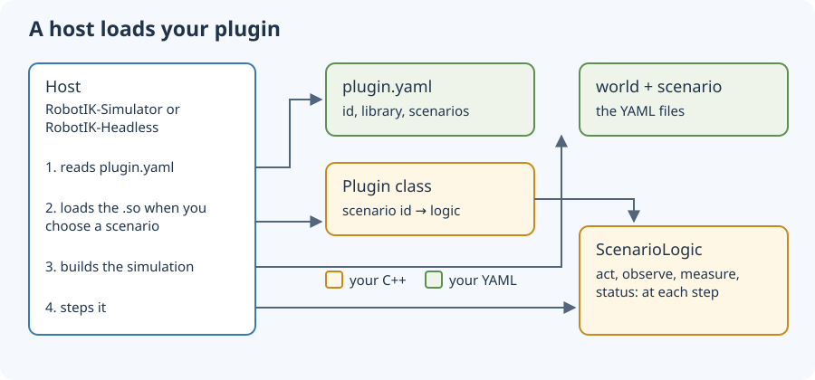
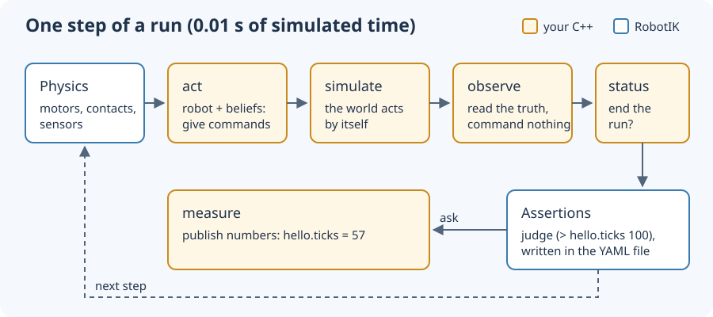

# 🔌 Your first plugin

[⏫ Tutorials](README.md)

In tutorial 3 you changed a scene and a verdict with YAML only. YAML says what exists and what must be true. It cannot say what the robot does: for that, you write C++. In RobotIK, your C++ code goes in a plugin. In this tutorial, you read the smallest plugin code of RobotIK, you run it, and you change it.

The next tutorials use the same plugin, HelloWorld, and add one idea each:

| Tutorial | Scenario | You learn |
|----------|----------|-----------|
| 4. Your first plugin (this page) | `hello` | What a plugin is, the scenario logic, metrics |
| [5. Move the arm](05-move-the-arm.md) | `wave`, `reach` | Command a joint, forward and inverse kinematics |
| [6. A skill and a behavior tree](06-skills-and-a-behavior-tree.md) | `skills` | Write a skill, run it from a behavior tree |
| [7. Your own plugin](07-your-own-plugin.md) | `nod` | Write a plugin from zero |
| [8. A planned pick and place](08-a-planned-pick-and-place.md) | `pick_and_place_pddl` | Give a goal to a planner |

## 🧩 What is a plugin?

A plugin is a folder of `plugins/`. It has YAML files, and C++ code that `make` compiles into a shared library (a `.so` file). Here is HelloWorld:

```text
📦 plugins/HelloWorld/
┣ 📄 plugin.yaml       ⬅️ the manifest: the id of the plugin, its library, its scenarios
┣ 📄 HelloWorld.mk     ⬅️ how make builds librobotik_hello_world.so
┣ 📂 worlds/
┃ ┗ 📄 arm.world.yaml  ⬅️ what exists: one 6-axis arm
┣ 📂 scenarios/        ⬅️ one scenario per lesson: what happens, what must be true
┣ 📂 experiments/      ⬅️ variants of a scenario to compare
┗ 📂 src/              ⬅️ the C++ code
  ┣ 📄 Plugin.cpp      ⬅️ the plugin class: which C++ code runs which scenario
  ┣ 📄 HelloLogic.*    ⬅️ lesson 1 (this tutorial)
  ┣ 📄 WaveLogic.*     ⬅️ lesson 2 (tutorial 5)
  ┣ 📄 ReachLogic.*    ⬅️ lesson 3 (tutorial 5)
  ┗ 📄 WaveSkill.*     ⬅️ lesson 4 (tutorial 6)
```

You do not start a plugin yourself. A host loads it. The host is RobotIK-Simulator (with a window) or RobotIK-Headless (without a window). The host reads `plugin.yaml` first, and it loads the library only when you choose a scenario:



You write two classes:

- The plugin class (`robotik::ScenarioPlugin`) is the entry point. It tells the host which scenario logic runs each scenario. It can also add menus, panels and keys to the simulator.
- The scenario logic (`robotik::ScenarioLogic`) is the behaviour during a run. It gives commands to the robot and publishes numbers (metrics).

## ▶ 1. Run the scenario

Run the scenario `hello` without a window:

```bash
./build/linux-gcc-debug/bin/RobotIK-Headless build/linux-gcc-debug/lib/robotik/plugins/HelloWorld/scenarios/hello.scenario.yaml
```

```text
[PASS] controller.success  (controller.success = 1)
[PASS] (> hello.ticks 100)  (hello.ticks = 200)
[PASS] (< time 3)  (time = 2)
[PASS] default                  seed=1      controller succeeded at 2 s  time=2
hello: 1/1 runs passed
```

The robot does not move in this scenario. The scenario logic only counts the steps, and stops the run after two seconds. The next sections explain each line of this output.

## 📄 2. Read the scenario file

`plugins/HelloWorld/scenarios/hello.scenario.yaml`:

```yaml
scenario:
  id: hello
  description: Count the simulation steps, then stop after two seconds.
  world: worlds/arm.world.yaml
  seed: 1
  timeout: 30
  assertions:
    - controller.success
    - (> hello.ticks 100)
    - (< time 3)
```

The `id` is the name of the scenario in `plugin.yaml` and in `Plugin.cpp`. The path of the world starts at the folder of the plugin. The `timeout` stops the run after 30 seconds of simulated time, if nothing stopped it before.

The three assertions are the verdict:

- `controller.success` is true when the controller ended with a success. Here the controller is the scenario logic.
- `(> hello.ticks 100)` reads the metric `hello.ticks`. RobotIK does not know this name: the scenario logic publishes it.
- `(< time 3)` reads the simulated time at the end of the run.

## 🧠 3. Read the scenario logic

`src/HelloLogic.hpp` declares four methods of `ScenarioLogic`:

```cpp
class HelloLogic final: public robotik::ScenarioLogic
{
public:

    void reset(robotik::RoboticCell& p_cell, robotik::Seed p_seed) override;
    void act(robotik::RobotContext& p_context, robotik::Seconds p_dt) override;
    void measure(robotik::RoboticCell const& p_cell,
                 robotik::Metrics& p_metrics) const override;
    [[nodiscard]] robotik::Status
    status(robotik::RobotContext const& p_context) const override;

private:

    double m_ticks = 0.0;
};
```

`src/HelloLogic.cpp` gives their code:

```cpp
void HelloLogic::reset(robotik::RoboticCell& /*p_cell*/,
                       robotik::Seed /*p_seed*/)
{
    m_ticks = 0.0;
}

void HelloLogic::act(robotik::RobotContext& /*p_context*/,
                     robotik::Seconds /*p_dt*/)
{
    m_ticks += 1.0;
}

void HelloLogic::measure(robotik::RoboticCell const& /*p_cell*/,
                         robotik::Metrics& p_metrics) const
{
    p_metrics.set("hello.ticks", m_ticks);
}

robotik::Status HelloLogic::status(robotik::RobotContext const& p_context) const
{
    if (p_context.time >= robotik::Seconds(2.0))
    {
        return robotik::Status::SUCCESS;
    }
    return robotik::Status::RUNNING;
}
```

RobotIK calls `reset` at the start of each run. A run can start again, for example in an experiment with several seeds, so `reset` clears the counter.

Then RobotIK advances the run by steps of 0.01 s of simulated time, and it calls the methods of the scenario logic at each step:



In two seconds, `act` runs 200 times: this gives `hello.ticks = 200` in the output. `status` returns `RUNNING` until two seconds, then `SUCCESS`. The `SUCCESS` ends the run and makes `controller.success` true.

All the methods are optional. A scenario logic overrides only the ones it needs:

| Method | RobotIK calls it | Use it to |
|--------|------------------|-----------|
| `setup(cell, view)` | once, after it builds the world | add skills and detectors. `view` is null without a window |
| `reset(cell, seed)` | at the start of each run | clear your state, and take random numbers from `seed` |
| `act(context, dt)` | at each step | give commands to the robot, from the robot and its beliefs |
| `simulate(cell, dt)` | at each step, in simulation only | make the world act by itself (a conveyor, ink on a canvas) |
| `observe(cell, dt)` | at each step | read the truth for your metrics. The cell is `const`: no command |
| `measure(cell, metrics)` | when the assertions need values | publish metrics |
| `status(context)` | at each step, only if the scenario has no behavior tree and no planner | end the run with `SUCCESS` or `FAILURE` |

`act` receives a `RobotContext`: the robot, its beliefs and the time. It does not receive the true position of the objects. A belief is what the robot thinks it knows, from its sensors: it can be late or wrong. So `act` works with the same information as the program of a real robot. `observe` can read the truth, because a metric must be exact, but it cannot give a command.

> [!IMPORTANT] The C++ code does not decide if the run passes. It publishes metrics, and the assertions of the scenario file give the verdict. Do not test a pass condition in C++: write an assertion.

## 🔌 4. Read the plugin class

`src/Plugin.cpp` connects each scenario of `plugin.yaml` to its scenario logic. Here is the part that the host needs:

```cpp
class HelloWorldPlugin final: public robotik::ScenarioPlugin
{
public:

    /// The id must match plugin.id in plugin.yaml.
    static robotik::PluginInfo describe()
    {
        return { .id = "robotik.hello_world" };
    }

    /// Scenario id (as in plugin.yaml) -> the scenario logic it runs.
    HelloWorldPlugin()
        : ScenarioPlugin({ { "hello", robotik::logic<HelloLogic>() },
                           { "wave", robotik::logic<WaveLogic>() },
                           { "reach", robotik::logic<ReachLogic>() },
                           { "skills", robotik::logic<SkillsLogic>() } })
    {
    }
    // ...
};

ROBOTIK_EXPORT_PLUGIN(HelloWorldPlugin)
```

When you choose the scenario `hello`, the plugin creates a `HelloLogic`. `ROBOTIK_EXPORT_PLUGIN` writes the C functions that the host calls in the library. The rest of the file adds a menu item, a panel and the key `H` to the simulator. The [plugin reference](../reference/plugin.md) lists these functions.

## 🔧 5. Change the code and see the verdict change

Open `plugins/HelloWorld/src/HelloLogic.cpp`. In `status`, change `robotik::Seconds(2.0)` to `robotik::Seconds(4.0)`. Then build the plugin and run the scenario again:

```bash
make robotik_hello_world
./build/linux-gcc-debug/bin/RobotIK-Headless build/linux-gcc-debug/lib/robotik/plugins/HelloWorld/scenarios/hello.scenario.yaml
```

```text
[PASS] controller.success  (controller.success = 1)
[PASS] (> hello.ticks 100)  (hello.ticks = 401)
[FAIL] (< time 3)  (time = 4.01)
[FAIL] default                  seed=1      controller succeeded at 4.01 s  time=4.01
         FAIL (< time 3)  (time = 4.01, expected < 3, at 4.01 s)
hello: 0/1 runs passed
```

The scenario logic still ends with a success, but the run fails: the assertion `(< time 3)` is false. A failed assertion gives the value it read (`time = 4.01`) and the bound (`expected < 3`). The exit code of RobotIK-Headless is 2, so a CI job sees the failure.

Put back `robotik::Seconds(2.0)` and run `make robotik_hello_world` again.

To see the same run in the simulator, start it and choose **Demos → Hello world → 1. Hello**:

```bash
./build/linux-gcc-debug/bin/RobotIK-Simulator
```

## 🔗 Next

In this tutorial the robot does not move. In the next tutorial, the scenario logic moves a joint and the tool of the arm.

Next: [Move the arm](05-move-the-arm.md).
