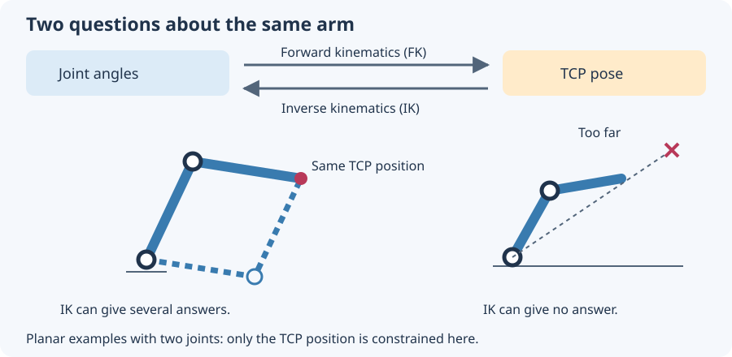

# 🦾 Move the arm

[⏫ Tutorials](README.md)

In [Your first plugin](04-your-first-plugin.md), the scenario logic counted steps and the robot did not move. Now the scenario logic moves the arm, in two ways. First it gives an angle to one joint and reads where the tool goes. Then it gives a point to reach, and RobotIK computes the angles of all the joints.

Two words of robotics are necessary here. If they are new to you, read [The body: links and joints](../concepts/01-robotics-in-ten-minutes.md#-the-body-links-and-joints) and [Frames and poses](../concepts/01-robotics-in-ten-minutes.md#-frames-and-poses) first (five minutes):

- A joint is an axis between two rigid parts of the arm. The HelloWorld arm has six joints, `joint1` (the base) to `joint6` (the wrist). They turn, so their position is an angle in radians.
- A pose is a position (x, y, z in metres) and a rotation. The pose of the tool is given in the frame of the robot base: x points forward, z points up.



## 🔁 1. Move one joint: lesson 2

Run the scenario `wave`. The base joint of the arm swings left and right for six seconds:

```bash
./build/linux-gcc-debug/bin/RobotIK-Headless build/linux-gcc-debug/lib/robotik/plugins/HelloWorld/scenarios/wave.scenario.yaml
```

```text
[PASS] controller.success  (controller.success = 1)
[PASS] (> wave.swing 0.4)  (wave.swing = 0.598172)
[PASS] (joint_limits_respected robot)  ((joint_limits_respected robot) = 1)
[PASS] default                  seed=1      controller succeeded at 6.01 s  time=6.01
wave: 1/1 runs passed
```

In the simulator, choose **Tutorials → Hello world → 2. Move a joint** to see the arm swing.

The scenario logic is in `src/WaveLogic.cpp`. `reset` finds the joint once, by its name in the robot model:

```cpp
void WaveLogic::reset(robotik::RoboticCell& p_cell, robotik::Seed /*p_seed*/)
{
    // Find the joint once: act() runs at each step and uses the handle.
    // A typed handle: its angle is in radians, the compiler checks it.
    m_base = p_cell.robot().getJoints().requireRevolute("joint1");
    m_swing = 0.0;
    m_tool_y = 0.0;
}
```

`requireRevolute` returns a handle of type `robotik::Revolute`: a joint that turns, with a position in `Radians`. A joint that slides gives a `Prismatic` handle, in metres. If you give an angle to a `Prismatic` handle, the code does not compile. If the name is wrong, `requireRevolute` throws: the name is written in the code, so it is a mistake of the programmer.

Search the joint once, and keep the handle. `act` runs 100 times per second, and a search by name at each step costs time for nothing.

At each step, `act` gives a new target to the joint and measures the result:

```cpp
void WaveLogic::act(robotik::RobotContext& p_context, robotik::Seconds /*p_dt*/)
{
    robotik::Robot& robot = p_context.robot;
    robotik::JointSet& joints = robot.getJoints();

    // Command: a target angle. The joint controller moves toward it.
    robotik::Radians const home = joints.home(m_base);
    robotik::Radians const offset(0.6 * std::sin(p_context.time.value()));
    joints.moveTo(m_base, home + offset);

    // Measure: the angle reached, and where the tool is (forward kinematics,
    // in the robot base frame).
    m_swing =
        std::max(m_swing, std::abs((joints.position(m_base) - home).value()));
    m_tool_y = robot.requireFramePose(robot.getTool()).position.y;
}
```

`moveTo` gives a target to the motor of the joint. The joint does not jump to the target: the physics engine (MuJoCo) moves it at the speed of the motor. For this reason, the code reads the angle that the joint reached with `joints.position`, and not the angle that it commanded. `home` is the angle at the start of the run, written in the world file.

`robot.getTool()` is the name of the work frame of the robot: `tcp` (the tip of the tool) when a tool is mounted, `tool0` (the end of the arm) when no tool is mounted. The HelloWorld arm has no tool, so it is `tool0`. `requireFramePose` gives the pose of this frame from the joint angles: this computation is forward kinematics.

`measure` publishes `wave.swing` (the largest angle reached) and `wave.tool_y`. The scenario file judges them:

```yaml
  assertions:
    - controller.success
    - (> wave.swing 0.4)
    - { condition: (joint_limits_respected robot), phase: always }
```

The last assertion has the `phase: always`. RobotIK checks it at each step, and not only at the end. A joint that goes past its limit for one step makes the run fail. The [scenario file reference](../reference/scenario-file.md#-assertions) lists the phases.

### 🧪 Try it

In `src/WaveLogic.cpp`, change `0.6 * std::sin` to `0.2 * std::sin`. Run `make robotik_hello_world`, then the scenario again:

```text
[FAIL] (> wave.swing 0.4)  (wave.swing = 0.197909)
...
wave: 0/1 runs passed
```

The joint turns 0.198 rad, and not exactly 0.2: the motor is always a little late on a target that changes. Put back `0.6` before the next step.

## 🎯 2. Reach a point: lesson 3

To put the tool on a point, you do not know the angle of each joint. Inverse kinematics (IK) computes them from the pose that you want. Run the scenario `reach`. The tool moves 3 cm forward:

```bash
./build/linux-gcc-debug/bin/RobotIK-Headless build/linux-gcc-debug/lib/robotik/plugins/HelloWorld/scenarios/reach.scenario.yaml
```

```text
[PASS] controller.success  (controller.success = 1)
[PASS] (< reach.error 0.02)  (reach.error = 0.019558)
[PASS] default                  seed=1      controller succeeded at 0.27 s  time=0.27
reach: 1/1 runs passed
```

`src/ReachLogic.cpp` computes the target and the angles in `reset`, once:

```cpp
void ReachLogic::reset(robotik::RoboticCell& p_cell, robotik::Seed /*p_seed*/)
{
    robotik::Robot& robot = p_cell.robot();

    // The tool frame is "tcp" when a tool is mounted, "tool0" otherwise.
    robotik::Pose const start = robot.requireFramePose(robot.getTool());
    m_target = start;
    m_target.position.x += 0.03;

    // Inverse kinematics: no answer when the pose is out of reach.
    std::optional<std::vector<double>> const solution =
        robot.inverseKinematics(robot.getTool(), m_target);
    m_solution = solution ? *solution : std::vector<double>{};
    m_error = distance(start, m_target);
}
```

The target is the start pose of the tool, 3 cm further on x. The rotation of the tool stays the same. `inverseKinematics` returns one angle per joint, or no value (`std::nullopt`) when no angles put the tool there.

At each step, `act` gives each joint its angle and measures the distance between the tool and the target:

```cpp
void ReachLogic::act(robotik::RobotContext& p_context,
                     robotik::Seconds /*p_dt*/)
{
    robotik::Robot& robot = p_context.robot;
    robotik::JointSet& joints = robot.getJoints();
    for (robotik::JointId id = 0; id < joints.size() && id < m_solution.size();
         ++id)
    {
        joints.moveTo(id, m_solution[id]);
    }
    m_error = distance(robot.requireFramePose(robot.getTool()), m_target);
}
```

This loop uses the other kind of joint handle. A `JointId` is the index of the joint, from 0 to `size() - 1`, and its values are plain `double`. Use a `JointId` to loop on all the joints, and a typed handle to name one joint.

`status` returns `FAILURE` if IK found no solution, and `SUCCESS` when the tool is closer than 5 mm to the target. The scenario gives a deadline to the metric `reach.error`:

```yaml
    - { condition: (< reach.error 0.02), within: 5.0 }
```

With `within: 5.0`, the condition must become true in the first five seconds. At the start, the error is 3 cm and the condition is false: this is not a failure yet. In the simulator, the assertion is red at the start, then it becomes green when the tool arrives. The output gives the value at the moment the condition became true (0.019558 m).

### 🧪 Try it

In `src/ReachLogic.cpp`, change `+= 0.03` to `+= 3.0`: a point 3 m in front of an arm shorter than 1.5 m. Build and run again:

```text
[FAIL] controller.success  (controller.success = 0)
[FAIL] (< reach.error 0.02)  (reach.error = 3, not true within 5.000000 s)
[FAIL] default                  seed=1      controller failed at 0.01 s  time=0.01
...
reach: 0/1 runs passed
```

IK has no solution. `status` returns `FAILURE` at the first step, and the run ends at 0.01 s. Put back `0.03` and run `make robotik_hello_world`.

## 🔗 Next

The scenario logic of this tutorial gives all the commands itself, at each step. This is enough for one motion. For a mission of several steps, you must also choose the order, keep two motions from using the arm at the same time, and react to a failure. The next tutorial does this with a skill and a behavior tree.

Next: [A skill and a behavior tree](06-skills-and-a-behavior-tree.md).
