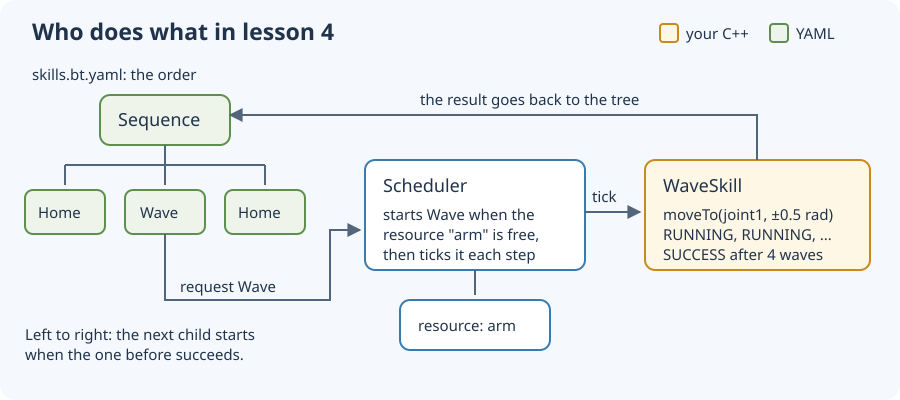

# 🌳 A skill and a behavior tree

[⏫ Tutorials](README.md)

In [Move the arm](05-move-the-arm.md), `act` gave all the commands at each step. For one motion, this is enough. A mission has several steps: go to the start position, do the work, come back. If `act` does all of it, the code must also choose the next step, keep two motions from using the arm at the same time, and react when a step fails. The code becomes difficult to read.

RobotIK separates these jobs:

- A skill is one behaviour of the robot, written in C++: "wave", "go home", "grasp". It knows how to do its job, and nothing else.
- A behavior tree, written in YAML, gives the order of the skills.
- The scheduler of RobotIK starts each skill when the robot parts it needs (its resources) are free.

In this tutorial, a tree runs three skills: `Home`, then `Wave`, then `Home` again. `Wave` is a skill of the HelloWorld plugin. `Home` is a built-in skill of RobotIK.



## ▶ 1. Run the scenario

Run the scenario `skills` with the option `--trace`. This option writes one line each time a skill ends:

```bash
./build/linux-gcc-debug/bin/RobotIK-Headless build/linux-gcc-debug/lib/robotik/plugins/HelloWorld/scenarios/skills.scenario.yaml --trace
```

```text
  0 s  Home  SUCCEEDED  (0 s)
  0.01 s  Wave  SUCCEEDED  (4 s)
  4.02 s  Home  SUCCEEDED  (0.63 s)
[PASS] controller.success  (controller.success = 1)
[PASS] (skill_succeeded Wave)  ((skill_succeeded Wave) = 1)
[PASS] (joint_limits_respected robot)  ((joint_limits_respected robot) = 1)
[PASS] home before waving  (2/2 reached)
[PASS] default                  seed=1      controller succeeded at 4.67 s  time=4.67
skills: 1/1 runs passed
```

Each trace line gives the time when the skill started, its name, its result and its duration. The first `Home` takes 0 s, because the arm is already at its home position.

In the simulator, choose **Tutorials → Hello world → 4. Skill and behavior tree**, then press **Play**. The **Mission** workspace shows the tree: the node that runs is lit. It also shows a timeline of the skills, with the resources that each skill holds.

## 🔧 2. Read the skill

A skill is a class derived from `robotik::Skill`. `src/WaveSkill.hpp`:

```cpp
class WaveSkill final: public robotik::Skill
{
public:

    /// @param p_base The joint to swing, found once when the skill is added.
    explicit WaveSkill(robotik::Revolute p_base)
        : m_base(p_base)
    {
    }

    void reset() override;
    robotik::Status tick(robotik::RobotContext& p_context,
                         robotik::Seconds p_dt) override;
    void cancel(robotik::RobotContext& p_context) override;

private:

    robotik::Revolute m_base;
    int m_waves = 0;
};
```

The scheduler calls `reset` each time the skill starts, `tick` at each step while it runs, and `cancel` if it must stop before its end. `src/WaveSkill.cpp`:

```cpp
void WaveSkill::reset()
{
    m_waves = 0;
}

robotik::Status WaveSkill::tick(robotik::RobotContext& p_context,
                                robotik::Seconds /*p_dt*/)
{
    robotik::JointSet& joints = p_context.robot.getJoints();
    robotik::Radians const target((m_waves % 2 == 0) ? 0.5 : -0.5);
    joints.moveTo(m_base, target);
    if (joints.reached(m_base, robotik::Radians(0.02)))
    {
        ++m_waves;
    }
    return m_waves >= 4 ? robotik::Status::SUCCESS : robotik::Status::RUNNING;
}

void WaveSkill::cancel(robotik::RobotContext& p_context)
{
    // Cancelled or preempted: stop where we are.
    p_context.robot.getJoints().hold();
}
```

`tick` does a small part of the work at each call, then returns. It does not wait in a loop: the physics moves only between two calls. It returns `RUNNING` while the work is not done, `SUCCESS` at the end, or `FAILURE`. Here the joint goes to +0.5 rad, then to -0.5 rad, four times.

`tick` receives the same `RobotContext` as `act`: the robot and its beliefs, not the truth. A skill that works in simulation can then work on a real robot.

`cancel` puts the robot in a safe state. Here, `hold` stops the joints where they are.

## 📝 3. Register the skill

A skill exists for the scheduler only after you register it. The scenario logic of this lesson, `SkillsLogic`, does it in `setup`:

```cpp
void SkillsLogic::setup(robotik::RoboticCell& p_cell,
                        robotik::SceneView* /*p_view*/)
{
    // The skill reserves the actuator "arm" while it runs: no other skill
    // can move the arm at the same time.
    robotik::SkillDescription wave;
    wave.name = "Wave";
    wave.resources = { p_cell.robot().getResources().require("arm") };
    wave.priority = 100;
    p_cell.skills().add<WaveSkill>(
        std::move(wave), p_cell.robot().getJoints().requireRevolute("joint1"));
}
```

The `SkillDescription` gives what the scheduler must know:

- The `name` is the name that the tree uses.
- The `resources` are the robot parts that the skill reserves while it runs. The resource `arm` is the actuator `arm` of the world file (`arm: { type: joint_group }`). `Home` reserves it too, so `Home` and `Wave` never move the arm at the same time.
- The `priority` chooses between two skills that want the same resource. A skill with a higher priority can stop (preempt) a running skill of lower priority.

The arguments after the description go to the constructor of the skill: here, the handle of `joint1`. The joint is found once, when the skill is added.

`SkillsLogic` has no `status` method. In this scenario, the tree ends the run: a scenario with a behavior tree ignores `status`.

## 🌳 4. Read the behavior tree

`scenarios/skills.bt.yaml`:

```yaml
BehaviorTree:
  Sequence:
    name: HelloSkills
    children:
      - Action:
          name: Home
      - Action:
          name: Wave
      - Action:
          name: Home
```

An `Action` node runs the skill that has the same name. A `Sequence` node runs its children from left to right (here, from top to bottom). It starts the next child when the one before succeeds. If a child fails, the `Sequence` fails at once.

Every simulation has the skills `Home` (go to the home angles of the world file) and `Stop` (an emergency stop). The skills of your plugin come in addition.

The scenario file names the tree as its controller, and judges the run:

```yaml
scenario:
  id: skills
  description: Go home, wave twice, go home again.
  world: worlds/arm.world.yaml
  seed: 1
  controller:
    behavior_tree: scenarios/skills.bt.yaml
  timeout: 30
  assertions:
    - controller.success
    - (skill_succeeded Wave)
    - { condition: (joint_limits_respected robot), phase: always }
    - name: home before waving
      sequence: [ (skill_succeeded Home), (skill_started Wave) ]
```

`controller.success` is now the result of the tree. A `sequence` assertion checks an order: its conditions must become true in this order during the run.

## 🧪 5. Change the order of the tree

Open `doc/tutorials/HelloWorld/scenarios/skills.bt.yaml` and remove the first `Action` (the first `Home`). Run `make robotik_hello_world`, then run the scenario again with `--trace`:

```text
  0 s  Wave  SUCCEEDED  (4 s)
  4.01 s  Home  SUCCEEDED  (0.63 s)
[PASS] controller.success  (controller.success = 1)
[PASS] (skill_succeeded Wave)  ((skill_succeeded Wave) = 1)
[PASS] (joint_limits_respected robot)  ((joint_limits_respected robot) = 1)
[FAIL] home before waving  ('(skill_started Wave)' before '(skill_succeeded Home)')
[FAIL] default                  seed=1      controller succeeded at 4.66 s  time=4.66
         FAIL home before waving  ('(skill_started Wave)' before '(skill_succeeded Home)', expected in order, at 0.01 s)
skills: 0/1 runs passed
```

You changed the order without a C++ build, and the scenario saw it. Put back the file with `git checkout doc/tutorials/HelloWorld/scenarios/skills.bt.yaml`, then run `make robotik_hello_world`.

## 🔗 Next

- The [skills and behavior trees concept](../concepts/04-skills-and-behavior-trees.md) explains the other nodes (`Selector`, `UntilSuccess`, `Repeater`), the states of a skill and the scheduler.
- [Inject a fault and recover from it](../guides/recover-from-a-fault.md) breaks the arm during this scenario, and makes the tree try `Wave` again.

You now know the parts of a plugin. In the next tutorial, you write your own plugin from zero.

Next: [Your own plugin](07-your-own-plugin.md).
