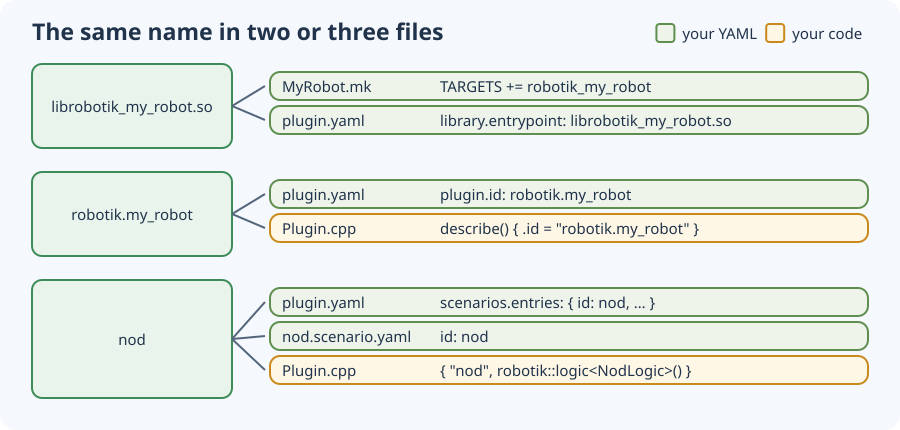

# 🧩 Your own plugin

[⏫ Tutorials](README.md)

In tutorials 4 to 6 you read the HelloWorld plugin. Now you write a plugin from zero: `MyRobot`. Its arm nods three times (`joint2` goes down, then up), and the scenario checks it. The plugin has six files, and you write each one yourself, so you know what each file does.

```text
📦 plugins/MyRobot/
┣ 📄 plugin.yaml           ⬅️ the manifest: id, library, scenarios
┣ 📄 MyRobot.mk            ⬅️ how make builds the library
┣ 📂 worlds/
┃ ┗ 📄 arm.world.yaml      ⬅️ what exists: one arm
┣ 📂 scenarios/
┃ ┗ 📄 nod.scenario.yaml   ⬅️ what happens and what must be true
┗ 📂 src/
  ┗ 📄 Plugin.cpp          ⬅️ the scenario logic and the plugin class
```

## 📄 1. Write the manifest

Create `plugins/MyRobot/plugin.yaml`:

```yaml
plugin:
  id: robotik.my_robot
  name: My robot
  version: 0.1.0
  api_version: 1
  category: Tutorial
  description: An arm nods three times.

library:
  entrypoint: librobotik_my_robot.so

resources:
  packs:
    - { id: robotik.robots, version: "1.0" }

scenarios:
  directory: scenarios
  entries:
    - { id: nod, name: Nod, file: nod.scenario.yaml }
```

The host reads this file before it loads any code. The `id` identifies the plugin. The `entrypoint` is the name of the library that `make` builds. The `packs` are the folders of 3D models that the plugin uses: the arm comes from the pack `robotik.robots` (in `data/packs/`). Each entry of `scenarios` is a scenario that the simulator shows in its menu. A scenario file that is not in this list is refused.

## 🔨 2. Write the build recipe

Create `plugins/MyRobot/MyRobot.mk`:

```make
# The plugin MyRobot. Paths are relative to this directory.
TARGETS += robotik_my_robot
robotik_my_robot.DESCRIPTION := An arm nods three times
robotik_my_robot.SOURCES := src/*.cpp
$(eval $(call ROBOTIK_PLUGIN,robotik_my_robot,MyRobot))
```

The target `robotik_my_robot` builds `librobotik_my_robot.so`: `lib`, the name of the target, then `.so`. `ROBOTIK_PLUGIN` adds what all plugins share (see `plugins/plugin.mk`). It also copies `plugin.yaml` and the folders `worlds/` and `scenarios/` to `build/`, where the hosts read them.

## 🌍 3. Write the world and the scenario

Create `plugins/MyRobot/worlds/arm.world.yaml`, with one arm:

```yaml
world:
  id: arm
  entities:
    - id: robot
      type: robot
      model: robotik.robots.robot_6axis
      actuators:
        arm: { type: joint_group }
```

The `model` is not a file path: it is `<pack>.<model>`. The actuator `arm` commands all the joints of the robot. It is also a resource that a skill can reserve ([tutorial 6](06-skills-and-a-behavior-tree.md)).

Create `plugins/MyRobot/scenarios/nod.scenario.yaml`:

```yaml
scenario:
  id: nod
  description: The arm nods three times.
  world: worlds/arm.world.yaml
  seed: 1
  timeout: 20
  assertions:
    - controller.success
    - (>= nod.count 3)
    - { condition: (joint_limits_respected robot), phase: always }
```

The metric `nod.count` does not exist yet: the scenario logic of the next step publishes it.

## 🧠 4. Write the C++ code

Create `plugins/MyRobot/src/Plugin.cpp`. The first class is the scenario logic. It uses the methods of [tutorial 4](04-your-first-plugin.md) and the joint handle of [tutorial 5](05-move-the-arm.md):

```cpp
#include "RobotIK/Package/Plugin/PluginAPI.hpp"
#include "RobotIK/Robot/Joints.hpp"
#include "RobotIK/Task/RobotContext.hpp"
#include "RobotIK/Task/RoboticCell.hpp"
#include "RobotIK/Task/ScenarioLogic.hpp"

/// The arm nods: joint2 goes down and up, three times.
class NodLogic final: public robotik::ScenarioLogic
{
public:

    void reset(robotik::RoboticCell& p_cell, robotik::Seed /*p_seed*/) override
    {
        m_joint = p_cell.robot().joints().requireRevolute("joint2");
        m_count = 0;
        m_down = true;
    }

    void act(robotik::RobotContext& p_context, robotik::Seconds /*p_dt*/) override
    {
        robotik::JointSet& joints = p_context.robot.joints();
        robotik::Radians const target(m_down ? 0.8 : 0.2);
        joints.moveTo(m_joint, target);
        if (joints.reached(m_joint, robotik::Radians(0.02)))
        {
            m_count += m_down ? 0 : 1;   // one nod = down, then up
            m_down = !m_down;
        }
    }

    void measure(robotik::RoboticCell const& /*p_cell*/,
                 robotik::Metrics& p_metrics) const override
    {
        p_metrics.set("nod.count", m_count);
    }

    [[nodiscard]] robotik::Status
    status(robotik::RobotContext const& /*p_context*/) const override
    {
        return m_count >= 3 ? robotik::Status::SUCCESS : robotik::Status::RUNNING;
    }

private:

    robotik::Revolute m_joint;
    double m_count = 0.0;
    bool m_down = true;
};
```

The second class is the plugin class. It connects the scenario `nod` to `NodLogic`:

```cpp
/// The plugin: the scenario "nod" of plugin.yaml runs a NodLogic.
class MyRobotPlugin final: public robotik::ScenarioPlugin
{
public:

    static robotik::PluginInfo describe()
    {
        return { .id = "robotik.my_robot" };
    }

    MyRobotPlugin()
        : ScenarioPlugin({ { "nod", robotik::logic<NodLogic>() } })
    {
    }
};

ROBOTIK_EXPORT_PLUGIN(MyRobotPlugin)
```

## 🔗 5. Check that the names match

The host finds each part of the plugin by its name. The names in the different files must be the same, or the host refuses the plugin:



## ▶ 6. Build and run

The root `Makefile` builds only the plugins of its `PLUGINS` list. Add yours with `EXTRA_PLUGINS`, then run the scenario:

```bash
make EXTRA_PLUGINS=MyRobot robotik_my_robot
./build/linux-gcc-debug/bin/RobotIK-Headless build/linux-gcc-debug/lib/robotik/plugins/MyRobot/scenarios/nod.scenario.yaml
```

```text
[PASS] controller.success  (controller.success = 1)
[PASS] (>= nod.count 3)  (nod.count = 3)
[PASS] (joint_limits_respected robot)  ((joint_limits_respected robot) = 1)
[PASS] default                  seed=1      controller succeeded at 4.63 s  time=4.63
nod: 1/1 runs passed
```

To keep the plugin in each build, add `MyRobot` to the `PLUGINS` list of the root `Makefile`. Then `make` builds it with the other plugins. In the simulator, the plugin is in **Demos → My robot → Nod**.

## 🤖 7. Use another robot

The data packs have other robots. Their `pack.yaml` files list them:

```bash
cat data/packs/*/pack.yaml
```

Try the SCARA arm of the pack `robotik.robots.scara`. Its joints have other names, but it also has a `joint2`. Add the pack to `plugin.yaml`:

```yaml
resources:
  packs:
    - { id: robotik.robots, version: "1.0" }
    - { id: robotik.robots.scara, version: "1.0" }
```

Then change the `model` in the world file, and build and run again:

```yaml
      model: robotik.robots.scara.scara_robot
```

```text
[PASS] controller.success  (controller.success = 1)
[PASS] (>= nod.count 3)  (nod.count = 3)
[FAIL] (joint_limits_respected robot)  ((joint_limits_respected robot) = 0)
[FAIL] default                  seed=1      controller succeeded at 8.2 s  time=8.2
         FAIL (joint_limits_respected robot)  ((joint_limits_respected robot) = 0, expected != 0, at 0.01 s)
nod: 0/1 runs passed
```

The arm nods, but the run fails at 0.01 s, before any motion. The SCARA has a third joint, `end_effector`, which slides between 0.038 m and 0.16 m. All the joints start at 0, so `end_effector` starts outside its limits. Give it a home position inside its limits in the world file:

```yaml
      model: robotik.robots.scara.scara_robot
      home: { end_effector: 0.05 }
```

Now the run passes. The assertion found a mistake in the world file that the C++ code could not see.

## 🐞 Common errors

| Message | Cause |
|---------|-------|
| `scenario is not in a plugin package` | The scenario file is not in the `entries` of `plugin.yaml`, or you ran a file that is not in a plugin folder |
| `unknown scenario 'X' (this plugin runs: ...)` | `Plugin.cpp` has no scenario logic for the scenario `X` |
| `plugin id does not match plugin.yaml` | `describe().id` is not the same as `plugin.id` |
| `plugin library not found: ...` | `library.entrypoint` is not the name of the library that the target builds, or the plugin was not built |
| `plugin built with another RobotIK build: ...` | The library was built by another version or compiler of RobotIK: build it again |
| `built for plugin API 99 ...` | `api_version` in `plugin.yaml` is not the version of the host (`1`) |
| A pack `robotik.xxx` is in the message | A pack of `resources.packs` is not found, or its version is not compatible |
| `Unknown Pinocchio frame: tcp` | An assertion uses `robot.tcp`, but no tool is mounted: use `robot.tool0` |
| A `body` falls forever | The world has no `floor:` |

## 🔗 Next

Your scenario logic gives all the commands itself. In the last tutorial, you give a goal, and a planner finds the skills to run.

Next: [A planned pick and place](08-a-planned-pick-and-place.md).
