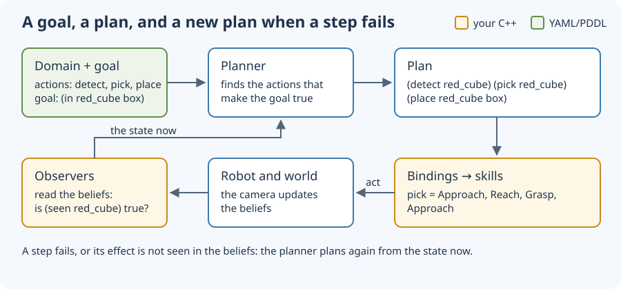

# 🧠 A planned pick and place

[⏫ Tutorials](README.md)

In [tutorial 6](06-skills-and-a-behavior-tree.md), a behavior tree gave the order of the skills. You wrote this order yourself. When the mission changes, or when a step fails, you must write a new tree. A planner finds the order itself: you give it the result that you want (the goal), and it chooses the actions that make the goal true.

In this tutorial you read and run the planned scenario of the PickAndPlace demo. An arm with a camera and a vacuum cup puts a red cube in a box. The scenario gives no tree, only the goal "the red cube is in the box". Then a camera fault breaks a step, and the planner makes a new plan.

## 📖 The words of the planner

RobotIK uses PDDL, a standard language of planners. A PDDL file, the domain, describes what the robot can do:

- A predicate is a kind of fact that can be true or false: `(holding ?o)` is "the cup holds the object `?o`".
- An action is a step that the planner can choose, for example `pick`. Its precondition must be true before the step, and its effect says which facts the step makes true or false.
- The goal is the list of facts that must be true at the end: `(in red_cube box)`.

The domain does not move the robot. Two parts of your C++ code connect it to the robot:

- An observer tells if a predicate is true now. It reads the beliefs of the robot, never the truth.
- A binding gives the skills that do an action: `pick` is `Approach`, `Reach`, `Grasp`, then `Approach` again.



The [glossary](../reference/glossary.md#-planning) defines these words, and [The PDDL planner](../concepts/05-pddl-planner.md) explains the choices of RobotIK.

## ▶ 1. Run the planned scenario

Run the scenario `pick_and_place_pddl` with `--trace`:

```bash
./build/linux-gcc-debug/bin/RobotIK-Headless build/linux-gcc-debug/lib/robotik/plugins/PickAndPlace/scenarios/pick_and_place_pddl.scenario.yaml --trace
```

```text
  0 s  Detect(red_cube)  SUCCEEDED  (0.01 s)
  0.02 s  Approach(red_cube)  SUCCEEDED  (2.37 s)
  2.4 s  Reach(red_cube)  SUCCEEDED  (0.5 s)
  2.91 s  Grasp(red_cube)  SUCCEEDED  (0.01 s)
  2.93 s  Approach(red_cube)  SUCCEEDED  (0.49 s)
  3.43 s  Transit(box)  SUCCEEDED  (1.02 s)
  4.46 s  Approach(box)  SUCCEEDED  (0.49 s)
  4.96 s  Release  SUCCEEDED  (0.01 s)
  plan 0 at 0 s (start): solved (detect red_cube) (pick red_cube) (place red_cube box)
[PASS] controller.success  (controller.success = 1)
[PASS] (inside red_cube box)  ((inside red_cube box) = 1)
...
[PASS] (== planner.replans 0)  (planner.replans = 0)
...
pick_and_place_pddl: 1/1 runs passed
```

The line `plan 0` gives the plan: three actions, `detect`, `pick` and `place`. The lines above it are the skills of these actions, in order. `pick` gives four skill lines, because its binding has four skills.

## 📄 2. Read the domain

`plugins/PickAndPlace/scenarios/pick_and_place.domain.pddl`:

```lisp
(define (domain pick_and_place)
  (:requirements :strips :typing :negative-preconditions)

  (:types
    graspable bin - object
    cube - graspable)

  (:predicates
    (seen ?o - object)                 ; observed by the camera at least once
    (holding ?o - graspable)           ; held by the vacuum cup
    (hand_empty)                       ; the cup holds nothing
    (in ?o - graspable ?b - bin))      ; resting inside the bin

  ; Look at the object: refines its position in the beliefs.
  (:action detect
    :parameters (?o - object)
    :precondition (not (seen ?o))
    :effect (seen ?o))

  ; Approach, reach, grasp, lift.
  (:action pick
    :parameters (?o - graspable)
    :precondition (and (seen ?o) (hand_empty))
    :effect (and (holding ?o) (not (hand_empty))))

  ; Carry above the bin and release. The bin does not move: its position in
  ; the world file is enough, as in the behavior tree.
  (:action place
    :parameters (?o - graspable ?b - bin)
    :precondition (holding ?o)
    :effect (and (in ?o ?b) (hand_empty) (not (holding ?o)))))
```

Read the plan of step 1 with this domain. At the start, the robot has not seen the cube. `pick` needs `(seen red_cube)`, so the plan starts with `detect`. After `pick`, the cup holds the cube, and `place` can make `(in red_cube box)` true: this is the goal.

The `?o` and `?b` are parameters. The planner gives them the objects of the world. An object of the world has a `kind`, which is its PDDL type. In the world file of the demo:

```yaml
    - id: red_cube
      type: prop
      kind: cube                # type of the PDDL planner (scenarios/*.domain.pddl)
    - id: box
      type: prop
      kind: bin
```

An entity without a `kind` is not an object of the plan.

## 📝 3. Read the scenario

`plugins/PickAndPlace/scenarios/pick_and_place_pddl.scenario.yaml` (shortened):

```yaml
scenario:
  id: pick_and_place_pddl
  world: worlds/pick_place_cell.world.yaml
  seed: 42

  controller:
    planner:
      domain: scenarios/pick_and_place.domain.pddl
      goal:
        - (in red_cube box)

  # Headless runs render no image: the true cube pose stands in for the
  # camera there. The simulator renders it and uses real perception.
  perception: { blind: truth }   # true poses when no camera has an image

  timeout: 60

  assertions:
    - controller.success
    - (inside red_cube box)
    - (== (holding gripper) 0)
    - { condition: (== (collision_count robot) 0), phase: always }
    - (== planner.replans 0)
    - (< time 30)
```

The `controller` is a `planner` instead of a `behavior_tree`. Its goal is a list of PDDL facts.

`perception: { blind: truth }` is needed without a window. Without a window, the camera makes no image, so it cannot see the cube. With this line, the true position of the cube replaces the camera. The run report says it (`perception truth`), so a reader of the report knows that perception was not tested.

The assertions read the truth. `(in red_cube box)` is what the robot believes. `(inside red_cube box)` is what is true in the simulated world. If the camera is wrong, the plan can succeed and the assertion can still fail.

## 🔭 4. Read the observers and the bindings

`plugins/PickAndPlace/src/PickPlacePlanning.cpp` gives an observer to each predicate and a binding to each action. Here is the observer of `seen`, and the three bindings:

```cpp
p_domain.observe("seen",
                 [](RobotContext const& p_context, Args p_args)
                 {
                     robotik::WorldObject const* object =
                         p_context.world_model.find(p_args[0]);
                     return robotik::truth(object != nullptr &&
                                           observed(*object));
                 });

// --- Actions, as skills of PickPlaceLogic -----------------------------
p_domain.bind("detect", { "Detect({0})" });
p_domain.bind(
    "pick",
    { "Approach({0})", "Reach({0})", "Grasp({0})", "Approach({0})" });
p_domain.bind("place", { "Transit({1})", "Approach({1})", "Release" });
```

The observer receives a `RobotContext`, as a skill does. It looks for the object in `world_model`, the beliefs of the robot. If the robot has no belief about the object, the fact is false.

In a binding, `{0}` is the first parameter of the action and `{1}` the second one. For `(place red_cube box)`, `Transit({1})` is the skill `Transit(box)`.

The scenario logic of the demo calls this function in its `setup`, with `p_cell.planning()`. The skills come from the same scenario logic: they are registered as in [tutorial 6](06-skills-and-a-behavior-tree.md).

## 💥 5. Break the camera, and see the new plans

The scenario `pick_and_place_pddl_faults` is the same mission, with faults. The camera stops at 0 s, starts again at 1 s, and stops for good at 3 s:

```yaml
  controller:
    planner:
      domain: scenarios/pick_and_place.domain.pddl
      goal:
        - (in red_cube box)
      replan: { max: 5, delay: 0.5 }

  faults:
    - { at: 0.0, resource: wrist_camera, action: disable }
    - { at: 1.0, resource: wrist_camera, action: restore }
    - { at: 3.0, resource: wrist_camera, action: disable }
```

`replan` allows five new plans, with 0.5 s of simulated time between two plans. Run it:

```bash
./build/linux-gcc-debug/bin/RobotIK-Headless build/linux-gcc-debug/lib/robotik/plugins/PickAndPlace/scenarios/pick_and_place_pddl_faults.scenario.yaml --trace
```

```text
  0 s  Detect(red_cube)  FAILED (unavailable: wrist_camera)  (0 s)
  0.51 s  Detect(red_cube)  FAILED (unavailable: wrist_camera)  (0 s)
  1.02 s  Approach(red_cube)  SUCCEEDED  (2.37 s)
  ...
  6.01 s  Release  SUCCEEDED  (0.01 s)
  plan 0 at 0 s (start): solved (detect red_cube) (pick red_cube) (place red_cube box)
  plan 1 at 0.51 s (1. (detect red_cube): skill Detect(red_cube) FAILED (unavailable: wrist_camera)): solved (detect red_cube) (pick red_cube) (place red_cube box)
  plan 2 at 1.02 s (1. (detect red_cube): skill Detect(red_cube) FAILED (unavailable: wrist_camera)): solved (pick red_cube) (place red_cube box)
[PASS] controller.success  (controller.success = 1)
[PASS] (inside red_cube box)  ((inside red_cube box) = 1)
...
[PASS] (>= planner.replans 1)  (planner.replans = 2)
```

Read the three plans:

1. At 0 s, the robot has not seen the cube. The plan starts with `detect`. `Detect` fails, because its resource `wrist_camera` is not available.
2. 0.5 s later, the planner makes a new plan from the beliefs. The camera is still down: same plan, same failure.
3. At 1.02 s, the camera works again, and it has already seen the cube. Now `(seen red_cube)` is true, so the new plan has no `detect`.

At 3 s the camera stops again, while the arm moves to the cube. The robot continues with the position that it saw before, and the cube ends in the box.

You did not write any code for these failures. The tree of tutorial 6 needs a node for each failure that you expect. The planner makes a new plan from what the robot believes now.

## 👀 6. Watch it in the simulator

Start the simulator and choose **Demos → Pick and place → PDDL planner**. Press **Play**, and look at the **Planner** panel of the **Mission** workspace. It shows each plan, the step that runs, and why the planner made a new plan ([debugging the planner](../reference/pddl-planner.md#-debugging)).

## 🔗 Next

The planner and the skills of this tutorial read the beliefs of the robot. The next tutorial shows where these beliefs come from: the camera, the detector, and their errors.

Next: [See and grasp](09-see-and-grasp.md).
