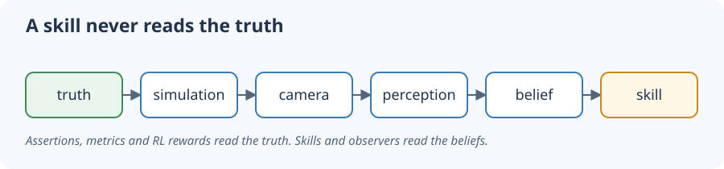
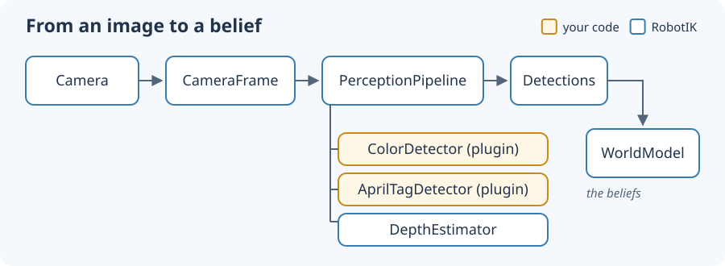
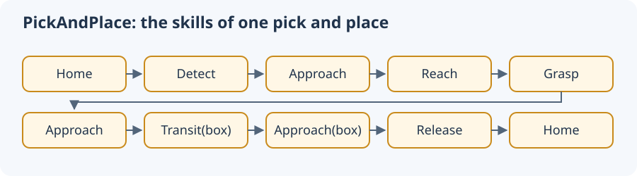
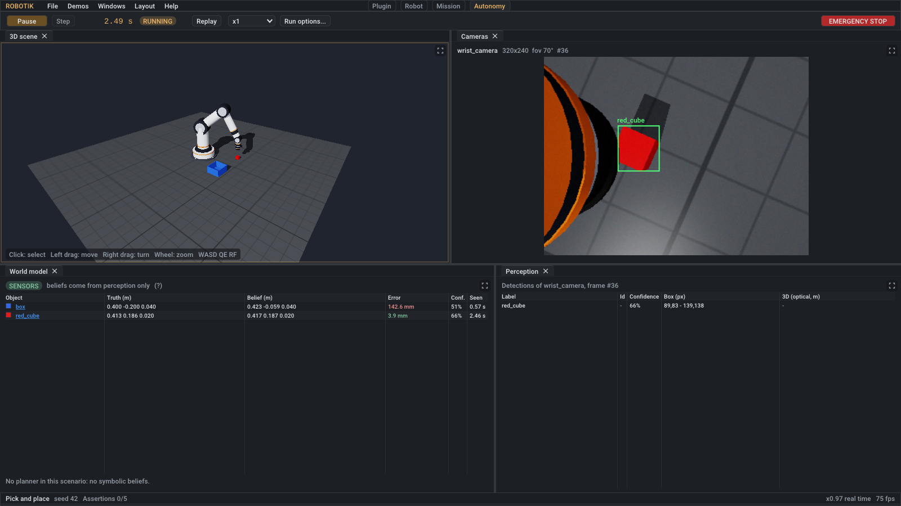

# 👁 See and grasp

[⏫ Tutorials](README.md)

A real robot never knows exactly where an object is. Its camera sees the object, a detector finds it in the image, and the robot keeps a belief: the position that it thinks is right. The skills move the arm to this belief. If the belief is wrong by 2 cm, the vacuum cup arrives beside the cube, and the grasp fails. In this tutorial you read the pick and place of the PickAndPlace demo, from the camera to the grasp. Then you add noise to the beliefs, and you see when the grasp fails.

You need tutorials [4 to 6](04-your-first-plugin.md): a scenario logic, skills and a behavior tree.



## ▶ 1. Run the pick and place

```bash
./build/linux-gcc-debug/bin/RobotIK-Headless build/linux-gcc-debug/lib/robotik/plugins/PickAndPlace/scenarios/pick_and_place.scenario.yaml --trace
```

```text
  0 s  Home  SUCCEEDED  (0 s)
  0.01 s  Detect(red_cube)  SUCCEEDED  (0.01 s)
  0.03 s  Approach(red_cube)  SUCCEEDED  (2.37 s)
  2.41 s  Reach(red_cube)  SUCCEEDED  (0.5 s)
  2.92 s  Grasp(red_cube)  SUCCEEDED  (0.01 s)
  2.94 s  Approach(red_cube)  SUCCEEDED  (0.49 s)
  3.44 s  Transit(box)  SUCCEEDED  (1.02 s)
  4.47 s  Approach(box)  SUCCEEDED  (0.49 s)
  4.97 s  Release  SUCCEEDED  (0.01 s)
  4.99 s  Home  SUCCEEDED  (2.37 s)
[PASS] controller.success  (controller.success = 1)
[PASS] (inside red_cube box)  ((inside red_cube box) = 1)
[PASS] (== (holding gripper) 0)  ((holding gripper) = 0)
[PASS] (== (collision_count robot) 0)  ((collision_count robot) = 0)
[PASS] (< time 30)  (time = 7.38)
[PASS] default                  seed=42     controller succeeded at 7.38 s (perception truth)  time=7.38
pick_and_place: 1/1 runs passed
```

Note `(perception truth)` on the last lines. Without a window, the camera makes no image, so the detector sees nothing. The scenario asks RobotIK to copy the true positions into the beliefs in this case. Section 5 explains this choice, and section 6 shows the real camera in the simulator.

## 📷 2. The camera and the cup in the world file

`plugins/PickAndPlace/worlds/pick_place_cell.world.yaml` gives the robot a camera on its wrist, and mounts a vacuum cup:

```yaml
    - id: robot
      type: robot
      model: robotik.robots.robot_6axis
      sensors:
        wrist_camera:
          type: camera            # camera | rgbd
          parent: link6
          # Optical frame (z forward, x right, y down) in the parent link frame.
          position: [0.05, 0.0, 0.0]
          rpy: [0.0, 0.0, 0.0]
          fov: 70                 # vertical, degrees
          resolution: [320, 240]
          frequency: 15           # Hz
          noise: 0.01             # gaussian, fraction of the color range
      actuators:
        arm: { type: joint_group }   # no joints listed: every joint

    - id: vacuum
      type: tool
      model: robotik.tools.vacuum
      attach: { parent: robot.flange, frame: tool_mount }
      actuators:
        gripper: { type: vacuum }
```

The camera is fixed on `link6`, the last link of the arm, so it looks where the tool goes. It takes 15 images per second, with a little noise on the colours. The camera and the cup are also resources: `wrist_camera` and `gripper`. A skill reserves them, and a fault can disable them.

The cube is a `prop` with a colour (`color: [0.9, 0.1, 0.1]`), and its position moves by up to 2 cm at each run (`randomize`), as in [A cube in a box](03-a-cube-in-a-box.md).

## 🔎 3. The detector fills the beliefs

The scenario logic of the demo (`PickPlaceLogic::setup`) adds one detector to the perception of the cell. It gives the detector the colour of each prop:

```cpp
for (robotik::EntitySpec const* prop : props)
{
    if (m_detector == nullptr)
    {
        m_detector = &p_cell.perception().add<ColorDetector>();
    }
    m_detector->add(prop->id, prop->shape->color);
}
```

`ColorDetector` (`plugins/PickAndPlace/src/ColorDetector.hpp`) looks for the largest region of each colour in the image. Its result is a detection: a label (`red_cube`) and a place in the image. At each step, the cell turns the detections into beliefs in the `WorldModel`: a position, a size, the time when the object was seen.



The detector is code of the plugin. A learned detector would implement the same interface (`robotik::Detector`), and the skills would not change.

## 🦾 4. The skills use the beliefs

For each prop, the scenario logic registers a family of skills. The tree (`scenarios/pick_and_place.bt.yaml`) calls them in this order:



| Skill | It reserves | What it does |
|-------|-------------|--------------|
| `Detect(red_cube)` | `wrist_camera` (shared) | waits for a new observation of the cube; fails after 2 s |
| `Approach(red_cube)` | `arm` | moves the cup 10 cm above the belief of the cube |
| `Reach(red_cube)` | `arm` | moves the cup down on the cube |
| `Grasp(red_cube)` | `gripper` | starts the vacuum; fails if the cup holds nothing |
| `Transit(box)`, `Approach(box)` | `arm` | carries the cube above the box |
| `Release` | `gripper` | stops the vacuum |

`Detect` does not move the robot: it makes sure that the belief is fresh (seen after the start of the skill) before the arm moves. `Grasp` has a precondition, "gripper is empty": the scheduler does not start it while the cup holds something.

No skill reads the true position of the cube. When a skill is wrong, the cause is the belief, as on a real robot.

## 🎲 5. Add noise to the beliefs

The key `perception` of the scenario chooses where the beliefs come from:

| Level | The beliefs come from | Use it to |
|-------|-----------------------|-----------|
| `sensed` (default) | the detectors, on the camera images | test the whole chain, perception included |
| `noisy_truth` | the true position, with a gaussian noise (`sigma`, in metres) | test how much error the skills accept, without a detector |
| `truth` | the true position, copied | test the motion only |

`blind` gives the level to use when no camera has an image. The scenario of the demo has `perception: { blind: truth }`: in the simulator the robot uses its camera (`sensed`), and without a window it uses the truth.

Now find how much error the grasp accepts. In `plugins/PickAndPlace/scenarios/pick_and_place.scenario.yaml`, replace the `perception` line, and add an assertion that measures the error of the belief:

```yaml
  perception: { fidelity: noisy_truth, noise: { sigma: 0.005 } }
  ...
  assertions:
    # ... the assertions of the file, then:
    - { condition: (< (belief_error red_cube) 0.01), phase: always, unknown: skip }
```

`(belief_error red_cube)` is the distance between the belief and the true cube. `unknown: skip` ignores the steps where the robot has no belief, for example while the cup carries the cube. Run `make robotik_pick_and_place`, then the scenario. With `sigma: 0.005` (5 mm):

```text
[PASS] controller.success  (controller.success = 1)
[PASS] (inside red_cube box)  ((inside red_cube box) = 1)
...
[FAIL] (< (belief_error red_cube) 0.01)  ((belief_error red_cube) = 0.0126571)
```

The robot puts the cube in the box: an error of 1.3 cm is still good enough for a cup on a 4 cm cube. But the belief was more than 1 cm wrong at least once, and the assertion sees it. Now try `sigma: 0.02` (2 cm):

```text
  2.88 s  Grasp(red_cube)  FAILED (failed)  (0.49 s)
[FAIL] controller.success  (controller.success = 0)
[FAIL] (inside red_cube box)  ((inside red_cube box) = 0)
...
[FAIL] (< (belief_error red_cube) 0.01)  ((belief_error red_cube) = 0.029083)
```

The belief is 2.9 cm wrong. The cup comes down beside the cube, the vacuum holds nothing after 0.5 s, and `Grasp` fails. The tree has no recovery for this failure, so the run fails. The simulator shows the reason that the skill gives: "suction holds nothing after 0.500000 s".

You found the limit of the skills without a detector: between 1 and 3 cm of error. A detector for this cell must be better than 1 cm. When you are done, restore the file with `git checkout` and run `make robotik_pick_and_place`.

## 👀 6. See the real camera in the simulator

Start the simulator on the scenario, in the **Autonomy** workspace:

```bash
./build/linux-gcc-debug/bin/RobotIK-Simulator build/linux-gcc-debug/lib/robotik/plugins/PickAndPlace/scenarios/pick_and_place.scenario.yaml --workspace autonomy
```

Press **Play**. Here the camera makes images, so the beliefs come from the detector (`sensed`). At 2.5 s:



- **Cameras** shows the image of `wrist_camera`, with a frame around each detection.
- **World model** puts the truth, the belief and the error of each object side by side. The cube is 3.9 mm wrong: the camera saw it 0.03 s ago. The box is 142.6 mm wrong: the camera saw it only once, at 0.57 s, from far. An old belief can be very wrong.
- **Perception** lists the detections of the last image, with their confidence.

## 🔗 Next

The tutorials end here. You can now:

- write a world, a scenario and its assertions ([world file](../reference/world-file.md), [scenario file](../reference/scenario-file.md));
- write a plugin with a scenario logic, skills and a behavior tree;
- give a goal to the planner;
- test how much perception error the skills accept.

The [guides](../guides/README.md) give the steps of other tasks: mount a tool, inject a fault, build a reinforcement learning environment. The [case studies](../case-studies/README.md) show the complete demos, and the [concepts](../concepts/README.md) explain the choices of RobotIK.

To go further:

- [Inject a fault and recover from it](../guides/recover-from-a-fault.md): disable the camera during the run.
- [Write a skill that moves to an object](../guides/write-a-skill.md): a skill of your own on the beliefs.
- [Truth, description and belief](../concepts/02-worlds-scenarios-experiments.md#-truth-description-and-belief): the levels of `perception` in detail.
